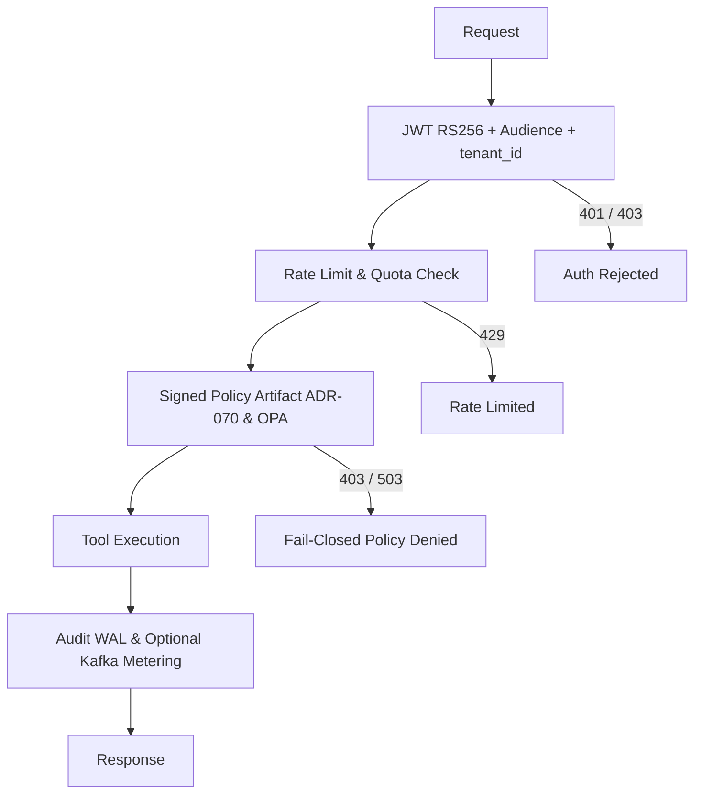

import EnvSetup from '@site/docs/_partials/_env-setup.mdx';

# MCP Gateway API

Complete API reference for the `stoa-gateway` MCP surface (`stoa-gateway/src/lib.rs`, `src/mcp/`).

<EnvSetup />

## Overview & Surface Separation

`stoa-gateway` implements the [Model Context Protocol](https://modelcontextprotocol.io) specification (`2025-11-25` by default, negotiating `2025-03-26` and `2024-11-05` for backward compatibility). It exposes **three distinct HTTP surfaces** that must not be conflated:

| Surface | Entrypoints | Framing | Authentication |
|---------|-------------|---------|----------------|
| **1. MCP JSON-RPC Protocol** | `POST /mcp` (Streamable HTTP, `Mcp-Session-Id` header), `GET/POST/DELETE /mcp/sse` (`?sessionId=`), and opt-in `GET /mcp/ws` (`STOA_WEBSOCKET_ENABLED=true`) | JSON-RPC 2.0 (single or batch); optional `text/event-stream` on single `POST` | Single (non-batch) `POST` without `Authorization` header allows stateless `initialize`, `ping`, `notifications/initialized`, `notifications/cancelled`; **Bearer JWT required** for batch JSON-RPC (`[...]`), `GET /mcp/sse`, `DELETE /mcp/sse`, `GET /mcp/ws`, and all other methods |
| **2. Companion REST API** | `POST /mcp/tools/*`, `POST /mcp/resources/*`, `POST /mcp/prompts/*`, `POST /mcp/completion/complete`, `GET /mcp/v1/tools`, `POST /mcp/v1/tools/invoke`, `GET /mcp/events` | Plain REST JSON (non-JSON-RPC) | **Strict JWT gate (`mcp_jwt_required`)** on every route (`STOA_MCP_AUDIENCE` + verified `tenant_id` claim) |
| **3. Public Discovery & OAuth 2.1** | `GET /mcp`, `GET /mcp/capabilities`, `GET /mcp/health`, `/.well-known/*`, `/oauth/*` | Plain HTTP JSON | Public (no Bearer token required; `GET /mcp` intentionally enumerates no tools) |

## Authentication

Authenticated calls require a Keycloak JWT from the shared `stoa` realm ([ADR-074](/docs/architecture/adr/adr-074-tenant-model)) carrying the configured `STOA_MCP_AUDIENCE` (`aud`) and a verified `tenant_id` claim. For machine-to-machine `client_credentials` flows, provision a **confidential Keycloak client** configured with an audience mapper for `STOA_MCP_AUDIENCE` and a `tenant_id` protocol mapper:

```bash
# Obtain an access token from a confidential client provisioned with STOA_MCP_AUDIENCE + tenant_id
TOKEN=$(curl -sS -X POST "${STOA_AUTH_URL}/realms/stoa/protocol/openid-connect/token" \
  -d "client_id=my-app" \
  -d "client_secret=${CLIENT_SECRET}" \
  -d "grant_type=client_credentials" | jq -r '.access_token')

# Example 1: MCP Streamable HTTP (JSON-RPC 2.0 on POST /mcp)
curl -sS -X POST "${STOA_GATEWAY_URL}/mcp" \
  -H "Authorization: Bearer ${TOKEN}" \
  -H "Content-Type: application/json" \
  -d '{"jsonrpc":"2.0","id":1,"method":"tools/list"}'

# Example 2: Companion REST endpoint (plain JSON on POST /mcp/tools/list)
curl -sS -X POST "${STOA_GATEWAY_URL}/mcp/tools/list" \
  -H "Authorization: Bearer ${TOKEN}" \
  -H "Content-Type: application/json" \
  -d '{}'
```

---

## 1. MCP JSON-RPC Protocol Transports

### Streamable HTTP (`POST /mcp`) — Primary Transport

Implements the MCP `2025-03-26` / `2025-11-25` Streamable HTTP specification (`handle_streamable_http_post` in `stoa-gateway/src/mcp/sse.rs`):

- **Anonymous handshake vs authenticated session**: A single (non-batch) `POST` with **no** `Authorization` header handles `initialize`, `ping`, `notifications/initialized`, and `notifications/cancelled` statelessly without creating a session (`Mcp-Session-Id` is omitted). Authenticated single requests resolve or create a tenant-scoped session and return `Mcp-Session-Id`.
- **Response framing**: For **single** requests, returns `application/json` by default or wraps the JSON-RPC response in an SSE `data:` frame when `Accept: text/event-stream` is sent.
- **Batching (`[...]`)**: JSON-RPC batch arrays **require a valid Bearer JWT** (`handle_batch_request`) and **always respond with `application/json`**, even if the client sends `Accept: text/event-stream`.

### SSE Transport (`GET /mcp/sse`, `POST /mcp/sse`, `DELETE /mcp/sse`)

- `GET /mcp/sse?sessionId=<id>` — Opens a persistent Server-Sent Events stream (**Bearer JWT required**).
- `POST /mcp/sse?sessionId=<id>` — Sends single or batch JSON-RPC 2.0 messages (same auth and batch rules as `POST /mcp`).
- `DELETE /mcp/sse?sessionId=<id>` — Explicitly closes the session (**Bearer JWT required**).

### WebSocket Transport (`GET /mcp/ws`) — Opt-In

Bidirectional JSON-RPC 2.0 over WebSocket (`stoa-gateway/src/mcp/ws.rs`) is **disabled by default**:

- Returns `404 Not Found` unless `STOA_WEBSOCKET_ENABLED=true` is set.
- **Authentication required on upgrade**: `GET /mcp/ws` validates the caller's Bearer token (or WebSocket subprotocol token) and `tenant_id` claim before upgrading (`websocket_identity`), and bounds the connection lifetime to the token's `exp`.

### Initialize Handshake

```http
POST /mcp
Content-Type: application/json

{
  "jsonrpc": "2.0",
  "method": "initialize",
  "params": {
    "protocolVersion": "2025-11-25",
    "capabilities": { "tools": {} },
    "clientInfo": { "name": "my-agent", "version": "1.0.0" }
  },
  "id": 1
}
```

**Response:**

```json
{
  "jsonrpc": "2.0",
  "result": {
    "protocolVersion": "2025-11-25",
    "capabilities": {
      "tools": { "listChanged": true },
      "resources": { "subscribe": false, "listChanged": false },
      "prompts": { "listChanged": false },
      "logging": {},
      "tokenOptimization": {
        "supported": true,
        "levels": ["none", "moderate", "aggressive"]
      },
      "elicitation": {}
    },
    "serverInfo": {
      "name": "STOA Gateway",
      "version": "<gateway-version>"
    }
  },
  "id": 1
}
```

### JSON-RPC Methods on `POST /mcp` & `POST /mcp/sse`

| JSON-RPC Method | Auth Required | Companion REST Route? | Effective Runtime Behavior |
|-----------------|---------------|-----------------------|----------------------------|
| `initialize` | No (single `POST` only; JWT required in batch or `/mcp/ws`) | No | Negotiates `2025-11-25` / `2025-03-26` / `2024-11-05`; creates a tenant session only when authenticated |
| `ping` | No (single `POST` only; JWT required in batch or `/mcp/ws`) | No | Keepalive (`{}`) |
| `notifications/initialized` | No (single `POST` only; JWT required in batch or `/mcp/ws`) | No | Client handshake acknowledgement (HTTP `204` when `id` is omitted) |
| `notifications/cancelled` | No (single `POST` only; JWT required in batch or `/mcp/ws`) | No | Request cancellation notification (HTTP `204` when `id` is omitted) |
| `tools/list` | **Yes (JWT)** | `POST /mcp/tools/list` | Lists tools visible to the caller's verified `tenant_id` |
| `tools/call` | **Yes (JWT)** | `POST /mcp/tools/call` | Evaluates signed tenant policy ([ADR-070](/docs/architecture/adr/adr-070-gateway-fail-closed-posture)) + OPA and invokes tool |
| `resources/list` | **Yes (JWT)** | `POST /mcp/resources/list` | Exposes registered tools as `stoa://tools/{name}` URIs (filtered by `tenant_id` on JSON-RPC) |
| `resources/read` | **Yes (JWT)** | `POST /mcp/resources/read` | Reads JSON descriptor of `stoa://tools/{name}` |
| `resources/templates/list` | **Yes (JWT)** | `POST /mcp/resources/templates/list` | Returns the single URI template `stoa://tools/{name}` |
| `prompts/list` | **Yes (JWT)** | `POST /mcp/prompts/list` | Returns `{"prompts": []}` (prompt registry not populated yet) |
| `prompts/get` | **Yes (JWT)** | `POST /mcp/prompts/get` | Always returns `-32002` `Prompt '<name>' not found` (`404` on REST) |
| `completion/complete` | **Yes (JWT)** | `POST /mcp/completion/complete` | Returns empty completion list (`values: []`, `hasMore: false`) |
| `logging/setLevel` | **Yes (JWT)** | *JSON-RPC only* | Accepts MCP log level (`debug`..`emergency`) for the session and returns `{}` |
| `roots/list` | **Yes (JWT)** | *JSON-RPC only* | Returns `{"roots": []}` |

### List Tools, Call Tool & Batch Requests (JSON-RPC)

```http
POST /mcp
Authorization: Bearer <token>
Content-Type: application/json

{
  "jsonrpc": "2.0",
  "method": "tools/call",
  "params": {
    "name": "get-weather",
    "arguments": { "q": "London" }
  },
  "id": 3
}
```

Batch requests (`POST /mcp` or `POST /mcp/sse`) execute concurrently, **require `Authorization: Bearer <token>`**, and always return a JSON array (`application/json`):

```http
POST /mcp
Authorization: Bearer <token>
Content-Type: application/json

[
  {
    "jsonrpc": "2.0",
    "method": "tools/call",
    "params": { "name": "get-weather", "arguments": { "q": "Paris" } },
    "id": 1
  },
  {
    "jsonrpc": "2.0",
    "method": "tools/call",
    "params": { "name": "get-weather", "arguments": { "q": "London" } },
    "id": 2
  }
]
```

---

## 2. Declared Capabilities vs Effective Runtime Responses

Note the subtle differences between the static discovery document (`GET /mcp/capabilities`), the JSON-RPC `initialize` handshake (`sse.rs`), and effective handler outputs (`resources.rs`):

| Capability Area | `GET /mcp/capabilities` | JSON-RPC `initialize` | Effective Runtime State on `main` |
|-----------------|-------------------------|-----------------------|-----------------------------------|
| **`tools`** | `listChanged: true` (+ `X-MCP-Tool-Count` header) | `listChanged: true` | **Fully active**: dynamically backed by `ToolRegistry` (CRDs, UAC contracts, federated MCP servers) and fail-closed tenant policies |
| **`resources`** | `subscribe: false, listChanged: true` | `subscribe: false, listChanged: false` | **Tool-backed**: exposes registered tools as `stoa://tools/{name}`. JSON-RPC `resources/list` filters by session `tenant_id`; companion REST `POST /mcp/resources/list` lists without a tenant filter |
| **`prompts`** | `listChanged: true` | `listChanged: false` | **Stubbed**: `prompts/list` returns `[]`; `prompts/get` returns `-32002` / HTTP `404` |
| **`completion`** | Not advertised | Not advertised | Mounted on both JSON-RPC and REST; returns empty `values: []` |
| **`logging`** | `{}` | `{}` | `logging/setLevel` handled on JSON-RPC |
| **`roots`** | Not advertised | Not advertised | `roots/list` handled on JSON-RPC; returns `{"roots": []}` |
| **`tokenOptimization`** | Not advertised | `levels: ["none","moderate","aggressive"]` | Active via `X-Token-Optimization` header |

---

## 3. Companion JWT-Gated REST Endpoints

All companion REST routes sit behind `mcp_jwt_required` (`stoa-gateway/src/lib.rs`) and use plain JSON request/response bodies (no `"jsonrpc": "2.0"` envelope):

| Endpoint | Method | Purpose |
|----------|--------|---------|
| `/mcp/tools/list` | `POST` | List tools visible to the authenticated tenant |
| `/mcp/tools/call` | `POST` | Invoke a tool (`{"name": "...", "arguments": {...}}`) |
| `/mcp/resources/list` | `POST` | List `stoa://tools/{name}` resource entries |
| `/mcp/resources/read` | `POST` | Read a `stoa://tools/{name}` resource (`{"uri": "stoa://tools/..."}`) |
| `/mcp/resources/templates/list` | `POST` | List resource URI templates (`stoa://tools/{name}`) |
| `/mcp/prompts/list` | `POST` | Returns `{"prompts": []}` |
| `/mcp/prompts/get` | `POST` | Returns `404` (`Prompt '<name>' not found`) |
| `/mcp/completion/complete` | `POST` | Returns empty `completion.values` |
| `/mcp/v1/tools` | `GET` | Legacy REST alias for listing tools |
| `/mcp/v1/tools/invoke` | `POST` | Legacy REST alias for invoking a tool |
| `/mcp/events` | `GET` | HTTP event polling fallback for clients without SSE |

### List Tools {#list-tools}

```http
POST /mcp/tools/list
Authorization: Bearer <token>
Content-Type: application/json

{}
```

**Response** (`next_cursor` is only present when paginated):

```json
{
  "tools": [
    {
      "name": "get-weather",
      "description": "Returns current weather for a given city",
      "inputSchema": {
        "type": "object",
        "properties": {
          "q": { "type": "string", "description": "City name" }
        },
        "required": ["q"]
      },
      "annotations": {
        "readOnlyHint": true,
        "destructiveHint": false,
        "idempotentHint": true,
        "openWorldHint": true
      }
    }
  ]
}
```

### Invoke Tool {#invoke-tool}

```http
POST /mcp/tools/call
Authorization: Bearer <token>
Content-Type: application/json

{
  "name": "get-weather",
  "arguments": { "q": "Paris" }
}
```

**Response:**

```json
{
  "content": [
    {
      "type": "text",
      "text": "{\"location\":{\"name\":\"Paris\"},\"current\":{\"temp_c\":12.0}}"
    }
  ],
  "isError": false
}
```

---

## 4. Public Discovery, OAuth 2.1 & A2A Endpoints

### MCP Discovery

- `GET /mcp` — Public server metadata (name, version, protocol version, transport paths; never leaks tool definitions).
- `GET /mcp/capabilities` — Capability manifest + `X-MCP-Tool-Count` response header.
- `GET /mcp/health` — MCP subsystem status, registered tool count, and active session count.

### OAuth 2.1 Discovery & Keycloak Proxy

STOA implements RFC 9728 and RFC 8414 discovery so AI agents authenticate automatically against the shared `stoa` realm:

| Endpoint | Method | Specification / Purpose |
|----------|--------|-------------------------|
| `/.well-known/oauth-protected-resource` | `GET` | RFC 9728 Protected Resource Metadata |
| `/.well-known/oauth-authorization-server` | `GET` | RFC 8414 Authorization Server Metadata |
| `/.well-known/openid-configuration` | `GET` | OpenID Connect Discovery |
| `/oauth/token` | `POST` | Token endpoint proxy to Keycloak |
| `/oauth/par` | `POST` | RFC 9126 Pushed Authorization Requests (FAPI 2.0) |
| `/oauth/register` | `POST` | RFC 7591 Dynamic Client Registration proxy |
| `/oauth/register/:client_id` | `GET`, `PUT`, `DELETE` | RFC 7592 Dynamic Client Registration Management |

*(Agent-to-Agent discovery is also served at `GET /.well-known/agent.json` and `GET /a2a/agents`, with JWT-gated invocation at `POST /a2a`.)*

---

## Execution Pipeline

Every tool invocation (`tools/call` or `POST /mcp/tools/call`) runs through the same enforcement pipeline:



### RBAC Scope Mapping

`expand_role_scopes` (`stoa-gateway/src/mcp/handlers.rs`) expands Keycloak realm roles into `stoa:*` OAuth scopes:

| Role | Expanded Scopes |
|------|-----------------|
| `cpi-admin` | `stoa:read`, `stoa:write`, `stoa:execute`, `stoa:deploy`, `stoa:audit` |
| `tenant-admin` (`tenant_admin`) | `stoa:read`, `stoa:write`, `stoa:execute` |
| `devops` (`dev-ops`) | `stoa:read`, `stoa:write`, `stoa:deploy` |
| `viewer` (`read-only`, `readonly`) | `stoa:read` |

`stoa:admin` is **not** automatically derived from `cpi-admin`; it must be explicitly issued in the token's `scope` claim for paths that recognize it (and `filter_admin_scope` strips `stoa:admin` whenever the caller does not hold `cpi-admin`).

---

## Token Optimization

Reduce LLM context usage on tool responses with the `X-Token-Optimization` header (`none`, `moderate`, `aggressive`):

```bash
curl -X POST "${STOA_GATEWAY_URL}/mcp/tools/call" \
  -H "Authorization: Bearer ${TOKEN}" \
  -H "X-Token-Optimization: aggressive" \
  -H "Content-Type: application/json" \
  -d '{"name": "get-weather", "arguments": {"q": "Paris"}}'
```

---

## Session Management

MCP sessions default to a 30-minute TTL (`STOA_MCP_SESSION_TTL_MINUTES`) with background zombie cleanup. Inspect active session counts via [`GET /admin/sessions/stats`](/docs/api/gateway-admin-api#get-adminsessionsstats).

---

## Error Responses

### Tool Errors (REST)

Gateway rejections after the JWT gate return a non-2xx HTTP status with `isError: true`:

```json
{
  "content": [
    { "type": "text", "text": "Tool 'unknown-tool' not found" }
  ],
  "isError": true
}
```

| Status | Cause |
|--------|-------|
| `400` | Malformed request or invalid arguments |
| `403` | Rejected by signed tenant policy ([ADR-070](/docs/architecture/adr/adr-070-gateway-fail-closed-posture)) or RBAC/OPA |
| `404` | Tool not found for the caller's verified `tenant_id` |
| `429` | Consumer rate limit or quota exceeded |
| `500` | Upstream tool execution failure |
| `503` | Required enforcement dependency unavailable |

Application-level upstream errors (such as a GraphQL error payload) return **HTTP `200` with `isError: true`**; clients must always inspect `isError`.

### Authentication Errors (`mcp_jwt_required`)

- Missing `Authorization` header → `401` with `WWW-Authenticate: Bearer resource_metadata="/.well-known/oauth-protected-resource"` and `{"error": "unauthorized", "message": "Missing Authorization header"}`.
- Invalid or expired JWT → `401` with `WWW-Authenticate: Bearer error="invalid_token", resource_metadata="/.well-known/oauth-protected-resource"`.
- Missing required `tenant_id` claim → `403` with `{"error": "forbidden", "message": "A tenant claim is required"}`.

### JSON-RPC Errors

On `POST /mcp` and `POST /mcp/sse`, rejected tool calls return a JSON-RPC 2.0 `error` object:

| Underlying HTTP Status | JSON-RPC `code` |
|------------------------|-----------------|
| `400`, `401`, `403`, `503` | `-32001` |
| `404` (tool not found) | `-32601` |
| `404` (prompt not found) | `-32002` |
| `429` | `-32029` |
| Other | `-32603` |

---

## Examples

The examples below assume `my-app` is a confidential Keycloak client in the `stoa` realm configured with an audience mapper matching `STOA_MCP_AUDIENCE` and a `tenant_id` protocol mapper (in JavaScript, `STOA_ACCESS_TOKEN` holds the Bearer JWT obtained from that `client_credentials` token exchange):

### Python Client

```python
import os
import requests

STOA_AUTH_URL = os.environ['STOA_AUTH_URL']
STOA_GATEWAY_URL = os.environ['STOA_GATEWAY_URL']

# Authenticate against the shared 'stoa' realm
auth = requests.post(
    f'{STOA_AUTH_URL}/realms/stoa/protocol/openid-connect/token',
    data={
        'client_id': 'my-app',
        'client_secret': os.environ['STOA_CLIENT_SECRET'],
        'grant_type': 'client_credentials'
    }
)
auth.raise_for_status()
token = auth.json()['access_token']

# Invoke tool via companion REST endpoint
response = requests.post(
    f'{STOA_GATEWAY_URL}/mcp/tools/call',
    headers={'Authorization': f'Bearer {token}'},
    json={'name': 'get-weather', 'arguments': {'q': 'Paris'}}
)
response.raise_for_status()

result = response.json()
# Application-level upstream errors return HTTP 200 with isError: true
if result.get('isError'):
    raise RuntimeError(result['content'][0]['text'])
print(result['content'][0]['text'])
```

### JavaScript Client

```javascript
const STOA_GATEWAY_URL = process.env.STOA_GATEWAY_URL;
// Bearer JWT minted by the 'stoa' realm with STOA_MCP_AUDIENCE and tenant_id claims
const token = process.env.STOA_ACCESS_TOKEN;

const response = await fetch(`${STOA_GATEWAY_URL}/mcp/tools/call`, {
  method: 'POST',
  headers: {
    'Authorization': `Bearer ${token}`,
    'Content-Type': 'application/json'
  },
  body: JSON.stringify({
    name: 'get-weather',
    arguments: { q: 'Paris' }
  })
});
if (!response.ok) {
  throw new Error(`Gateway error: ${response.status}`);
}

const result = await response.json();
// Application-level upstream errors return HTTP 200 with isError: true
if (result.isError) {
  throw new Error(result.content?.[0]?.text ?? 'Tool execution failed');
}
console.log(result.content[0].text);
```

---

## Related

- [MCP Getting Started](/docs/guides/mcp-getting-started) — Hands-on tutorial
- [Gateway Admin API](/docs/api/gateway-admin-api) — `/admin/contracts`, `/admin/skills`, `/admin/federation`
- [Kubernetes CRDs Reference](/docs/reference/crds) — `Tool`, `ToolSet`, `Skill`, `GatewayInstance`, `GatewayBinding`
