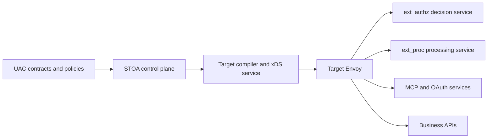

# ADR-098: Envoy as the Target Data Plane

- **Status: Accepted** — architectural direction only.
- **Supersedes for target direction:** [ADR-034](/docs/architecture/adr/adr-034-python-rust-migration/), [ADR-058](/docs/architecture/adr/adr-058-pingora-integration/) and runtime prescriptions in [ADR-057](/docs/architecture/adr/adr-057-product-lineup-gateway-link-connect/).

## Context

R1 currently uses a Rust gateway. Envoy is accepted as the architectural direction; this does not establish a delivered migration. Historical Rust and Pingora decisions are preserved with that context.

## Decision

STOA, with its gateway and control plane, selects **Envoy as the target data plane engine**. Envoy owns transport, routing, upstream connections and standard resilience mechanisms. STOA retains UAC contracts, business policies and agent services.

The FastAPI control plane remains the owner of the business model. The target calls for UAC compilation into Envoy resources and a dedicated xDS service with durable snapshots, reconciliation and ACK/NACK tracking. A contract published in the control plane must not be presented as applied without evidence of acceptance and routing.

Business decisions are called through `ext_authz`; request and response processing uses `ext_proc` where needed. MCP and OAuth remain application services behind Envoy. Wasm is an option to qualify after porting; existing extensions are not assumed compatible.

This diagram describes the target, not the delivered state. Each Envoy has a single configuration authority; an existing service mesh keeps its own control plane. Administration and diagnostics remain separate from public exposure.

## Migration criteria

- Demonstrate parity of routes, policies, per-contract audiences and cross-tenant access rejection.
- Qualify failures of authorization and identity services with denial by default.
- Retain the last accepted snapshot across restarts and without external access where required.
- Distinguish accepted configuration, routed requests and effectively applied contracts.
- Rehearse recovery from durable contracts and policies before switching traffic.

Adapters and parity remain to be implemented and validated. No migration date or numerical promise is published. Historical Rust measurements do not establish Envoy performance.

## Consequences and alternatives

The Rust/Pingora proxy remains transitional and a fallback to qualify. Its removal depends on the migration criteria; Rust business services may remain behind Envoy. Recovery requires a suitable rendering of contracts, rather than passing native configuration between engines.

Direct xDS management is the selected direction. Envoy Gateway remains an implementation option to evaluate; it does not change the engine decision. Building and operating compilation, reconciliation and snapshots adds work and requires evidence of operation.

## Licence

STOA's published code is open source under the Apache 2.0 licence.

Dependencies and extensions retain their own licences and attribution obligations.
