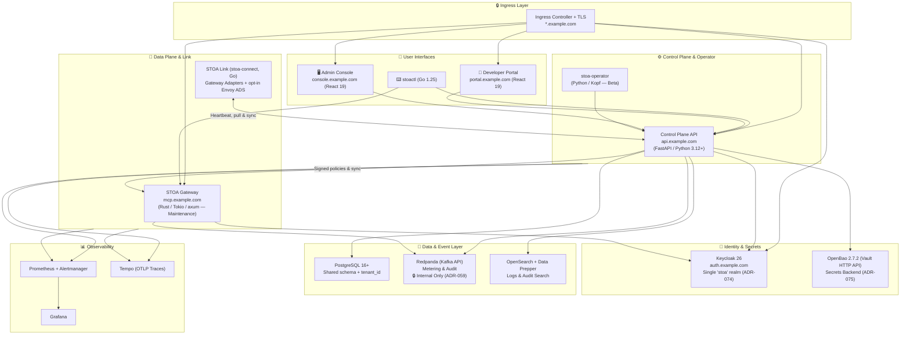
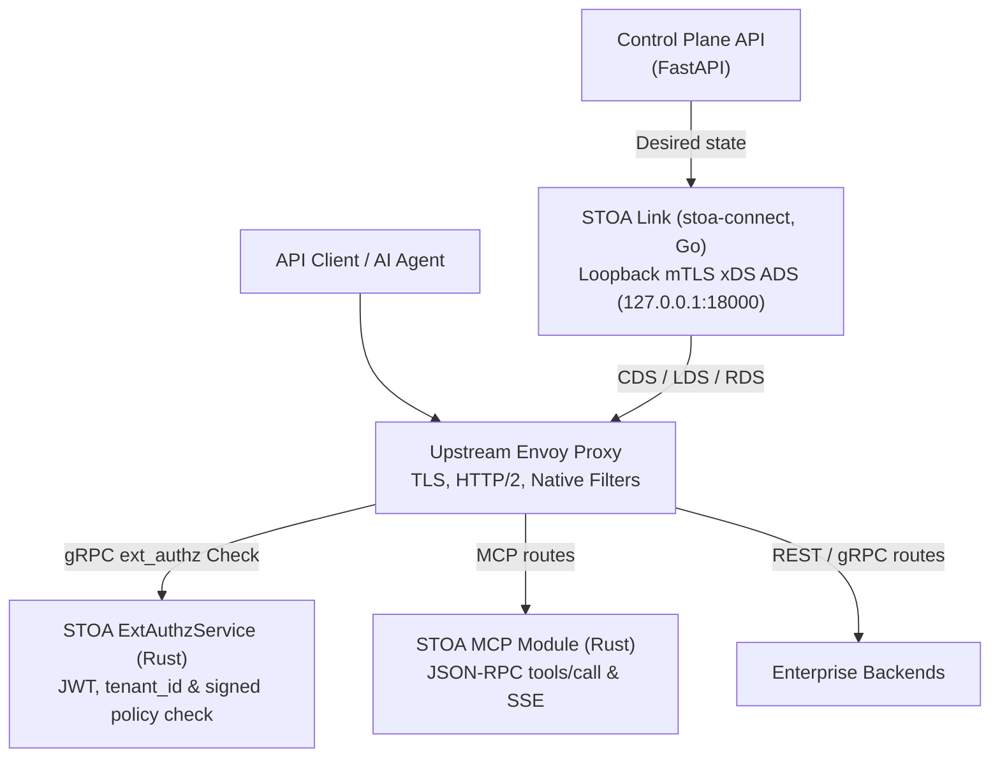

# Architecture Overview

> **Current Production & Target Data Plane** — Verified against `stoa-platform/stoa` (`main`)

STOA Platform is an open-source, cloud-native, multi-tenant gateway platform built for both traditional APIs and AI agents. This document separates two explicit views:

1. **Current Production Stack** — What runs today on `stoa-platform/stoa` `main`
2. **Target Envoy Data Plane ([ADR-073](/docs/architecture/adr/adr-073-adopt-envoy-data-plane))** — How L4/L7 proxy duties are converging onto upstream Envoy while STOA retains the Control Plane, authorization, MCP protocol layer, and Link control loop

---

## Current Production Architecture



### Core Services on `main`

| Component | Endpoint / Scope | Lifecycle | Stack |
|-----------|------------------|-----------|-------|
| **Developer Portal** | `portal.<domain>` | ✅ Production | React 19, TypeScript (`portal/`) |
| **Admin Console** | `console.<domain>` | ✅ Production | React 19, TypeScript (`control-plane-ui/`) |
| **Control Plane API** | `api.<domain>` | ✅ Production | Python 3.12+, FastAPI, SQLAlchemy (`control-plane-api/`) |
| **STOA Gateway** | `mcp.<domain>` / `:8080` | ✅ Production / Maintenance ([ADR-073](/docs/architecture/adr/adr-073-adopt-envoy-data-plane)) | Rust, Tokio, axum, tonic (`stoa-gateway/`) |
| **STOA Link (`stoa-connect`)** | On-premise / cluster agent (`:8090`) | ✅ Production (adapters) / Opt-in Envoy ADS | Go 1.25 (`stoa-go/cmd/stoa-connect`) |
| **`stoactl` CLI** | Operator workstation / CI | ✅ Production (built from `stoa-go/`) | Go 1.25 (`stoa-go/cmd/stoactl`) |
| **`stoa-operator`** | In-cluster (`GatewayInstance`, `GatewayBinding`) | 🧪 Beta | Python, Kopf (`stoa-operator/`) |
| **Keycloak** | `auth.<domain>` (`stoa` realm) | ✅ Production | Keycloak 26 ([ADR-074](/docs/architecture/adr/adr-074-tenant-model)) |
| **OpenBao** | Internal Vault HTTP API | 🔄 Partial rollout | OpenBao 2.7.2 ([ADR-075](/docs/architecture/adr/adr-075-secrets-backend-openbao)) |
| **Redpanda** | Internal cluster network only | ✅ Production | Redpanda / Kafka API ([ADR-005](/docs/architecture/adr/adr-005-event-driven-kafka)) |
| **PostgreSQL** | Internal cluster network only | ✅ Production | PostgreSQL 16+ (shared schema, `tenant_id` column) |
| **Observability** | Internal / operator ingress | ✅ Production | Prometheus, Grafana, OpenSearch, Data Prepper, Tempo |

### Key Architectural Guarantees Implemented on `main`

- **Single-realm tenant identity ([ADR-074](/docs/architecture/adr/adr-074-tenant-model))**: One shared Keycloak realm (`stoa`), one Keycloak group per tenant (`setup_tenant_group`), verified `tenant_id` JWT claims (`require_tenant_access` in Python, `enforce_tenant_isolation` in Rust), and a shared PostgreSQL schema filtered by `tenant_id` (retiring the older realm-per-tenant draft in ADR-026).
- **Fail-closed gateway posture ([ADR-070](/docs/architecture/adr/adr-070-gateway-fail-closed-posture))**: `stoa-gateway` verifies Ed25519-signed per-tenant policy bundles (`STOA_POLICY_BOOT_TENANTS`), enforces `STOA_MCP_AUDIENCE`, and maintains a durable audit WAL spool (`STOA_AUDIT_SPOOL_DIR`).
- **MCP `2025-11-25` & Contract Routes**: Streamable HTTP (`POST /mcp`), SSE (`/mcp/sse`), opt-in WebSocket (`/mcp/ws` via `STOA_WEBSOCKET_ENABLED=true`), and transactional REST + MCP route registration (`POST /admin/contracts`).
- **Multi-Gateway Orchestration ([ADR-035](/docs/architecture/adr/adr-035-gateway-adapter-pattern))**: Control Plane adapters and `stoa-connect` synchronize APIs and policies across Kong, Gravitee, webMethods, Apigee, AWS API Gateway, and Azure APIM without routing deployment commands over Kafka.
- **No Redis Dependency**: Rate-limiting, JWKS, and token caches operate in-process; STOA does not deploy or require Redis.

### Public Git Repositories

| Repository | Purpose |
|------------|---------|
| `stoa-platform/stoa` | Monorepo: Control Plane API, UIs, `stoa-gateway`, `stoa-go` (`stoactl` + `stoa-connect`), `stoa-operator`, `quickstart/`, `deploy/docker-compose/`, and Helm charts (`charts/stoa-platform`, `charts/stoa-observability`) |
| `stoa-platform/stoa-docs` | Documentation site (`docs.gostoa.dev`) |
| `stoa-platform/stoa-web` | Landing site (`gostoa.dev`) |

*(Note: Helm charts live inside `stoa-platform/stoa/charts/`; there is no separate active `stoa-helm` chart release repository.)*

### Synchronization Flow

```mermaid
sequenceDiagram
    participant Dev as Operator / GitOps
    participant CP as Control Plane API
    participant Link as STOA Link / Adapter
    participant GW as Target Gateway (STOA / Envoy / 3rd-party)

    Dev->>CP: Declare API / Contract / Binding
    CP->>Link: Policy & route sync (HTTPS / pull or adapter push)
    Link->>GW: Apply routes & policies (Admin API or loopback mTLS ADS)
    GW-->>Link: Sync acknowledgement
    Link-->>CP: Heartbeat & reconciliation status
```

:::caution Event Backbone vs Config Sync
Control Plane synchronization is **not** Kafka-driven. Redpanda/Kafka is strictly internal for asynchronous metering, audit, and error snapshots ([ADR-005](/docs/architecture/adr/adr-005-event-driven-kafka)).
:::

---

## Target Data Plane Architecture ([ADR-073](/docs/architecture/adr/adr-073-adopt-envoy-data-plane))

Rather than building a custom kernel/eBPF proxy or rewriting the Control Plane in Go, [ADR-073](/docs/architecture/adr/adr-073-adopt-envoy-data-plane) delegates commodity L4/L7 proxy functions (TLS/mTLS, HTTP/1-2-3, connection pooling, retries, circuit breaking) to **upstream Envoy** while keeping STOA's differentiators in dedicated processes:



### Delivered Building Blocks vs Pending Migration on `main`

| Capability | Status on `main` | Implementation Proof |
|------------|------------------|----------------------|
| **Loopback mTLS xDS ADS server in `stoa-connect`** | ✅ Implemented (opt-in via `STOA_GATEWAY_TYPE=envoy`) | `stoa-go/cmd/stoa-connect/envoy.go`, `stoa-go/cmd/stoa-connect/ENVOY.md`; translates v1 `cors`, per-process `rate_limit`, and direct-peer `ip_filter` |
| **gRPC `ExtAuthzService` in `stoa-gateway`** | ✅ Implemented (opt-in via `STOA_EXT_AUTHZ_GRPC_ADDR` + `STOA_EXT_AUTHZ_AUDIENCE`) | `stoa-gateway/src/authz/ext_authz_grpc.rs`, supervised in `stoa-gateway/src/main.rs` |
| **Offline Envoy + Link + gRPC integration proof** | ✅ Verified in CI | `.github/workflows/o1-envoy-real-proof.yml`, `docs/testing/o1-offline-envoy.md` |
| **Full policy translator parity** | 🚧 In progress | `jwt_validation`, OIDC, `logging`, `caching`, and `transform` are not yet translated into Envoy filters by `stoa-connect` |
| **Streaming `ext_proc` & standalone MCP split** | 📋 Planned ([ADR-073](/docs/architecture/adr/adr-073-adopt-envoy-data-plane)) | Token metering / guardrail `ext_proc` and decoupling MCP from standalone proxy listener |
| **Default Helm & Compose topology cut-over** | 📋 Planned | `charts/stoa-platform` and `deploy/docker-compose/` still deploy `stoa-gateway` directly as the default ingress gateway |

See [Data Plane Architecture](/docs/architecture/data-plane) for line-level code references and migration phases.

---

## Deployed Kubernetes CRDs (`gostoa.dev/v1alpha1`)

Five Custom Resource Definitions are shipped today in `charts/stoa-platform/crds/` under the `gostoa.dev/v1alpha1` API group:

- **Watched by `stoa-gateway`** (`STOA_K8S_WATCHER_ENABLED=true`): `Tool`, `ToolSet`, `Skill`
- **Reconciled by `stoa-operator`**: `GatewayInstance`, `GatewayBinding`

```yaml
apiVersion: gostoa.dev/v1alpha1
kind: Tool
metadata:
  name: billing-api
  namespace: stoa-system
spec:
  displayName: Billing API
  description: Query customer invoices
  endpoint: https://billing.internal.example.com/v1/invoices
  method: GET
---
apiVersion: gostoa.dev/v1alpha1
kind: GatewayInstance
metadata:
  name: prod-edge-mcp
  namespace: stoa-system
spec:
  displayName: Production Edge MCP Gateway
  gatewayType: stoa_edge_mcp
  environment: prod
  baseUrl: https://mcp.example.com
```

See the [Kubernetes CRDs Reference](/docs/reference/crds) for complete schemas and enforced enum values.

---

## Technology Stack Comparison

| Layer | Current Production (`main`) | Target Evolution |
|-------|-----------------------------|------------------|
| **L4/L7 Data Plane** | `stoa-gateway` (Rust, Tokio, axum — Maintenance) | Upstream Envoy + `stoa-connect` loopback mTLS ADS ([ADR-073](/docs/architecture/adr/adr-073-adopt-envoy-data-plane)) |
| **Authorization Engine** | In-process Rust middleware + OPA + signed policies ([ADR-070](/docs/architecture/adr/adr-070-gateway-fail-closed-posture)) | Rust `ExtAuthzService` gRPC server called by Envoy (`STOA_EXT_AUTHZ_GRPC_ADDR`) |
| **MCP Protocol Layer** | Integrated in `stoa-gateway` (Rust) | Dedicated Rust MCP service behind Envoy |
| **Control Plane API** | Python 3.12+, FastAPI | Python 3.12+, FastAPI |
| **CLI & Link Agent** | Go 1.25 (`stoactl`, `stoa-connect`) | Go 1.25 (`stoactl`, `stoa-connect` / STOA Link) |
| **Kubernetes Operator** | Python, Kopf (`stoa-operator`, Beta) | Python, Kopf (`stoa-operator`) |
| **Frontend** | React 19, TypeScript, Tailwind | React 19, TypeScript, Tailwind |
| **Database** | PostgreSQL 16+ (shared schema, `tenant_id`) | PostgreSQL 16+ ([ADR-074](/docs/architecture/adr/adr-074-tenant-model)) |
| **Event Backbone** | Redpanda (Kafka API, internal only) | Redpanda ([ADR-005](/docs/architecture/adr/adr-005-event-driven-kafka)) |
| **Identity** | Keycloak 26 (single `stoa` realm, tenant groups) | Keycloak 26 ([ADR-074](/docs/architecture/adr/adr-074-tenant-model)) |
| **Secrets** | OpenBao 2.7.2 / Vault HTTP API (partial rollout) | Full OpenBao / Vault HTTP API coverage ([ADR-075](/docs/architecture/adr/adr-075-secrets-backend-openbao)) |
| **Observability** | Prometheus, Grafana, OpenSearch, Data Prepper, Tempo | OpenTelemetry-native metrics, logs, and traces |

---

## Security Zones

| Zone | Trust Level | Components |
|------|-------------|------------|
| **External** | Untrusted | API Clients, AI Agents, Browser UIs |
| **DMZ** | Semi-trusted | Ingress Controller, `stoa-gateway`, Envoy + `stoa-connect` |
| **Internal** | Trusted | Control Plane API, `stoa-operator`, Keycloak, PostgreSQL, Redpanda, OpenBao, OpenSearch |

Key security principles:
- Redpanda/Kafka has **zero external exposure** ([ADR-005](/docs/architecture/adr/adr-005-event-driven-kafka))
- Multi-tenant isolation uses a single `stoa` Keycloak realm, per-tenant groups, and verified `tenant_id` JWT claims ([ADR-074](/docs/architecture/adr/adr-074-tenant-model))
- Gateway tool authorization fails closed on missing or invalid signed policy bundles ([ADR-070](/docs/architecture/adr/adr-070-gateway-fail-closed-posture))
- Declarative GitOps delivery with Argo CD ([ADR-007](/docs/architecture/adr/adr-007-gitops-argocd)) and digest-pinned Helm images
- Secrets managed through the Vault HTTP API backend: OpenBao by default ([ADR-075](/docs/architecture/adr/adr-075-secrets-backend-openbao))

---

## Related Documents

- [Data Plane Architecture](/docs/architecture/data-plane) — Detailed Envoy + STOA Link + `ext_authz` architecture
- [Gateway Deployment Modes](/docs/concepts/gateway) — `edge-mcp`, `sidecar`, `proxy`, and `shadow`
- [Architecture Decision Records (ADRs)](/docs/architecture/adr) — Full decision log
- [Kubernetes CRDs Reference](/docs/reference/crds) — `gostoa.dev/v1alpha1` schemas
