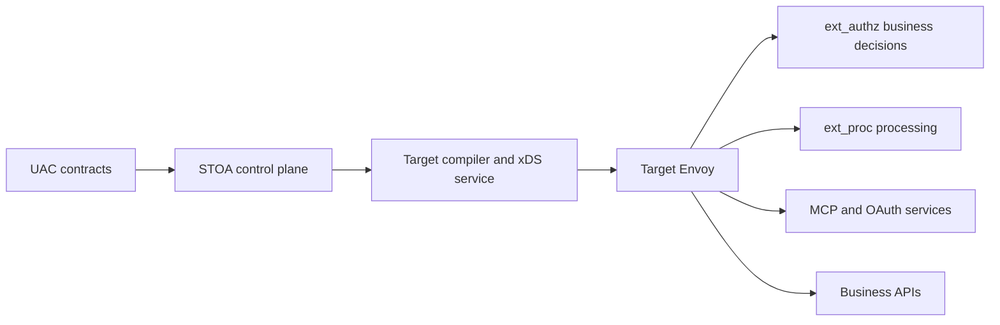

# Current and Target Architecture

:::info Current state and target direction
R1 currently uses the **Rust gateway**. **Envoy is the decided target**; migration remains ahead. This page does not attest availability or performance. See [the Envoy ADR](/docs/architecture/adr/adr-073-adopt-envoy-data-plane/).
:::

## Current Architecture

The R1 path uses a Rust gateway, a FastAPI control plane, PostgreSQL, Keycloak and a mock backend. Its verification script declares a contract directly on the gateway. The control plane responds to a health check; this does not demonstrate API publication through it.

## Target Architecture

This target remains to be implemented and qualified. Envoy provides the proxy engine; STOA services retain contracts, policies and agent logic. Any existing service mesh retains a separate control plane.

## Live to Target Differences

| Scope | Current R1 | Target direction |
|---|---|---|
| Proxy engine | Rust gateway | Envoy |
| Local scenario declaration | Directly on the gateway | Compilation and reconciliation through the control plane |
| Business and MCP services | Capabilities to validate for each path | Application services behind Envoy |
| Evidence of application | Local script to execute | ACK/NACK plus routing and policy checks |

Migration must demonstrate contract and audience parity, access rejection, service failures and recovery. No migration date or Envoy performance measurement is announced.

## Git Repositories

Only [stoa](https://github.com/stoa-platform/stoa) and [stoa-quickstart](https://github.com/stoa-platform/stoa-quickstart) are cited as public product repositories. Other components are not published.

## Configuration

Operators supply environment addresses, for example `STOA_API_URL`, `STOA_GATEWAY_URL`, `STOA_AUTH_URL`. Secrets remain outside the repository and logs.

## Related Documents

- [Envoy decision](/docs/architecture/adr/adr-073-adopt-envoy-data-plane/)
- [Local R1 quickstart](/docs/guides/quickstart/)
- [Implementation status](/docs/concepts/implementation-status/)
