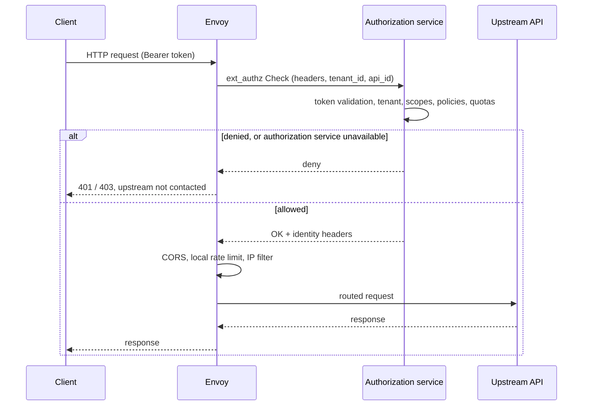

# Data plane

This document describes how the STOA data plane processes a request. STOA is a sovereign API and integration platform (iPaaS) with an MCP module; [ADR-073](./adr/adr-073-adopt-envoy-data-plane.md) decides that the data plane uses upstream Envoy, configured only over xDS by STOA Link, with STOA logic running in external services that Envoy calls. ADR-073 leaves the detailed iPaaS scope and several implementation details open.

Two levels are kept apart throughout:

- **Decided** — what ADR-073 and [ADR-070](./adr/adr-070-gateway-fail-closed-posture.md) fix as the target.
- **In the repository** — what the public `stoa` repository contains at a pinned revision; every code link below points to that revision.

No performance figure appears here. ADR-073 states that any performance statement about the Envoy data plane will come from a benchmark run with the [ADR-049](./adr/adr-049-enterprise-ai-native-benchmark.md) methodology; figures measured on the earlier in-house gateway are not reused.

## Components

| Component | Role | Decided (ADR-073) | In the repository |
|---|---|---|---|
| **Envoy** | Listens, routes, load-balances, terminates TLS, runs built-in filters | Unmodified upstream release, no extension loaded (no Wasm, Lua or dynamic module), configured only over xDS (§1, §2) | A pinned upstream image is exercised by the [offline acceptance harness][o1-doc] |
| **STOA Link** (`stoa-connect`) | On-site agent: outbound SSE connection to the control plane, local xDS server, `SYNCED` / `FAILED` reporting | §2, §7 | [Envoy mode][envoy-md], [xDS snapshot builder][snapshot], [ADS server][ads] |
| **Authorization service** | Called by Envoy's `ext_authz` filter before routing | API keys, subscriptions, tenant isolation, OPA policies, consumer quotas, token binding when Envoy does not check it (§4, §5, §10) | gRPC `envoy.service.auth.v3` adapter in front of the existing policy logic: [`ExtAuthzService`][ext-authz] |
| **Processing service** | Called by `ext_proc` for features that need request or response bodies (guardrails, token budgets, compression, transformation) | §4 | Not in the reference snapshot |
| **MCP module** | Upstream behind Envoy: MCP protocol, tool registry, tool-level authorization | §4, §10; deny-by-default tool permissions per ADR-070 | Signed policy artifact verification: [`policy_artifact.rs`][artifact], [`tool_permissions.rs`][tool-perms] |
| **Metering collector** | Access-log service producing usage events to Kafka | §4, transport to be confirmed | Not in the reference snapshot |

Community and Enterprise use the same Envoy release; they differ only by the generated configuration and by which STOA services are deployed (ADR-073 §6).

## Configuration delivery

Envoy receives its configuration only over xDS, served on the customer site by STOA Link. The deployment path is the single path of [ADR-059](./adr/adr-059-simplified-deployment-sse.md), and the control plane never opens a connection towards the site (ADR-073 §2):

```text
Console → CP API → SSE → STOA Link → xDS → Envoy
                              ↓
                   callback SYNCED / FAILED → CP API
```

In the repository, the [Envoy mode][envoy-md] of `stoa-connect` must be selected explicitly through `STOA_GATEWAY_TYPE`; automatic detection never selects it. The Link's [ADS listener][ads-main] binds to a loopback address only, requires mutual TLS (TLS 1.3 minimum) and identifies the Envoy client by the single URI SAN of its verified certificate chain; the node ID declared in discovery requests is never an authentication input. Each publication is a complete state-of-the-world snapshot of clusters, listener and routes, versioned by a hash of its content. The Link waits for the CDS, LDS and RDS acknowledgements; a NACK or a missed deadline is a deployment error, and the last acknowledged routes and policies are kept ([snapshot builder][snapshot], [ADS server][ads]). Routes and policies arrive through the control plane's gateway configuration endpoint and SSE events. The [Envoy adapter][adapter] refuses stale generations and any route loss without an explicit deletion tombstone, and reconciles the complete applicable policy set atomically, so a rejected inventory is never partially applied ([control-plane inventory][inventory]).

Decided but not in the repository at this revision: the UAC → xDS translation as a dedicated control-plane component (§2), the JWKS delivered over xDS (§10) and the bootstrap content of each Envoy instance (§2, to be confirmed). Today the Link builds the snapshot from the route and policy inventory it receives.

## Request chain

The diagram shows the reference implementation at the pinned revision, not the decided target.



The [reference snapshot][snapshot] installs this HTTP filter chain on the listener: `ext_authz` first, then `cors`, `local_ratelimit` and `rbac` when at least one route carries a policy, then the router. The external authorization filter denies requests when the authorization service fails and uses a gRPC service on a dedicated HTTP/2 cluster, and each route passes `tenant_id` and `api_id` to the authorization service as context extensions. Authorization therefore runs before CORS and may deny a preflight without contacting the upstream ([Envoy mode][envoy-md]).

### Token validation

- **Decided.** Envoy's `jwt_authn` filter validates signatures and standard claims against the Keycloak JWKS, delivered locally over xDS (ADR-073 §5, §10). Whether that filter can check certificate-bound tokens (RFC 8705) and DPoP proofs (RFC 9449) is to be verified; if not, the authorization service performs the check and keeps the [ADR-039](./adr/adr-039-mtls-cert-bound-tokens.md) error contract.
- **In the repository.** The reference snapshot carries no `jwt_authn` filter; the [authorization service][ext-authz] validates the token itself. It requires a configured audience (otherwise every request is denied and the gateway reports not ready), validates the bearer token against the OIDC provider's JWKS with a bounded timeout, requires a tenant claim equal to the route's `tenant_id`, and requires every configured scope (`scope` and `scp` claims). A missing token yields 401 with `WWW-Authenticate: Bearer`; an invalid one 401; a tenant or scope mismatch 403. In production, when the external authorization listener is enabled, the gateway [refuses to start][loader] if the audience is missing or the scope list is empty or contains a blank entry.

### Authorization and identity propagation

The authorization service normalises headers (lower-case, no duplicates, no CRLF), then strips every inbound identity header (`x-stoa-*`, `x-user-*`, `x-tenant-id`, …) and the `authorization`, `cookie` and `proxy-authorization` headers from the decision input, so a client cannot forge an identity for the upstream. The shared [decision engine][decision] evaluates policies and quotas on a gateway-neutral input. On allow, Envoy adds `x-stoa-tenant-id` and `x-stoa-api-id` to the upstream request and removes the inbound identity headers. Each decision is logged as an `ext_authz_decision` event with a closed set of denial reasons, never the token or a claim ([`ExtAuthzService`][ext-authz]).

### Rate limiting and quotas

- **Decided.** There is no separate rate-limit service. Consumer quotas are checked by the authorization service: billed quotas and MCP budgets through an atomic PostgreSQL update that fails closed, non-billed quotas through batched counters with a bounded degraded mode. Envoy's `local_ratelimit` filter provides coarse protection only (ADR-073 §4, §10).
- **In the repository.** A `rate_limit` policy (`maxRequests`, `intervalSeconds`) becomes a local token bucket per route and per Envoy process; it is neither distributed nor a fixed window ([policy translation][policy]). Consumer quota decisions from the authorization service carry a `Retry-After` header computed from the window reset ([`ExtAuthzService`][ext-authz]).

### Policies

Policies are generated from control-plane objects and are never edited by hand on Envoy (ADR-073 §3). The v1 translator in the repository supports three types; everything else is refused explicitly rather than ignored ([Envoy mode][envoy-md], [policy translation][policy]):

| Policy | Envoy filter | Behaviour |
|---|---|---|
| `cors` | `envoy.filters.http.cors` | The six contract keys, per route; `OPTIONS` is accepted on method-constrained routes for preflight |
| `rate_limit` | `envoy.filters.http.local_ratelimit` | Token bucket per route and per Envoy process |
| `ip_filter` | `envoy.filters.http.rbac` | Allow or deny on the direct peer address (CIDR or single address); forwarded address headers are not trusted |
| `jwt_validation`, `logging`, `caching`, `transform`, OIDC | — | Unsupported: the inventory is rejected and nothing is published |

Scopes `gateway` and `tenant` expand onto matching routes; `api` scope targets exact catalogue identifiers. Two rules of the same type on one route are rejected rather than merged or ordered by priority. The control plane attributes each policy with `scope`, targets, `tenant_id` and `applicable`, and an empty API binding never broadens to gateway scope ([inventory][inventory]).

### Routing

Each activated route becomes a prefix match on its path (`path_prefix`, or `/apis/{api_id}` by default) with one entry per allowed method, and an upstream cluster per route resolved by static address or strict DNS. An `https` backend gets an upstream TLS context with SNI set to the host and the system CA bundle as trust anchor ([snapshot builder][snapshot]). The `edge-mcp`, `proxy`, `sidecar` and `shadow` positions of [ADR-024](./adr/adr-024-gateway-unified-modes.md) become configuration profiles generated by STOA plus the set of STOA services deployed (ADR-073 §8); in the repository the ADS server serves one verified node.

## Failure behaviour

| Situation | Decided | In the repository |
|---|---|---|
| Authorization service unreachable or timed out | Envoy denies with HTTP 503, a neutral body identical to the 403, bounded `Retry-After`, no automatic retry of non-idempotent methods or MCP `tools/call` (ADR-073 §10) | Requests are denied on authorization failure, with a bounded timeout set by the Link; the harness checks that a gRPC failure or timeout returns 403 without reaching the upstream ([snapshot builder][snapshot], [harness][o1-doc]) |
| Envoy rejects a configuration (NACK) | Link reports `FAILED`; drift detection relies on the acknowledged version (§2) | Deployment error; the last acknowledged routes and policies are kept ([adapter][adapter]) |
| Control plane unreachable | Tool-permission enforcement is deny-by-default: allow only per a signed, short-lived policy artifact until its expiry, never extended locally; revocation overrides cache; readiness reflects enforcement state ([ADR-070](./adr/adr-070-gateway-fail-closed-posture.md)) | Compact JWS artifact verification with pinned Ed25519 keys ([`policy_artifact.rs`][artifact]); nothing is allowed after boot until a fresh policy loads ([`tool_permissions.rs`][tool-perms]) |
| Audience missing outside production, external authorization listener enabled | — | Requests denied, `/ready` returns 503, gRPC health reports not serving ([readiness][ready], [startup][main]) |
| Scope list empty outside production, audience valid | — | Startup warns; scope checks are skipped and requests may be allowed. gRPC health reports serving; HTTP readiness still depends on its other checks ([configuration validation][loader], [decision engine][decision], [readiness][ready], [startup][main]) |
| Audience missing or scope list empty or containing a blank entry in production, external authorization listener enabled | — | Configuration validation rejects startup; no running server response is produced ([configuration validation][loader]) |
| JWKS not reachable at startup | — | Startup warns and requests remain fail-closed ([startup][main]) |

The `ext_authz` gRPC listener of the authorization service has no TLS of its own: the startup code warns when it is bound to a non-loopback address and expects a trusted private network ([startup][main]).

## Verification in the repository

The [offline acceptance harness][o1-doc] runs the control plane's deployment router, the Go agent and adapters, the mTLS ADS server, a real Envoy process from a pinned image and an independent gRPC `Check` witness, without external network access; local connections and the Docker bridge are used. It checks, among other things, that the route count never decreases during publication, that only explicit tombstones remove routes, that a foreign gateway's publication leaves the snapshot unchanged, that the old snapshot keeps serving during an SSE outage, that CORS, token-bucket and address-filter behaviours are observed on real responses, that `Check` precedes routing and that a CORS preflight cannot bypass a denial. A manual CI workflow ([`o1-envoy-real-proof.yml`][o1-ci]) runs the same harness on demand. The harness validates the integration contract, not STOA business authorization; its timing records are test deadlines, not performance claims.

## Scope notes

- The in-house Rust gateway is no longer the strategic data plane and enters maintenance (ADR-073 §9); its policy logic is reused behind the `ext_authz` adapter described above.
- Third-party gateways connected through adapters ([ADR-035](./adr/adr-035-gateway-adapter-pattern.md)) do not call the STOA authorization service directly for now (ADR-073 §8).

[envoy-md]: https://github.com/stoa-platform/stoa/blob/4290bb39fe57de7516c46ea675a5c90ce4ed13f8/stoa-go/cmd/stoa-connect/ENVOY.md
[ads-main]: https://github.com/stoa-platform/stoa/blob/4290bb39fe57de7516c46ea675a5c90ce4ed13f8/stoa-go/cmd/stoa-connect/envoy.go
[ads]: https://github.com/stoa-platform/stoa/blob/4290bb39fe57de7516c46ea675a5c90ce4ed13f8/stoa-go/internal/xds/server.go
[snapshot]: https://github.com/stoa-platform/stoa/blob/4290bb39fe57de7516c46ea675a5c90ce4ed13f8/stoa-go/internal/xds/snapshot.go
[policy]: https://github.com/stoa-platform/stoa/blob/4290bb39fe57de7516c46ea675a5c90ce4ed13f8/stoa-go/internal/xds/policy.go
[adapter]: https://github.com/stoa-platform/stoa/blob/4290bb39fe57de7516c46ea675a5c90ce4ed13f8/stoa-go/internal/connect/adapters/envoy.go
[inventory]: https://github.com/stoa-platform/stoa/blob/4290bb39fe57de7516c46ea675a5c90ce4ed13f8/control-plane-api/src/services/envoy_policy_inventory.py
[ext-authz]: https://github.com/stoa-platform/stoa/blob/4290bb39fe57de7516c46ea675a5c90ce4ed13f8/stoa-gateway/src/authz/ext_authz_grpc.rs
[decision]: https://github.com/stoa-platform/stoa/blob/4290bb39fe57de7516c46ea675a5c90ce4ed13f8/stoa-gateway/src/mode/decision.rs
[loader]: https://github.com/stoa-platform/stoa/blob/4290bb39fe57de7516c46ea675a5c90ce4ed13f8/stoa-gateway/src/config/loader.rs
[main]: https://github.com/stoa-platform/stoa/blob/4290bb39fe57de7516c46ea675a5c90ce4ed13f8/stoa-gateway/src/main.rs
[ready]: https://github.com/stoa-platform/stoa/blob/4290bb39fe57de7516c46ea675a5c90ce4ed13f8/stoa-gateway/src/lib.rs
[artifact]: https://github.com/stoa-platform/stoa/blob/4290bb39fe57de7516c46ea675a5c90ce4ed13f8/stoa-gateway/src/control_plane/policy_artifact.rs
[tool-perms]: https://github.com/stoa-platform/stoa/blob/4290bb39fe57de7516c46ea675a5c90ce4ed13f8/stoa-gateway/src/control_plane/tool_permissions.rs
[o1-doc]: https://github.com/stoa-platform/stoa/blob/4290bb39fe57de7516c46ea675a5c90ce4ed13f8/docs/testing/o1-offline-envoy.md
[o1-ci]: https://github.com/stoa-platform/stoa/blob/4290bb39fe57de7516c46ea675a5c90ce4ed13f8/.github/workflows/o1-envoy-real-proof.yml
