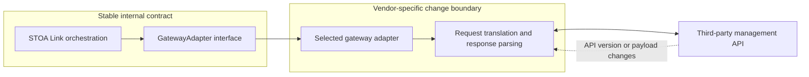

## Purpose and audience

This document explains the adapter boundary for architects and integration maintainers reviewing STOA's **Sovereign iPaaS — API & integration platform**, including its MCP module. It distinguishes the existing adapter implementations from the Envoy target architecture. The architectural basis is [ADR-035](./adr/adr-035-gateway-adapter-pattern.md) and [ADR-073](./adr/adr-073-adopt-envoy-data-plane.md); ADR-073 leaves the detailed iPaaS scope open.

## Sources and scope

The implementation links below are pinned to a reviewed revision of the public `stoa` repository. No running gateway or credentials are required to read this document. The Python control-plane interface and the Go interface used by STOA Link are separate contracts; they must not be treated as interchangeable.

- [Python interface and result type][python-interface], [adapter registry][registry], and [request/response mappers][mappers].
- [Go gateway interface and shared types][go-interface], [Link route synchronization][route-sync], and [gateway-specific implementation][go-adapter].
- [ADR-059: deployment through STOA Link](./adr/adr-059-simplified-deployment-sse.md).

## Isolation boundary

An adapter translates an internal operation into the gateway's management API and translates the response back. ADR-035 places the vendor-specific behavior behind an abstract interface and explicitly identifies version-specific mappers as the mitigation for gateway API changes. This is **code and contract isolation**: it does not promise a separate process or sandbox for each adapter.

The diagram shows the Go Link boundary, not the request traffic path. Link's route synchronizer receives a `GatewayAdapter` and calls `SyncRoutes`; the implementation owns gateway-specific HTTP requests and parsing ([interface][go-interface], [caller][route-sync], [implementation][go-adapter]).

| Layer | Responsibility | Evidence |
|-------|----------------|----------|
| Internal orchestration | Calls shared operations and interprets their outcomes | [Link route synchronizer][route-sync] |
| Internal contract | Defines operations and common input/output types | [Go interface][go-interface], [Python interface][python-interface] |
| Adapter and mappers | Translate payloads, invoke the management API, normalize responses | [Go implementation][go-adapter], [Python mappers][mappers] |
| Adapter selection | Resolves a concrete implementation by gateway type | [Python registry][registry] |

## What remains stable

The Python contract covers lifecycle, APIs, policies, applications, authentication configuration, aliases, global gateway configuration and archive operations. `AdapterResult` carries `success`, `resource_id`, `data` and `error`. Return types differ by method: list operations return lists, lifecycle methods can return no value, and archive export returns bytes. The interface requires idempotent operations; this is a contract requirement, not a blanket assertion that every implementation is proven idempotent ([Python interface][python-interface]).

The Go contract defines `Detect`, `Discover`, `ApplyPolicy`, `RemovePolicy`, `SyncRoutes` and `InjectCredentials`. It uses shared types such as `Route`, `DiscoveredAPI` and `SyncResult`. `SyncRoutes` returns both a result and an error; callers must consider both. OIDC and alias operations have separate extension interfaces ([Go interface][go-interface]).

Stability means preserving these caller-visible operations and their semantics while accommodating a vendor API change inside the relevant adapter. It does not imply that all gateways provide identical capabilities: ADR-035 explicitly recognizes features that do not map cleanly to the abstraction.

## When a third-party gateway changes

For a management API change that still expresses the same internal operation, the intended change scope is the affected adapter, its mappers or parsing helpers, and its tests. The orchestration and shared interface remain unchanged. This follows ADR-035's independent adapter maintenance and version-specific mapper design; the code separates the [caller][route-sync] from the [vendor implementation][go-adapter].

A maintenance review can follow this sequence:

1. Identify the affected operation and vendor payload or endpoint in the adapter. Compare its behavior with the shared interface rather than exposing a vendor field to callers ([Go interface][go-interface], [implementation][go-adapter]).
2. Adapt request translation and response normalization within that boundary. The Python mapper module illustrates both directions: internal API specification to gateway service, and gateway service to normalized API data ([mappers][mappers]).
3. Verify the same caller-visible results with updated vendor-response fixtures. Existing Go adapter tests use an HTTP test server; route synchronizer tests exercise orchestration separately ([adapter tests][adapter-tests], [orchestration tests][route-tests]).
4. Run the relevant checks before accepting the change. The Go CI workflow builds both binaries and runs the test suite with the race detector ([workflow][go-ci]). This document does not claim that a future vendor version has already passed those checks.

If a new vendor feature cannot fit the current semantics, changing only the adapter is insufficient. Treat that as a contract design change, review its callers and capability boundaries, and retain explicit unsupported behavior where appropriate. The separate Go extension interfaces and the Python default unsupported `deploy_contract` result illustrate these limits ([Go interface][go-interface], [Python interface][python-interface]).

## Relationship to the Envoy decision

Under the decision dated 2026-10-22, the STOA data plane is to use upstream Envoy. STOA logic is to run in external services, and the MCP module is to sit behind Envoy. The decided configuration path is control plane → STOA Link → xDS → Envoy; for third-party gateways, Link continues to apply desired state through each gateway's interface ([ADR-073](./adr/adr-073-adopt-envoy-data-plane.md)).

This keeps third-party API translation distinct from the Envoy configuration path. ADR-073 places the translation from the [Universal API Contract (UAC)](../concepts/uac.md) to xDS in a dedicated control-plane component, while Link serves versioned snapshots. It explicitly marks the Link xDS server as **not yet implemented**. The decision is therefore the target architecture, not evidence of a delivered Envoy deployment or of an existing Envoy implementation of the Go adapter interface.

## See also

- [Multi-gateway orchestration decision](./adr/adr-004-gateway-adapter-pattern.md)
- [Gateway adapter decision](./adr/adr-035-gateway-adapter-pattern.md)
- [Single deployment path](./adr/adr-059-simplified-deployment-sse.md)
- [Envoy data plane decision](./adr/adr-073-adopt-envoy-data-plane.md)
- [Hybrid gateway adapter guide: bring your own gateway](../guides/hybrid-gateway-adapter.md)

[python-interface]: https://github.com/stoa-platform/stoa/blob/4290bb39fe57de7516c46ea675a5c90ce4ed13f8/control-plane-api/src/adapters/gateway_adapter_interface.py
[registry]: https://github.com/stoa-platform/stoa/blob/4290bb39fe57de7516c46ea675a5c90ce4ed13f8/control-plane-api/src/adapters/registry.py
[mappers]: https://github.com/stoa-platform/stoa/blob/4290bb39fe57de7516c46ea675a5c90ce4ed13f8/control-plane-api/src/adapters/kong/mappers.py
[go-interface]: https://github.com/stoa-platform/stoa/blob/4290bb39fe57de7516c46ea675a5c90ce4ed13f8/stoa-go/internal/connect/adapters/adapter.go
[route-sync]: https://github.com/stoa-platform/stoa/blob/4290bb39fe57de7516c46ea675a5c90ce4ed13f8/stoa-go/internal/connect/sync_route.go
[go-adapter]: https://github.com/stoa-platform/stoa/blob/4290bb39fe57de7516c46ea675a5c90ce4ed13f8/stoa-go/internal/connect/adapters/kong.go
[adapter-tests]: https://github.com/stoa-platform/stoa/blob/4290bb39fe57de7516c46ea675a5c90ce4ed13f8/stoa-go/internal/connect/adapters/kong_test.go
[route-tests]: https://github.com/stoa-platform/stoa/blob/4290bb39fe57de7516c46ea675a5c90ce4ed13f8/stoa-go/internal/connect/sync_route_test.go
[go-ci]: https://github.com/stoa-platform/stoa/blob/4290bb39fe57de7516c46ea675a5c90ce4ed13f8/.github/workflows/stoa-go-ci.yml
