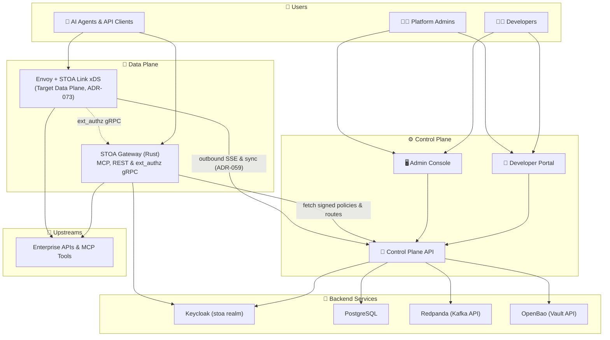
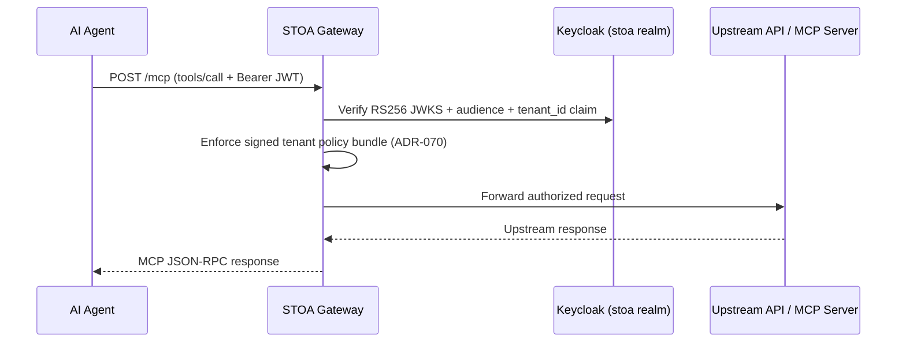

# Architecture Overview

STOA Platform is designed as a cloud-native, multi-tenant gateway platform built for both traditional APIs and AI agents.

## High-Level Architecture

STOA follows a **Control Plane / Data Plane** separation pattern, similar to Kubernetes and Istio.



### Control Plane vs Data Plane

| Aspect | Control Plane | Data Plane |
|--------|---------------|------------|
| **Role** | Configuration, Catalog & Governance | Traffic Execution & Policy Enforcement |
| **Components** | Control Plane API, Portal, Console, `stoa-operator` | `stoa-gateway` (Rust, maintenance) & Upstream Envoy + `stoa-connect` (STOA Link, [ADR-073](/docs/architecture/adr/adr-073-adopt-envoy-data-plane)) |
| **Latency** | Human-scale (ms OK) | Machine-scale (low-ms) |
| **Scaling** | Moderate | High (per-request, horizontal) |

:::tip Architecture Decisions
This separation and data plane evolution are documented in [ADR-001: API Exposure Strategy](/docs/architecture/adr/adr-001-api-exposure-strategy) and [ADR-073: Adopt Envoy as Primary Data Plane](/docs/architecture/adr/adr-073-adopt-envoy-data-plane).
:::

## Core Components

### Control Plane API

The central management API built with **Python** and **FastAPI** (`control-plane-api/`).

| Aspect | Details |
|--------|---------|
| Language | Python 3.11 (`requires-python >= 3.11`) |
| Framework | FastAPI (async) |
| Database | PostgreSQL 15 / 16 + SQLAlchemy (shared schema scoped by `tenant_id`) |
| Event Streaming | Redpanda / Kafka ([ADR-005](/docs/architecture/adr/adr-005-event-driven-kafka)) |
| Auth | Keycloak OIDC (`stoa` realm, [ADR-074](/docs/architecture/adr/adr-074-tenant-model)) |

**Responsibilities:**
- Subscription and API catalog management
- Tenant provisioning (`setup_tenant_group` in Keycloak)
- Signed Ed25519 gateway policy bundle issuance ([ADR-070](/docs/architecture/adr/adr-070-gateway-fail-closed-posture))
- Multi-gateway orchestration across 6 Control Plane adapters: Kong, Gravitee, webMethods, Apigee, AWS API Gateway, and Azure APIM ([ADR-035](/docs/architecture/adr/adr-035-gateway-adapter-pattern))
- Usage tracking and audit trails

### STOA Gateway & Envoy Data Plane

STOA operates a production Rust gateway while converging the L4/L7 proxy layer onto upstream Envoy ([ADR-073](/docs/architecture/adr/adr-073-adopt-envoy-data-plane)):

| Aspect | Current Production (`stoa-gateway`) | Target Data Plane (`Envoy` + `STOA Link`) |
|--------|-------------------------------------|-------------------------------------------|
| Implementation | Rust (`Tokio` + `axum`) | Upstream Envoy + `stoa-connect` (Go xDS ADS) + Rust `ext_authz` gRPC |
| Lifecycle | Production / Maintenance | Opt-in runtime blocks implemented; topology cut-over in progress |
| Policy Engine | Signed Ed25519 policy bundles ([ADR-070](/docs/architecture/adr/adr-070-gateway-fail-closed-posture)) + OPA | Envoy native filters (`cors`, `rate_limit`, `ip_filter`) + gRPC `ExtAuthzService` (JWT, `tenant_id`, audience/scopes & `DecisionEngine`; MCP tool permissions remain separate per [ADR-070](/docs/architecture/adr/adr-070-gateway-fail-closed-posture)) |
| Protocols | MCP (`POST /mcp`, `/mcp/sse`, opt-in `/mcp/ws`), REST, A2A | HTTP/1.1, HTTP/2, gRPC, MCP module behind Envoy |

**Delivered building blocks on `main`:**
- **Rust `stoa-gateway`** handles MCP protocol sessions, REST contract routes, fail-closed tenant policy enforcement, and supervises an optional gRPC `envoy.service.auth.v3.Authorization` server (`ExtAuthzService`, enabled via `STOA_EXT_AUTHZ_GRPC_ADDR`, `STOA_EXT_AUTHZ_AUDIENCE`, and non-empty `STOA_EXT_AUTHZ_REQUIRED_SCOPES` in `prod`).
- **STOA Link (`stoa-connect`)** opens an outbound SSE stream ([ADR-059](/docs/architecture/adr/adr-059-simplified-deployment-sse)) to the Control Plane to receive deployment notifications, and embeds an explicit opt-in loopback mTLS ADS server (`STOA_GATEWAY_TYPE=envoy`) alongside its Go route adapters for **Kong, Gravitee, and webMethods** (Link policy application is rejected as `unsupported` for Kong and Gravitee in `policy_contract.go`, while the broader 6-adapter set runs in the Control Plane). Full policy parity and default topology migration remain distinct milestones ([Data Plane Architecture](/docs/architecture/data-plane)).

### Portal UI

Self-service developer portal built with **React 19** and **TypeScript** (`portal/`).

**Features:**
- API and MCP tool catalog browsing
- Subscription and API key management
- Usage dashboards and interactive documentation

### Console UI

Admin management console built with **React 19** and **TypeScript** (`control-plane-ui/`).

**Features:**
- Tenant and user administration
- Gateway instance and binding management
- Policy configuration, system monitoring, and audit logs

## Security Layer

### Keycloak

Identity and access management ([ADR-074](/docs/architecture/adr/adr-074-tenant-model)) providing:
- Single shared `stoa` realm (`KEYCLOAK_REALM=stoa`) with one Keycloak group per tenant
- OIDC/OAuth2 authentication, PKCE, and verified `tenant_id` JWT claims
- Platform and tenant-scoped RBAC (`cpi-admin`, `tenant-admin`, `devops`, `viewer`)
- Multi-IdP brokering demonstrated in the separate federation topology (`deploy/docker-compose/` profile `federation`)

### Secrets Backend (OpenBao)

Reached through the Vault HTTP API: **OpenBao 2.7.2** by default, or an existing HashiCorp Vault ([ADR-075](/docs/architecture/adr/adr-075-secrets-backend-openbao), partial rollout across platform components). Used for:
- API key and credential encryption
- Gateway adapter credentials
- TLS material and service tokens

## Data Layer

### PostgreSQL

Primary relational store using a **shared schema scoped by `tenant_id`** ([ADR-074](/docs/architecture/adr/adr-074-tenant-model)):
- Tenants, users, and subscriptions
- APIs, contracts, and MCP server/tool definitions
- Control-plane audit logs

*(Note: STOA does not use Redis; rate-limit and token caches run in-process.)*

### Redpanda (Kafka API)

Asynchronous event backbone ([ADR-005](/docs/architecture/adr/adr-005-event-driven-kafka)) for:
- Metering and usage events
- Audit and error snapshot pipelines
- Asynchronous cross-service notifications

:::warning Internal Only
Redpanda/Kafka is strictly internal with zero external exposure ([ADR-005](/docs/architecture/adr/adr-005-event-driven-kafka)). All external client and agent integrations use HTTPS/gRPC APIs.
:::

## Observability Stack

| Component | Purpose |
|-----------|---------|
| **Prometheus** | Metrics scraping and alerting rules |
| **Grafana** | Dashboards and per-tenant visualization |
| **OpenSearch** (+ Data Prepper / Fluent Bit) | Structured logs, analytics, and audit search |
| **Tempo** | Distributed OpenTelemetry trace storage |
| **Alertmanager** | Alert routing |

## Request Flow



1. **AI Agent** sends a `POST /mcp` (`tools/call`) request with a Keycloak Bearer JWT
2. **STOA Gateway** validates the RS256 signature against cached JWKS, audience (`STOA_MCP_AUDIENCE`), and `tenant_id` claim ([ADR-074](/docs/architecture/adr/adr-074-tenant-model))
3. **Gateway** evaluates the signed per-tenant policy artifact fail-closed ([ADR-070](/docs/architecture/adr/adr-070-gateway-fail-closed-posture)) and OPA rules
4. **Gateway** forwards the authorized call to the upstream backend or MCP server
5. **Gateway** returns the JSON-RPC response and records telemetry

## Deployment

STOA Platform runs on **Kubernetes** (or Docker Compose for local evaluation):

- **Helm Charts**: Located in `charts/stoa-platform` (gateway-scoped workload + 5 CRDs; Control Plane, UIs, Keycloak, PostgreSQL, Redpanda, and OpenBao are deployed separately) and `charts/stoa-observability` in `stoa-platform/stoa`
- **GitOps**: ArgoCD compatible
- **IaC**: Terraform modules planned (`infra/terraform`)

### Kubernetes Namespace

Gateway workloads default to the `stoa-system` namespace:

```bash
kubectl get pods -n stoa-system
```

### Ingress Endpoints

| Service | URL Pattern |
|---------|-------------|
| Portal | `portal.<domain>` |
| Console | `console.<domain>` |
| Control Plane API | `api.<domain>` |
| Gateway | `mcp.<domain>` / `gateway.<domain>` |
| Auth | `auth.<domain>` |

## Technology Stack Summary

| Layer | Technology | Notes |
|-------|------------|-------|
| Control Plane | Python 3.11, FastAPI | Management API (`control-plane-api/`) |
| Data Plane (current) | Rust, Tokio, axum | `stoa-gateway` (maintenance, MCP + REST + `ext_authz` gRPC) |
| Data Plane (target) | Upstream Envoy + Go (`stoa-connect`) | Loopback mTLS xDS ADS + external services ([ADR-073](/docs/architecture/adr/adr-073-adopt-envoy-data-plane)) |
| Kubernetes Operator | Python, Kopf | `stoa-operator` (Beta, reconciles `GatewayInstance` / `GatewayBinding`) |
| CLI & Link Agent | Go 1.25 | `stoactl` & `stoa-connect` (`stoa-go/`) |
| Frontend | React 19, TypeScript, Tailwind | Developer Portal & Admin Console |
| Database | PostgreSQL 15 / 16 | 15 in full Compose / prod catalog, 16 in minimal R1; shared schema scoped by `tenant_id` ([ADR-074](/docs/architecture/adr/adr-074-tenant-model)) |
| Event Streaming | Redpanda (Kafka API) | Internal event backbone ([ADR-005](/docs/architecture/adr/adr-005-event-driven-kafka)) |
| Auth | Keycloak 26 | Single `stoa` realm + per-tenant groups ([ADR-074](/docs/architecture/adr/adr-074-tenant-model)) |
| Secrets | OpenBao 2.7.2 / HashiCorp Vault | Vault HTTP API ([ADR-075](/docs/architecture/adr/adr-075-secrets-backend-openbao), partial rollout) |
| Observability | Prometheus, Grafana, OpenSearch, Tempo | Metrics, logs, traces |
| Infrastructure | Kubernetes, Helm, ArgoCD | Declarative deployment |

## Next Steps

- [Quick Start Guide](/docs/guides/quickstart) — Run STOA locally
- [Data Plane Architecture](/docs/architecture/data-plane) — Current vs target Envoy data plane details
- [API Reference](/docs/api/control-plane) — Explore the Control Plane API
- [MCP Gateway](/docs/concepts/mcp-gateway) — Deep dive into MCP integration
