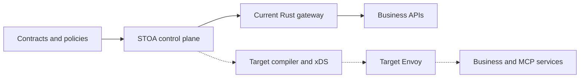

# Architecture Overview

:::info Current state and target direction
R1 currently uses the **Rust gateway**. **Envoy is the decided target**; migration remains ahead. This page does not attest availability or performance. See [the Envoy ADR](/docs/architecture/adr/adr-073-adopt-envoy-data-plane/).
:::

STOA is a Sovereign iPaaS with a European focus, with its gateway and control plane.

## High-Level Architecture

The control plane manages UAC contracts, policies and publication. The data plane executes requests. Publishing a contract alone does not establish its effective application.

Dotted arrows represent the target without implying a delivered integration.

## Core Components

| Role | Scope |
|---|---|
| FastAPI control plane | Contracts, policies, orchestration |
| Current Rust gateway | Execution of the R1 path |
| Target Envoy | Transport and routing after migration |
| Keycloak | Identity in the local path |
| PostgreSQL | Control plane database in Compose |
| Management interfaces | Console and Portal outside the R1 quickstart |

## Security Layer

Migration must preserve tenant isolation and per-contract audiences, denying access by default when a security decision is unavailable. Operators supply secrets; contracts and logs must not publish them.

## Data Layer

The quickstart does not require a broker. Event integrations in other paths are not a dependency to add to R1 Compose.

## Deployment

The [local quickstart](/docs/guides/quickstart/) is the main entry point. Other deployments need validation specific to their environment. Readers supply their own URLs and parameters; no operational inventory is published here.

## Next Steps

- [Detailed current and target view](/docs/architecture/architecture-overview/)
- [Implementation status](/docs/concepts/implementation-status/)
