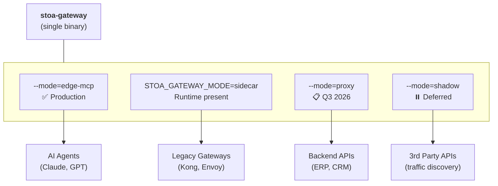

# STOA Gateway

## Overview

STOA Gateway is the unified API gateway component of the STOA Platform. It provides AI-native API management with 4 deployment modes to fit different use cases.

**Implementation**: Rust/Tokio/axum (`stoa-gateway/`) — in production since February 2026

See [ADR-024](../architecture/adr/adr-024-gateway-unified-modes) for the architecture decision.

## Architecture Vision



## Deployment Modes

### Edge-MCP Mode (Current)

**Status**: ✅ Production

The primary mode for AI agent integration via Model Context Protocol (MCP).

**Use Cases**:
- Claude Desktop integration
- Custom LLM agent access to enterprise APIs
- AI-powered automation workflows

**Features**:
- SSE (Server-Sent Events) transport
- JSON-RPC 2.0 message handling
- Dynamic tool registry from Kubernetes CRDs
- OAuth2/OIDC authentication via Keycloak
- OPA policy evaluation
- Kafka metering pipeline

**Example**:
```bash
stoa-gateway --mode=edge-mcp --port=3001
```

**Endpoints**:
- `GET /mcp/sse` — SSE endpoint for Claude Desktop
- `POST /mcp/v1/tools/{name}` — Tool invocation
- `GET /mcp/v1/tools` — List available tools

---

### Sidecar mode (companion runtime)

**Status**: runtime present. Same-pod packaging exists in the Helm chart and is off by default. No live third-party gateway call is recorded.

The same binary starts with `STOA_GATEWAY_MODE=sidecar` and answers `POST /authz`. The host keeps authentication, routing, and enforcement. The decision engine does not evaluate OPA and does not emit Kafka metering events. Mesh adapters are design notes.

The flags `--mode`, `--primary-gateway`, and `--metering-enabled` are not the runtime switch. See [Companion usage](../guides/companion-usage.md) for the request body, the three integration shapes, and the limits. GitOps sync to an existing gateway is [stoa-connect](../guides/stoa-connect-quickstart.md).

```text
Client → host gateway → POST /authz → stoa-gateway (sidecar)
                └── on 200 → backend
```

---

### Proxy Mode (Planned Q3 2026)

**Status**: 📋 Planned

Classic API gateway with full policy enforcement, for greenfield deployments.

**Use Cases**:
- New API deployments needing governance
- Replacing legacy gateways entirely
- Multi-tenant API platforms

**Features**:
- OPA policy evaluation (blocking)
- Rate limiting per tenant/consumer
- Request/response transformation
- Circuit breaker patterns
- mTLS termination

**Example**:
```bash
stoa-gateway --mode=proxy \
  --upstream=http://backend:8080 \
  --opa-endpoint=http://opa:8181
```

---

### Shadow Mode (Deferred)

**Status**: ⏸️ Deferred pending security review

Passive traffic observation for legacy API discovery. Deploy for 2 weeks, auto-generate interface contracts.

**Use Cases**:
- Legacy APIs with no documentation
- Black-box progiciels (SAP, Oracle, etc.)
- API inventory discovery

**Features** (planned):
- Zero modification to requests/responses
- Capture traffic patterns
- Auto-generate UAC contracts (HTTP parsing, no ML)
- Human-in-the-loop validation before promotion

**Example**:
```bash
stoa-gateway --mode=shadow \
  --target=http://legacy-erp:8080 \
  --output=/var/lib/stoa/uac
```

**Security Requirements** (before implementation):
- PII detection/masking before storage
- Explicit opt-in per API/tenant
- Retention < 30 days with auto-purge
- RGPD Article 25 compliance

---

## Configuration

### Environment Variables

| Variable | Description | Default |
|----------|-------------|---------|
| `GATEWAY_MODE` | Deployment mode | `edge-mcp` |
| `GATEWAY_PORT` | HTTP port | `3001` |
| `KEYCLOAK_URL` | Keycloak base URL | Required |
| `KEYCLOAK_REALM` | Keycloak realm | `stoa` |
| `OPA_ENABLED` | Enable OPA policy evaluation | `true` |
| `METERING_ENABLED` | Enable Kafka metering | `true` |

### Kubernetes CRDs

The gateway watches for Tool and ToolSet CRDs:

```yaml
apiVersion: gostoa.dev/v1alpha1
kind: Tool
metadata:
  name: my-api-tool
  namespace: tenant-acme
spec:
  displayName: My API Tool
  description: A sample tool
  endpoint: https://api.example.com/v1/action
  method: POST
```

See [MCP Tools Reference](../reference/mcp-tools) for full schema.

## Implementation

| Aspect | Details |
|--------|---------|
| Directory | `stoa-gateway/` |
| Language | Rust (stable) |
| Framework | Tokio + axum |
| Status | Production (since Feb 2026) |
| Active Mode | edge-mcp |
| Sidecar | Runtime present. Limits in [Companion usage](../guides/companion-usage.md) |
| Planned Modes | proxy (Q3 2026), shadow (deferred) |

## Related Documentation

- [Companion usage](../guides/companion-usage.md)
- [ADR-024: Unified Gateway Architecture](../architecture/adr/adr-024-gateway-unified-modes)
- [MCP Protocol Specification](https://modelcontextprotocol.io/)
- [MCP Gateway API Reference](../api/mcp-gateway)
- [ADR-021: UAC-Driven Observability](../architecture/adr/adr-021-uac-driven-observability)
