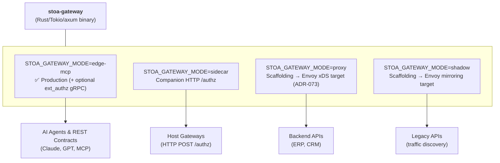

# STOA Gateway

## Overview

STOA Gateway (`stoa-gateway/`, Rust/Tokio/axum) is the unified AI-native gateway runtime in production since February 2026. It exposes four `STOA_GATEWAY_MODE` profiles ([ADR-024](../architecture/adr/adr-024-gateway-unified-modes)) and an optional Envoy gRPC `ExtAuthzService` listener.

:::info Data Plane Evolution (ADR-073)
Under [ADR-073: Adopt Envoy as Primary Data Plane](../architecture/adr/adr-073-adopt-envoy-data-plane), `stoa-gateway` is in **Production / Maintenance** while L4/L7 proxy duties converge onto upstream **Envoy** configured via **STOA Link** (`stoa-connect` loopback mTLS ADS) and authorized by `stoa-gateway`'s built-in gRPC `ExtAuthzService` (`STOA_EXT_AUTHZ_GRPC_ADDR`, `STOA_EXT_AUTHZ_AUDIENCE`, and non-empty `STOA_EXT_AUTHZ_REQUIRED_SCOPES` in `prod`). Full policy parity and default topology migration remain in progress ([Data Plane Architecture](../architecture/data-plane)).
:::

## Architecture Vision



## Deployment Modes

### Edge-MCP Mode (Current Default)

**Status**: ✅ Production (Maintenance under [ADR-073](../architecture/adr/adr-073-adopt-envoy-data-plane))

The primary mode for AI agent integration via the Model Context Protocol (MCP) and contract-driven REST routes.

**Use Cases**:
- Claude.ai and Claude Desktop integration
- Custom LLM agent access to enterprise APIs
- Transactional REST + MCP API contracts (`POST /admin/contracts`)

**Features**:
- Streamable HTTP (`POST /mcp`), SSE (`GET/POST/DELETE /mcp/sse`), and opt-in WebSocket (`GET /mcp/ws` when `STOA_WEBSOCKET_ENABLED=true`)
- JSON-RPC 2.0 single and batch message handling (`2025-11-25`, `2025-03-26`, `2024-11-05`)
- Dynamic tool registry from Kubernetes CRDs (`Tool`, `ToolSet`, `Skill`) and Control Plane sync
- OAuth2/OIDC authentication via Keycloak (`stoa` realm, verified `tenant_id` claim, [ADR-074](../architecture/adr/adr-074-tenant-model))
- Fail-closed signed Ed25519 per-tenant policy enforcement ([ADR-070](/docs/architecture/adr/adr-070-gateway-fail-closed-posture)) and OPA evaluation
- Optional gRPC `envoy.service.auth.v3.Authorization` server (`STOA_EXT_AUTHZ_GRPC_ADDR` + `STOA_EXT_AUTHZ_AUDIENCE` + non-empty `STOA_EXT_AUTHZ_REQUIRED_SCOPES` in `prod`)

**Example**:
```bash
STOA_GATEWAY_MODE=edge-mcp \
STOA_PORT=8080 \
STOA_KEYCLOAK_URL=https://auth.example.com \
STOA_KEYCLOAK_REALM=stoa \
STOA_MCP_AUDIENCE=stoa-mcp \
stoa-gateway
```

**Primary Endpoints**:
- `POST /mcp` — Streamable HTTP JSON-RPC 2.0 entrypoint
- `GET /mcp/sse` & `POST /mcp/sse` — SSE transport
- `GET /mcp/v1/tools` & `POST /mcp/v1/tools/invoke` — Companion JWT-gated REST tool endpoints

---

### Sidecar Mode (Companion Runtime)

**Status**: Runtime present. Same-pod packaging exists in `charts/stoa-platform` (`stoaSidecar.enabled=false` by default).

The same binary starts with `STOA_GATEWAY_MODE=sidecar` and answers HTTP `POST /authz`. The host gateway keeps authentication, routing, and verdict enforcement. The HTTP companion decision engine does not evaluate OPA and does not emit Kafka metering events.

:::note Envoy gRPC `ext_authz` vs HTTP Companion
`stoa-gateway` is configured exclusively via `STOA_*` environment variables or `config.yaml` (not `--mode` CLI flags). For Envoy's native `envoy.filters.http.ext_authz` gRPC filter ([ADR-073](../architecture/adr/adr-073-adopt-envoy-data-plane)), set `STOA_EXT_AUTHZ_GRPC_ADDR`, `STOA_EXT_AUTHZ_AUDIENCE`, and `STOA_EXT_AUTHZ_REQUIRED_SCOPES` (required non-empty when `STOA_ENVIRONMENT=prod`) rather than `POST /authz`. See [Companion usage](../guides/companion-usage.md) for HTTP `/authz` limits and [stoa-connect](../guides/stoa-connect-quickstart.md) for control-plane sync and loopback mTLS ADS.
:::

```text
Client → host gateway → POST /authz → stoa-gateway (sidecar)
                └── on 200 → backend
```

---

### Proxy Mode

**Status**: Rust scaffolding present; full L7 API proxy targeted on upstream Envoy via xDS ([ADR-073 §8](../architecture/adr/adr-073-adopt-envoy-data-plane))

Classic API gateway profile for greenfield REST/gRPC traffic with full policy enforcement.

**Use Cases**:
- New API deployments needing centralized governance
- Replacing legacy gateways without MCP tool exposure
- Multi-tenant API platforms

**Capabilities & Trajectory**:
- `stoa-gateway` already serves dynamic contract routes (`POST /admin/contracts`) and API proxy backends in `edge-mcp` mode
- Under [ADR-073 §8](../architecture/adr/adr-073-adopt-envoy-data-plane), standalone `proxy` mode maps to an Envoy listener/cluster profile reconciled over xDS with `ExtAuthzService` gRPC enforcement

---

### Shadow Mode

**Status**: ⏸️ Rust capture scaffolding present; production traffic mirroring targeted on Envoy ([ADR-073 §8](../architecture/adr/adr-073-adopt-envoy-data-plane)) pending security review

Passive traffic observation for legacy API discovery and UAC contract generation without modifying live responses.

**Use Cases**:
- Legacy APIs with missing or stale OpenAPI specs
- Black-box enterprise applications (SAP, Oracle, ERP)
- API inventory discovery

**Security Requirements** (before production enablement):
- PII detection and masking before storage
- Explicit opt-in per API and tenant
- Retention < 30 days with automatic purge
- GDPR Article 25 data-protection-by-design compliance

---

## Configuration

### Environment Variables

`stoa-gateway` reads `STOA_*` environment variables (and optional `config.yaml`):

| Variable | Description | Default |
|----------|-------------|---------|
| `STOA_GATEWAY_MODE` | Deployment mode (`edge-mcp`, `sidecar`, `proxy`, `shadow`) | `edge-mcp` |
| `STOA_PORT` | HTTP listener port | `8080` |
| `STOA_KEYCLOAK_URL` | Canonical Keycloak base URL | Optional (required for OIDC) |
| `STOA_KEYCLOAK_REALM` | Shared Keycloak realm ([ADR-074](../architecture/adr/adr-074-tenant-model)) | `stoa` (in Helm/Compose) |
| `STOA_MCP_AUDIENCE` | Required JWT `aud` for MCP endpoints (mandatory when `STOA_ENVIRONMENT=prod`) | Unset (fail-closed) |
| `STOA_POLICY_ENABLED` | Enforce signed Ed25519 per-tenant tool policies ([ADR-070](/docs/architecture/adr/adr-070-gateway-fail-closed-posture)) | `true` |
| `STOA_POLICY_BOOT_TENANTS` | Comma-separated tenant IDs whose signed policy must exist at startup | Empty |
| `STOA_EXT_AUTHZ_GRPC_ADDR` | Optional gRPC `ExtAuthzService` socket address for Envoy (`host:port`) | Unset |
| `STOA_EXT_AUTHZ_AUDIENCE` | Required JWT `aud` for Envoy gRPC `ext_authz` checks (mandatory in `prod`) | Unset (fail-closed) |
| `STOA_EXT_AUTHZ_REQUIRED_SCOPES` | Comma-separated required JWT scopes for Envoy gRPC `ext_authz` (mandatory non-empty in `prod`) | Empty |
| `STOA_K8S_ENABLED` | Enable Kubernetes `Tool`/`ToolSet`/`Skill` CRD watcher (requires Cargo `k8s` feature) | `false` |
| `STOA_KAFKA_ENABLED` | Enable internal Kafka/Redpanda metering producer | `false` |

### Kubernetes CRDs

When compiled with the `k8s` Cargo feature and started with `STOA_K8S_ENABLED=true`, `stoa-gateway` watches `Tool`, `ToolSet`, and `Skill` resources (`gostoa.dev/v1alpha1`):

```yaml
apiVersion: gostoa.dev/v1alpha1
kind: Tool
metadata:
  name: my-api-tool
  namespace: stoa-system
spec:
  displayName: My API Tool
  description: A sample tool
  endpoint: https://api.example.com/v1/action
  method: POST
  inputSchema:
    type: object
    properties:
      query:
        type: string
```

See [Kubernetes CRDs Reference](../reference/crds) for all five CRDs (`Tool`, `ToolSet`, `Skill`, `GatewayInstance`, `GatewayBinding`).

## Implementation Summary

| Aspect | Details |
|--------|---------|
| Directory | `stoa-gateway/` |
| Language & Runtime | Rust (stable), Tokio + axum + tonic |
| Lifecycle Status | Production / Maintenance ([ADR-073](../architecture/adr/adr-073-adopt-envoy-data-plane)) |
| Primary Active Mode | `edge-mcp` (plus optional `ExtAuthzService` gRPC listener) |
| Companion Mode | `sidecar` HTTP `POST /authz` ([Companion usage](../guides/companion-usage.md)) |
| Target Proxy & Shadow | Upstream Envoy via `stoa-connect` xDS ADS ([ADR-073](../architecture/adr/adr-073-adopt-envoy-data-plane)) |

## Related Documentation

- [Data Plane Architecture](../architecture/data-plane)
- [ADR-073: Adopt Envoy as Primary Data Plane](../architecture/adr/adr-073-adopt-envoy-data-plane)
- [Companion usage](../guides/companion-usage.md)
- [ADR-024: Unified Gateway Architecture](../architecture/adr/adr-024-gateway-unified-modes)
- [MCP Gateway API Reference](../api/mcp-gateway)
