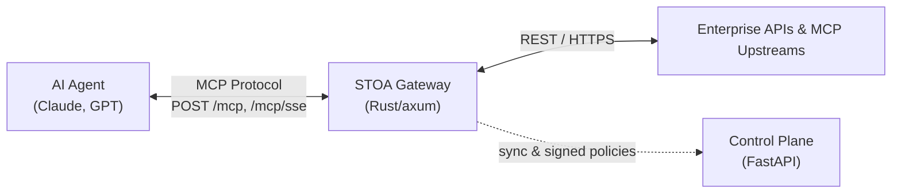
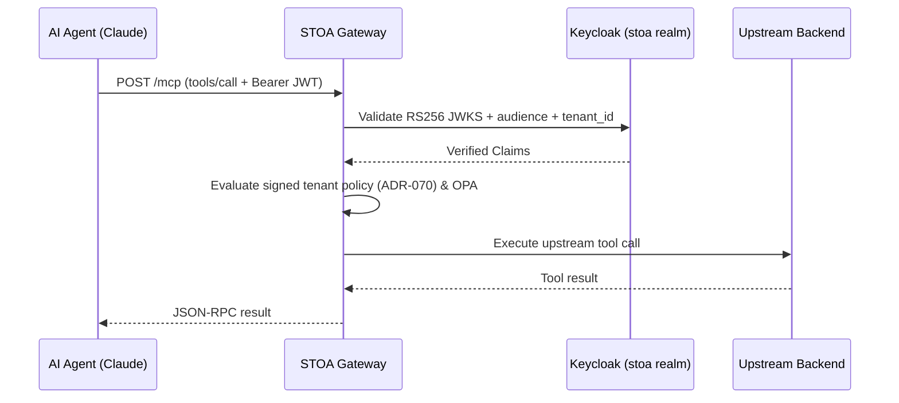

# MCP Gateway

STOA's MCP Gateway (`stoa-gateway`) is a **purpose-built MCP-native API Gateway**, enabling AI agents like Claude, GPT, and custom LLM applications to securely consume enterprise APIs through the Model Context Protocol.

## Overview

The MCP Gateway acts as the governed bridge between AI agents and your API ecosystem. It handles OIDC authentication, audience verification, fail-closed per-tenant tool authorization, and rate limiting while speaking the native MCP protocol.



## Implementation

The MCP Gateway is built in `stoa-gateway/` with **Rust**, **Tokio**, and **axum** — in production since February 2026 (replacing the archived Python prototype). Under [ADR-073](/docs/architecture/adr/adr-073-adopt-envoy-data-plane), `stoa-gateway` is in **Production / Maintenance** and evolves toward an MCP protocol service operating behind upstream Envoy.

| Aspect | Details |
|--------|---------|
| Language | Rust (stable) |
| Framework | Tokio + axum |
| Policy Engine | Signed Ed25519 policy artifacts ([ADR-070](/docs/architecture/adr/adr-070-gateway-fail-closed-posture)) + OPA |
| Protocol | MCP `2025-11-25` (negotiating `2025-03-26` and `2024-11-05`) |
| Status | Production / Maintenance ([ADR-073](/docs/architecture/adr/adr-073-adopt-envoy-data-plane)) |

## Key Features

### 🔐 Enterprise Security
- **Keycloak OIDC integration** on the shared `stoa` realm with per-tenant groups and verified `tenant_id` JWT claims ([ADR-074](/docs/architecture/adr/adr-074-tenant-model))
- Mandatory audience verification via `STOA_MCP_AUDIENCE` (fail-closed in production)
- Signed Ed25519 per-tenant policy bundles ([ADR-070](/docs/architecture/adr/adr-070-gateway-fail-closed-posture))

### 🏢 Multi-Tenant Isolation
- Verified JWT `tenant_id` scoping across tool discovery (`tools/list`), invocation (`tools/call`), and `stoa://tools/{name}` resource URIs
- Optional dedicated Kubernetes namespaces and `NetworkPolicy` isolation for tenant workloads
- Per-tenant rate limiting and quotas

### 📊 Full Observability
- Prometheus metrics (`GET /metrics` on the gateway HTTP listener)
- OpenTelemetry trace propagation with correlation IDs
- Durable audit WAL spool (`STOA_AUDIT_SPOOL_DIR`) and optional Redpanda/Kafka metering

### ⚡ Production Ready
- Async request handling in Rust/Tokio with single and batch JSON-RPC 2.0 support
- Optional token optimization (`X-Token-Optimization` / `tokenOptimization` capability)
- Fail-closed startup readiness (`STOA_POLICY_BOOT_TENANTS`)

## MCP Protocol Support

STOA implements the [MCP specification](https://modelcontextprotocol.io/) (`2025-11-25`, with protocol negotiation for `2025-03-26` and `2024-11-05`).

### Supported JSON-RPC Methods

| Method | Runtime Behavior |
|--------|------------------|
| `initialize` / `ping` | Protocol handshake and liveness check (permitted before bearer auth) |
| `tools/list` | Discover tools visible to the caller's verified `tenant_id` |
| `tools/call` | Invoke an authorized tool |
| `resources/list` / `resources/read` | List and read tool descriptors exposed as `stoa://tools/{name}` |
| `resources/templates/list` | Returns the `stoa://tools/{name}` URI template |
| `prompts/list` / `prompts/get` | Declared in handshake; `prompts/list` currently returns `[]` and `prompts/get` returns `-32002` (prompt registry not populated yet) |

See the [MCP Gateway API Reference](/docs/api/mcp-gateway) for the complete distinction between JSON-RPC methods on `POST /mcp`, companion JWT-gated REST routes, and declared vs effective capabilities.

### Transport Options

- **Streamable HTTP (`POST /mcp`)**: Primary MCP `2025-03-26+` transport using the `Mcp-Session-Id` header (returns JSON or `text/event-stream` when requested via `Accept`)
- **HTTP + SSE (`GET /mcp/sse`, `POST /mcp/sse`, `DELETE /mcp/sse`)**: Server-Sent Events transport (`?sessionId=`)
- **WebSocket (`GET /mcp/ws`)**: Opt-in bidirectional JSON-RPC transport enabled via `STOA_WEBSOCKET_ENABLED=true` (returns `404` when disabled by default)

## Authentication Flow



## Multi-Tenant Tool Visibility

Each authenticated caller only sees tools scoped to its verified `tenant_id` (or global tools), unless granted platform-wide admin access:

| Tenant | Visible Tools |
|--------|---------------|
| **Parzival** (`high-five`) | `stoa_*`, `high-five:*` |
| **Sorrento** (`ioi`) | `stoa_*`, `ioi:*` |
| **Halliday** (`cpi-admin`) | Cross-tenant administrative visibility |

## Configuration

### Environment Variables

```bash
# Listener
STOA_HOST=0.0.0.0
STOA_PORT=8080

# Control Plane
STOA_CONTROL_PLANE_URL=http://control-plane-api:8000

# Keycloak (shared stoa realm — ADR-074)
STOA_KEYCLOAK_URL=https://auth.<YOUR_DOMAIN>
STOA_KEYCLOAK_REALM=stoa
STOA_MCP_AUDIENCE=stoa-mcp

# Fail-closed tenant policy enforcement (ADR-070)
STOA_POLICY_ENABLED=true
STOA_POLICY_BOOT_TENANTS=acme
```

### Kubernetes Deployment

Deploy `stoa-gateway` via the `./charts/stoa-platform` Helm chart using a digest-pinned image (`repository` + `sha256` digest):

```yaml
stoaGateway:
  image:
    repository: ghcr.io/stoa-platform/stoa-gateway
    digest: "sha256:<64-hex-digest>"
  policyBootTenants:
    - acme
```

## Integration with Claude.ai

1. **Configure MCP Server** in Claude.ai / MCP client settings (`https://mcp.<YOUR_DOMAIN>/mcp` or `/mcp/sse`)
2. **Authenticate** via OAuth 2.1 PKCE discovery (`/.well-known/oauth-protected-resource`) against the `stoa` Keycloak realm
3. **Discover tools** automatically via `tools/list`
4. **Invoke tools** through natural conversation

### Example Tool Invocation

```json
{
  "jsonrpc": "2.0",
  "id": 1,
  "method": "tools/call",
  "params": {
    "name": "stoa_catalog",
    "arguments": {
      "action": "list",
      "status": "active"
    }
  }
}
```

## Metrics & Monitoring

### Prometheus Metrics

`stoa-gateway` exposes Prometheus metrics at `GET /metrics` on its HTTP port (`8080` by default), tracking MCP JSON-RPC requests, tool latency histograms, active sessions, and policy/auth rejections by tenant.

### Grafana Dashboards

Dashboards in `charts/stoa-observability` visualize:
- Request throughput and latency percentiles
- Tool invocation patterns by tenant
- Policy and authentication rejection rates
- Rate limiting events

## Next Steps

- [Quick Start Guide](/docs/guides/quickstart) — Run STOA locally
- [MCP Gateway API Reference](/docs/api/mcp-gateway) — JSON-RPC methods, REST companion endpoints, and capabilities
- [Authentication Guide](/docs/guides/authentication) — Configure Keycloak OIDC (`stoa` realm)
