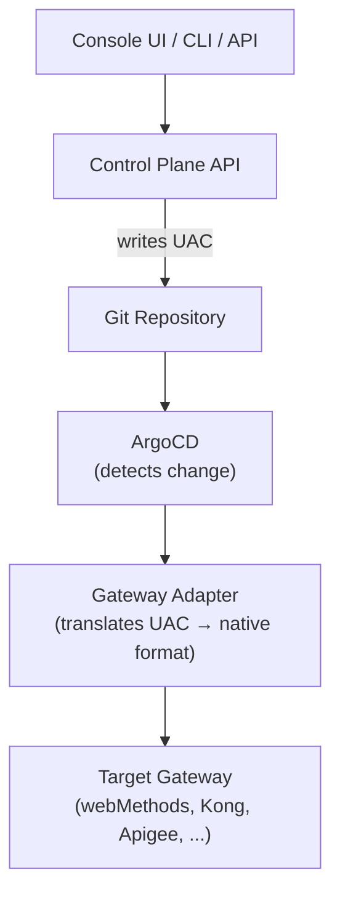

# Universal API Contract (UAC)

The Universal API Contract (UAC) is STOA's **gateway-agnostic API definition format**. It normalizes API specifications into a common model that can be reconciled to any supported gateway.

## Why UAC?

Different API gateways use different configuration formats:

- webMethods uses its own REST API with specific resource models
- Kong uses declarative YAML with services, routes, and plugins
- Apigee uses API proxies with proxy endpoints and target endpoints

UAC provides a single definition that STOA translates to each gateway's native format through the [Gateway Adapter](../guides/console#gateway-adapters) pattern.

## UAC Structure

A UAC contract is a JSON document validated against the UAC v1 JSON Schema (`uac_contract_v1_schema.json` in the Control Plane API, mirrored by the gateway's Rust types). YAML is shown here for readability and converts 1:1 to JSON:

```yaml
name: catalog-api                 # kebab-case, unique within the tenant
version: 1.0.0                    # semantic version
tenant_id: example                # owning tenant
display_name: Catalog API
description: Read access to the product catalog
classification: H                 # H | VH | VVH (DORA-aligned ICT risk level)
required_policies: [rate-limit, auth-jwt]   # derived from classification
status: published                 # draft | published | deprecated

endpoints:
  - path: /catalog/items/{item_id}
    methods: [GET]
    backend_url: https://backend.example.local/v1/catalog
    operation_id: get_catalog_item
    # Optional LLM-facing metadata: drives the MCP tool projection
    llm:
      summary: Fetch a catalog item by id.
      intent: Use when an agent needs read-only details about a known item.
      tool_name: catalog_get_item
      side_effects: read            # none | read | write | destructive
      safe_for_agents: true
      requires_human_approval: false
      examples:
        - input: { item_id: sku-1234 }
          expected_output_contains: { id: sku-1234 }
```

Serialized as JSON, this document is accepted unchanged by the gateway's `POST /admin/contracts` endpoint. A `published` contract must declare at least one endpoint with a `backend_url`.

## UAC in the GitOps Flow

The UAC is the artifact that flows through the GitOps pipeline:



## UAC Components

### Contract

| Field | Required | Description |
|-------|----------|-------------|
| `name` | Yes | Unique contract name within the tenant (kebab-case) |
| `version` | Yes | Semantic version (`MAJOR.MINOR.PATCH`) |
| `tenant_id` | Yes | Owning tenant identifier |
| `classification` | Yes | ICT risk level: `H`, `VH` or `VVH` |
| `status` | Yes | Lifecycle: `draft`, `published` or `deprecated` |
| `display_name`, `description` | No | Human-readable name and description |
| `required_policies` | No | Policies derived from the classification (recomputed on upsert) |
| `source_spec_url`, `spec_hash` | No | Source OpenAPI URL and hash used for drift detection |
| `llm_config` | No | LLM backend configuration for AI-powered contracts |

Classification drives the required policies: `H` requires `rate-limit` and `auth-jwt`; `VH` adds `mtls` and `audit-logging`; `VVH` adds `data-encryption` and `geo-restriction`.

### Endpoint

Operations are listed under `endpoints[]`. Each entry becomes a REST route and, when projected, an MCP tool.

| Field | Required | Description |
|-------|----------|-------------|
| `path` | Yes | URL path pattern, e.g. `/catalog/items/{item_id}` |
| `methods` | Yes | Allowed HTTP methods (`GET`, `POST`, `PUT`, `PATCH`, `DELETE`, `HEAD`, `OPTIONS`) |
| `backend_url` | Yes | Backend URL to proxy requests to |
| `operation_id` | No | OpenAPI operationId, used for MCP tool naming |
| `input_schema`, `output_schema` | No | JSON Schema for request and response bodies |
| `llm` | No | LLM-facing metadata for the MCP tool projection (see below) |

### LLM metadata

`endpoint.llm` is optional in v1: a `published` contract whose endpoint lacks it gets a validation warning, while a malformed block is an error. When present, every field is required:

| Field | Description |
|-------|-------------|
| `summary` | Short human-readable tool summary |
| `intent` | When an agent should use this endpoint |
| `tool_name` | Stable MCP tool name, unique within the contract |
| `side_effects` | `none`, `read`, `write` or `destructive` |
| `safe_for_agents` | Whether autonomous agents may call the endpoint |
| `requires_human_approval` | Whether a human approval step precedes invocation |
| `examples` | At least one example with `input` and an optional `expected_output_contains` |

Hard rule: `side_effects: destructive` requires `requires_human_approval: true`. The validator rejects the contract otherwise.

## Gateway Adapter Translation

Each Gateway Adapter implements the translation from UAC to native format:

```python
class GatewayAdapterInterface:
    def sync_api(self, api_spec: dict, tenant_id: str) -> AdapterResult:
        """Translate UAC and sync to target gateway."""

    def upsert_policy(self, policy_spec: dict) -> AdapterResult:
        """Translate and apply policy."""

    def provision_application(self, app_spec: dict) -> AdapterResult:
        """Provision consumer access."""
```

The adapter guarantees **idempotent** operations — syncing the same UAC twice produces identical results on the gateway.

**Legacy adapter input.** The `api_spec` dictionary passed to `sync_api` is the deployment's desired state, a flat structure keyed by `api_name`/`apiName` that the Control Plane derives for each adapter. It is not the UAC contract format shown above and is not accepted by the contract endpoints.

## Shadow Mode (Future)

In the planned **shadow** gateway mode, STOA will be able to auto-generate UAC definitions by passively capturing API traffic. This enables onboarding existing APIs without manual specification:

1. Deploy STOA Gateway in shadow mode alongside existing traffic
2. Capture request/response patterns
3. Auto-generate UAC with inferred schemas and policies
4. Review and publish via Console UI
