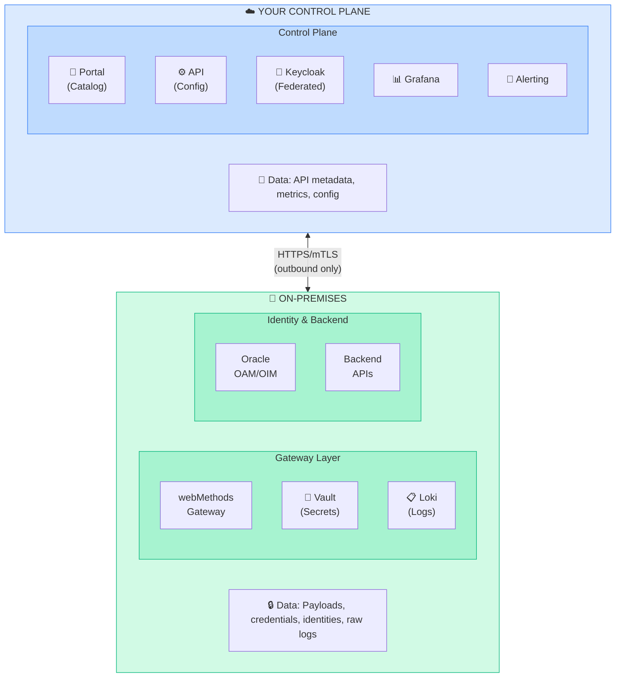
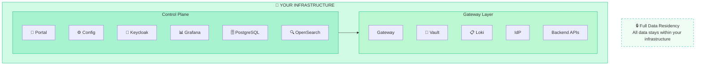
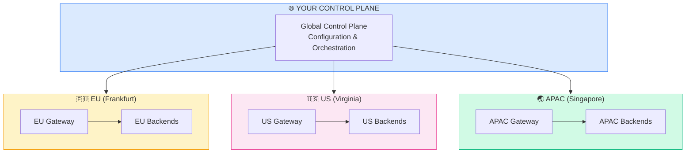
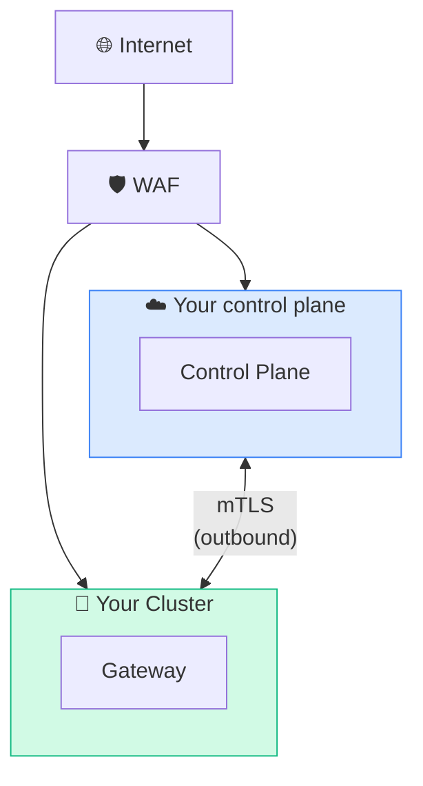

# Hybrid Deployment

:::caution No vendor-hosted cloud
The public STOA cloud was shut down on 23 May 2026. STOA does not operate a control plane for you. Every model on this page is a deployment **you** install and run. "Split placement" means you put the control plane and the gateway on different networks that you operate.
:::

STOA Platform supports multiple deployment models to match your security, sovereignty, and operational requirements.

## Deployment Models

| Model | Control Plane | Gateway | Data Residency | Best For |
|-------|---------------|---------|----------------|----------|
| **Split placement** | Your infrastructure | Your infrastructure, next to the APIs | Payloads stay next to the gateway | Separate control-plane network |
| **Full on-premises** | Your infrastructure | Your infrastructure | Full on-prem | Maximum sovereignty |
| **Multi-site** | Your infrastructure | Several sites you operate | Distributed | Several regions you run yourself |

---

## Model 1: Split placement

**Your control plane and your gateway**

You run both. The gateway stays next to your APIs. The control plane can sit on another network you operate. STOA does not host either plane.



### What Stays On-Premises

| Data Type | Description | Encryption |
|-----------|-------------|------------|
| **API Payloads** | Request/response bodies | TLS in transit |
| **Credentials** | API keys, tokens, certificates | AES-256 at rest (Vault) |
| **User Identities** | Oracle OAM/OIM directory | Existing controls |
| **Raw Logs** | Full transaction details | Customer-controlled |
| **Secrets** | HashiCorp Vault data | AES-256-GCM |

### What Goes to Cloud

| Data Type | Description | Sensitivity |
|-----------|-------------|-------------|
| **API Metadata** | Names, descriptions, OpenAPI specs | Low |
| **Aggregated Metrics** | Request counts, latencies, errors | Low |
| **Configuration** | Routing rules, policies | Low |
| **Federated Tokens** | Short-lived, no credentials | Low |

### Network Requirements

| Direction | Protocol | Ports | Purpose |
|-----------|----------|-------|---------|
| **Gateway network → your control plane** | HTTPS | 443 | Config sync, metrics push |
| **Control plane → gateway network** | None | — | No inbound required |

**Key security benefit:** No inbound connections required. All communication is initiated from your infrastructure.

### Prerequisites

- Kubernetes 1.28+ cluster on-premises
- Outbound HTTPS only to endpoints you operate (your control plane, container registry, identity provider)
- DNS resolution for STOA services
- Existing identity provider (OAM, Okta, Azure AD)

---

## Model 2: Full On-Premises

**Maximum Sovereignty**

For organizations requiring complete control over all components.



### When to Choose Full On-Premises

- Regulatory requirement for 100% data residency
- Air-gapped environments
- Government or defense sector
- Extreme compliance requirements (banking regulators)

### Additional Requirements

| Component | On-Premises Requirement |
|-----------|------------------------|
| **Kubernetes** | Production cluster (3+ nodes) |
| **PostgreSQL** | HA setup (primary + replica) |
| **OpenSearch** | Cluster for logs and search |
| **Object Storage** | S3-compatible (MinIO) |
| **TLS Certificates** | PKI or Let's Encrypt |

### Trade-offs

| Aspect | Split placement | Full on-prem |
|--------|-----------------|--------------|
| Operational complexity | Two networks you run | One perimeter |
| Updates | You apply them on both sides | You apply them |
| Support | Community, or a support contract | Community, or a support contract |
| Data residency | Metadata on the control-plane network you choose | 100% in one perimeter |
| Initial setup | You install both planes | You install the full stack |

---

## Model 3: Multi-Cloud (Future)

**Global Distribution**

For organizations requiring presence in multiple regions or clouds.



### Planned Capabilities

- Geographic load balancing
- Data residency per region
- Cross-region failover
- Unified global dashboard

**Status:** Roadmap Q4 2026

---

## Data Flow Summary

### Hybrid Model Data Matrix

| Data | Direction | Encryption | Frequency |
|------|-----------|------------|-----------|
| Config | Cloud → On-prem | mTLS | On change |
| Metrics (aggregated) | On-prem → Cloud | TLS | Every 15s |
| Alerts | Cloud → Ops team | TLS | On trigger |
| Tokens (federated) | Cloud ↔ On-prem | TLS | Per request |
| Payloads | Designed to remain on-prem | N/A | N/A |
| Credentials | Designed to remain on-prem | N/A | N/A |

### Network Diagram



---

## Getting Started

### Hybrid Deployment Quick Start

The public chart host and the private-beta gate were retired on 23 May 2026. Install from source, and point the gateway at a control plane **you** run:

```bash
git clone https://github.com/stoa-platform/stoa.git
kubectl create namespace stoa-system
helm install stoa-platform ./stoa/charts/stoa-platform \
  --namespace stoa-system \
  --set stoaGateway.controlPlaneUrl="https://api.stoa.example"
kubectl get pods -n stoa-system
```

Replace `api.stoa.example` with your control plane. See the [installation guide](/docs/admin/installation).

### Full On-Premises Quick Start

```bash
# 1. Install prerequisites
helm install postgresql bitnami/postgresql -n stoa-system
helm install opensearch opensearch/opensearch -n stoa-system
helm install vault hashicorp/vault -n stoa-system

# 2. Install STOA full stack
helm install stoa stoa/stoa-full \
  --namespace stoa-system \
  --set mode=on-premises \
  --values your-values.yaml
```

---

## Next Steps

- [Security & Compliance](/docs/enterprise/security-compliance) — Data residency details
- [Migration Guides](/docs/guides/migration) — Move from legacy platforms
- [Architecture Overview](/docs/concepts/architecture) — Component deep dive

---

*Need help choosing the right deployment model? [Contact us](mailto:contact@gostoa.dev) for an architecture consultation.*
