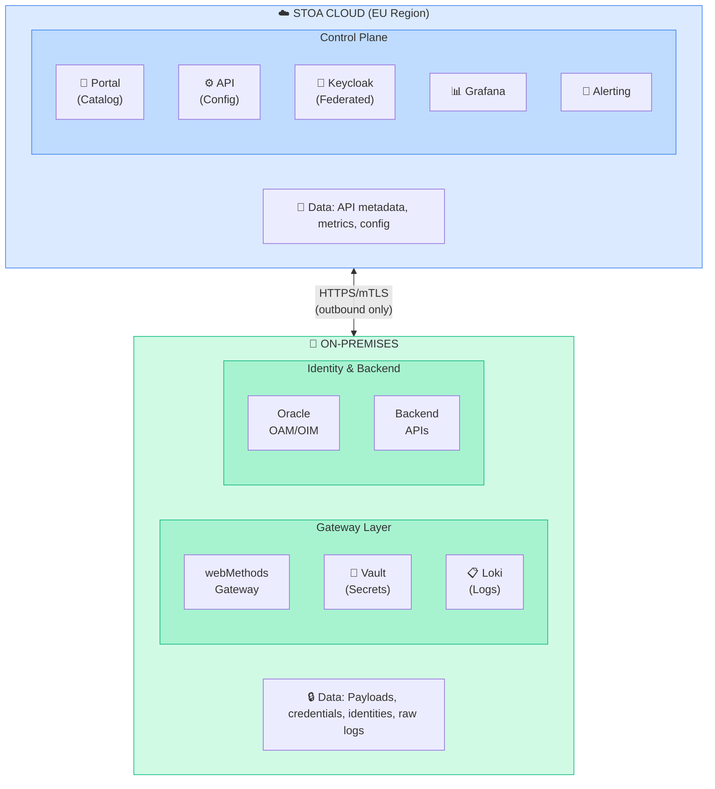
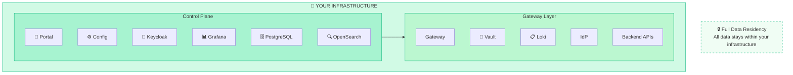
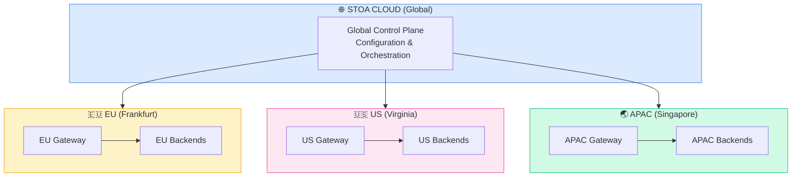
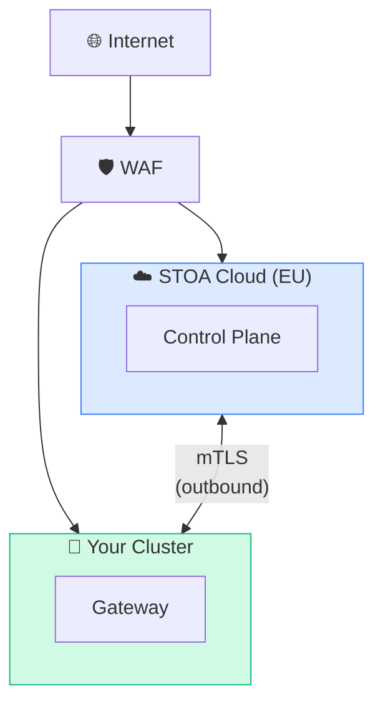

# Hybrid Deployment

STOA Platform supports multiple deployment models to match your security, sovereignty, and operational requirements.

## Deployment Models

| Model | Control Plane | Gateway | Data Residency | Best For |
|-------|---------------|---------|----------------|----------|
| **Hybrid** | STOA Cloud (EU) | On-Premises | Business data on-prem | Most enterprises |
| **Full On-Premises** | Your infrastructure | Your infrastructure | Full on-prem | Max sovereignty |
| **Multi-Cloud** | STOA Cloud | Multiple regions | Distributed | Global organizations |

---

## Model 1: Hybrid (Recommended)

**Control Plane Cloud + Gateway On-Premises**

The default deployment model balances ease of management with data sovereignty.



### What Stays On-Premises

| Data Type | Description | Encryption |
|-----------|-------------|------------|
| **API Payloads** | Request/response bodies | TLS in transit |
| **Credentials** | API keys, tokens, certificates | AES-256 at rest (Vault) |
| **User Identities** | Oracle OAM/OIM directory | Existing controls |
| **Raw Logs** | Full transaction details | Customer-controlled |
| **Secrets** | Secrets backend data (OpenBao or HashiCorp Vault) | AES-256-GCM |

### What Goes to Cloud

| Data Type | Description | Sensitivity |
|-----------|-------------|-------------|
| **API Metadata** | Names, descriptions, OpenAPI specs | Low |
| **Aggregated Metrics** | Request counts, latencies, errors | Low |
| **Configuration** | Routing rules, policies | Low |
| **Federated Tokens** | Short-lived, no credentials | Low |

### Network Requirements

| Direction | Protocol | Ports | Purpose |
|-----------|----------|-------|---------|
| **On-prem → Cloud** | HTTPS | 443 | Config sync, metrics push |
| **Cloud → On-prem** | None | — | No inbound required |

**Key security benefit:** No inbound connections required. All communication is initiated from your infrastructure.

### Prerequisites

- Kubernetes 1.28+ cluster on-premises
- Outbound HTTPS to STOA Cloud endpoints
- DNS resolution for STOA services
- Existing identity provider (OAM, Okta, Azure AD)

---

## Model 2: Full On-Premises

**Maximum Sovereignty**

For organizations requiring complete control over all components.



### When to Choose Full On-Premises

- Regulatory requirement for 100% data residency
- Air-gapped environments
- Government or defense sector
- Extreme compliance requirements (banking regulators)

### Additional Requirements

| Component | On-Premises Requirement |
|-----------|------------------------|
| **Kubernetes** | Production cluster (3+ nodes) |
| **PostgreSQL** | HA setup (primary + replica) |
| **OpenSearch** | Cluster for logs and search |
| **Object Storage** | S3-compatible (MinIO) |
| **TLS Certificates** | PKI or Let's Encrypt |

### Trade-offs

| Aspect | Hybrid | Full On-Prem |
|--------|--------|--------------|
| Operational complexity | Lower | Higher |
| Updates | Automatic | Manual |
| Support | Full | Limited self-service |
| Data residency | Metadata in cloud | 100% on-prem |
| Initial setup | 1-2 days | 1-2 weeks |

---

## Model 3: Multi-Cloud (Future)

**Global Distribution**

For organizations requiring presence in multiple regions or clouds.



### Planned Capabilities

- Geographic load balancing
- Data residency per region
- Cross-region failover
- Unified global dashboard

**Status:** Planned

---

## Data Flow Summary

### Hybrid Model Data Matrix

| Data | Direction | Encryption | Frequency |
|------|-----------|------------|-----------|
| Config | Cloud → On-prem | mTLS | On change |
| Metrics (aggregated) | On-prem → Cloud | TLS | Every 15s |
| Alerts | Cloud → Ops team | TLS | On trigger |
| Tokens (federated) | Cloud ↔ On-prem | TLS | Per request |
| Payloads | Designed to remain on-prem | N/A | N/A |
| Credentials | Designed to remain on-prem | N/A | N/A |

### Network Diagram



---

## Getting Started

### Hybrid Gateway Deployment (Kubernetes)

`charts/stoa-platform` is installed from a checkout of [`stoa-platform/stoa`](https://github.com/stoa-platform/stoa) (no public `charts.gostoa.dev` index is published) and deploys the **STOA Gateway** and its 5 CRDs. To connect an existing Kong, Gravitee, or webMethods gateway without Kubernetes, use [`stoa-connect` (STOA Link)](/docs/guides/stoa-connect-quickstart) instead. Hosted Control Plane access is available on request at [sales@gostoa.dev](mailto:sales@gostoa.dev).

```bash
# 1. Clone the repository at a verified revision
git clone https://github.com/stoa-platform/stoa.git
cd stoa
git checkout 639e8b9a2217695cfc2f590e246ed9d4ce4d4913

# 2. Install the on-premises STOA Gateway against your Control Plane and Keycloak URLs
helm upgrade --install stoa-platform ./charts/stoa-platform \
  -n stoa-system --create-namespace \
  -f my-values.yaml
```

Minimal `my-values.yaml` for a hybrid gateway (`stoaGateway.image` requires both `repository` and `digest` when overridden; see the [Installation Guide](/docs/admin/installation) for startup policy readiness requirements):

```yaml
stoa:
  domain: "<YOUR_DOMAIN>"

stoaGateway:
  controlPlaneUrl: "https://api.<YOUR_DOMAIN>"
  keycloakUrl: "https://auth.<YOUR_DOMAIN>"
  secretName: stoa-gateway-secrets
  policyBootTenants:
    - "<YOUR_TENANT_ID>"
  serviceMonitor:
    enabled: false
  otelEndpoint: ""

controlPlaneApi:
  serviceMonitor:
    enabled: false
gateway:
  edgeMcp:
    enabled: false
gatewaySync:
  enabled: false
```

:::warning Prerequisite before expecting `1/1 Ready`
This minimal values file alone will **not** bring pods to `1/1 Ready` (`/health` tests process liveness only, whereas `/ready` enforces `policyBootTenants` and fresh signed tool permissions). At commit `639e8b9a`, `charts/stoa-platform` mounts only `tmp` (`emptyDir`) and `stoa-gateway-policies` (`ConfigMap`) — before expecting `1/1 Ready`, mount the `private_key_jwt` signing-key Secret (`STOA_KEYCLOAK_CLIENT_KEY_PATH`, plus `STOA_KEYCLOAK_CLIENT_KEY_ID` via `extraEnv`) using a Deployment manifest overlay, Kustomize patch, or Helm `--post-renderer` as documented in [Startup Policy and Readiness](/docs/admin/installation#startup-policy-and-readiness).
:::

```bash
# 3. Check pod status (pods reach 1/1 Ready only after the private_key_jwt Secret is mounted and signed policies load)
kubectl get pods -n stoa-system
```

### Full On-Premises Stack

`charts/stoa-platform` deploys **only the STOA Gateway, 5 CRDs, and optional integration hooks** (`charts/stoa-observability` packages optional Grafana Alloy/Tempo/Blackbox telemetry). Provision PostgreSQL, Keycloak (single `stoa` realm), OpenSearch, the Control Plane API / Console / Developer Portal workloads, and — **if** your site uses an external secrets backend ([ADR-075](/docs/architecture/adr/adr-075-secrets-backend-openbao)) — optional OpenBao separately before installing the gateway chart:

```bash
# 1. Optional: install OpenBao only if your site uses an external secrets backend (ADR-075)
helm repo add openbao https://openbao.github.io/openbao-helm
helm repo update
helm install openbao openbao/openbao -n openbao --create-namespace

# 2. Deploy Control Plane API, Console, Portal, PostgreSQL, and Keycloak per your site manifests
#    (or evaluate locally via deploy/docker-compose — see /docs/guides/quickstart)

# 3. Install the STOA Gateway from the checked-out repository (with your values + private_key_jwt volume overlay)
helm upgrade --install stoa-platform ./charts/stoa-platform \
  -n stoa-system --create-namespace \
  -f your-values.yaml
```

For air-gapped sites with no outbound Internet access, follow [Offline Installation](/docs/deployment/offline-install).

---

## Next Steps

- [Security & Compliance](/docs/enterprise/security-compliance) — Data residency details
- [Migration Guides](/docs/guides/migration) — Move from legacy platforms
- [Architecture Overview](/docs/concepts/architecture) — Component deep dive

---

*Need help choosing the right deployment model? [Contact us](mailto:contact@gostoa.dev) for an architecture consultation.*
