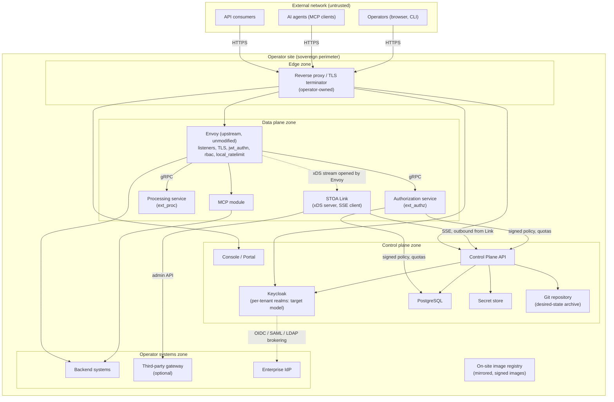
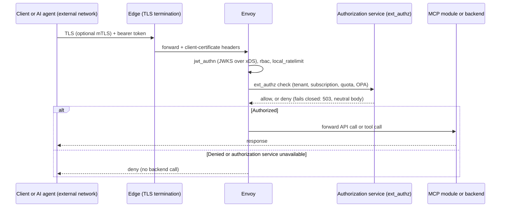
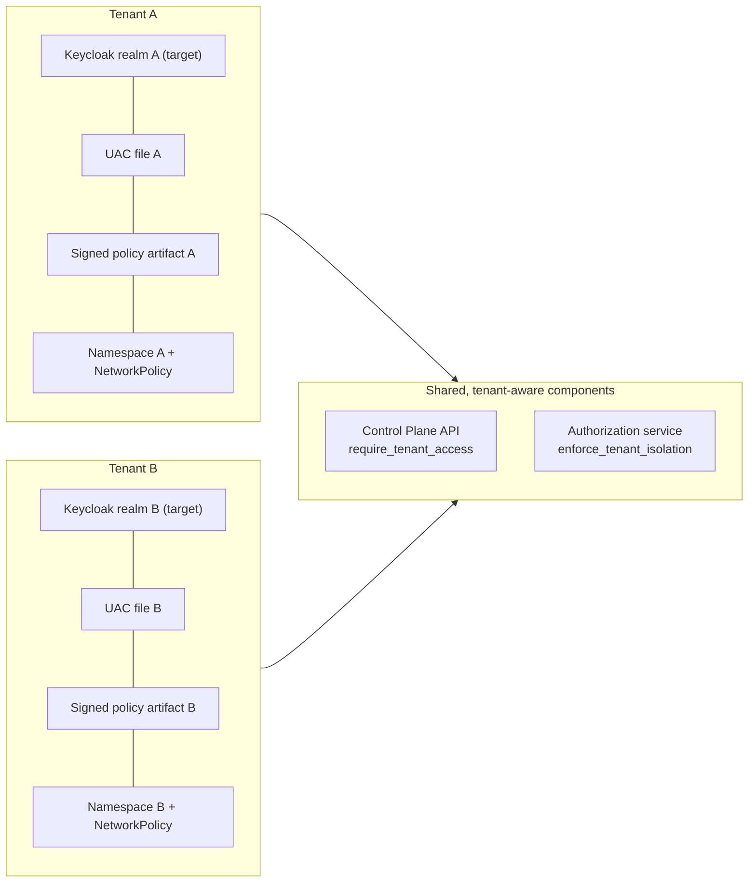

# Sovereign Deployment

In sovereign mode the control plane and the data plane both run inside the operator's own perimeter ([ADR-037](../architecture/adr/adr-037-deployment-modes-sovereign-first.md)). The hosted service was shut down on 2026-05-23; STOA is deployed on site. This page is a generic reference pattern: names are placeholders, no real infrastructure is described, and every statement points to a published ADR or a file of the `stoa` repository. Sizing, ports and DNS live in [Deployment Prerequisites](./prerequisites.md).

:::info Data plane status
[ADR-073](../architecture/adr/adr-073-adopt-envoy-data-plane.md) (2026-10-22) decides that the data plane uses upstream Envoy, configured only over xDS served on site by STOA Link, with STOA logic in external services called by Envoy. The Link xDS server is decided but not yet implemented (ADR-073 §7); the diagrams below show the decided target. The current data plane, STOA Gateway (Rust), is in maintenance (ADR-073 §9).
:::

## 1. Network topology

| Flow | Direction and protocol | Source |
|------|------------------------|--------|
| Consumers, agents and operators → edge | HTTPS, initiated by the client; the only inbound entry to the site | [Prerequisites §2](./prerequisites.md#2-network-flow-matrix) |
| Edge → Envoy, Console, Portal, API, Keycloak | TLS terminated at the edge; client-certificate data forwarded as headers from a trusted proxy only | [ADR-027](../architecture/adr/adr-027-x509-header-authentication.md), [ADR-039](../architecture/adr/adr-039-mtls-cert-bound-tokens.md) |
| Envoy → authorization and processing services | gRPC `ext_authz` and `ext_proc`; services co-located with Envoy | ADR-073 §4, Mitigations |
| Envoy ↔ STOA Link | Envoy opens the xDS stream to the local Link; Link serves versioned snapshots generated from UAC contracts | ADR-073 §2 |
| STOA Link → Control Plane API | Outbound SSE from Link plus HTTPS callback; the control plane never opens a connection towards the data plane | [ADR-059](../architecture/adr/adr-059-simplified-deployment-sse.md), ADR-073 §2 |
| Enforcement point → Control Plane API | Periodic fetch of the signed policy artifact, initiated by the enforcement point | [ADR-070 A7](../architecture/adr/adr-070-gateway-fail-closed-posture.md) |
| Site → Internet | None required: sovereign mode never requires outbound connectivity; images are mirrored to an on-site registry | ADR-037, [Prerequisites §5](./prerequisites.md#air-gapped--private-registry), ADR-073 Mitigations |

Every Envoy instance keeps its admin interface on loopback and is never configured by hand or through an administration API (ADR-073 §2 and Mitigations). Kafka, when deployed, stays internal to the site and only carries side-effect events (ADR-059).

## 2. Access control from an external network

| Step | Control | Source |
|------|---------|--------|
| Identity | ADR-026 defines a target federation model with a dedicated realm per tenant, brokering to the operator's IdP (OIDC, SAML or LDAP), no local user records, and audience/realm checks. Current tenant provisioning instead creates groups and an admin user in the configured realm (see Identity below); it does not establish this realm-per-tenant model. | [ADR-026](../architecture/adr/adr-026-multi-iam-federation.md) |
| AI agents | MCP clients use OAuth 2.1 with PKCE; the gateway serves the discovery metadata and proxies dynamic client registration to Keycloak. | [ADR-044](../architecture/adr/adr-044-mcp-oauth-gateway-proxy.md) |
| Transport | TLS at the edge; optional mTLS with certificate-bound tokens (`cnf.x5t#S256`), checked by Envoy's JWT filter or by the authorization service. Sender-constrained tokens (DPoP, mTLS) are designed to support the FAPI 2.0 profile for clients that require it; no conformance certification is claimed. | ADR-039, ADR-073 §5, [ADR-056](../architecture/adr/adr-056-fapi-2-architecture.md) |
| Token validation | Envoy `jwt_authn` validates signature and claims against a JWKS delivered over xDS, so validation needs no call outside the site; coarse `rbac` and `local_ratelimit` follow. | ADR-073 §10 |
| Authorization | The authorization service checks tenant, active subscription, API key, OPA policy and consumer quotas. On failure Envoy denies with 503, a neutral body identical to the 403, and no automatic retry of non-idempotent requests. | ADR-073 §4, §10 |
| Tool permissions | Deny by default. A tool is allowed only if a Control-Plane-signed artifact (Ed25519 JWS, scoped to one tenant, time-bounded) lists it; revocation overrides the cache; tools flagged `requires_human_approval` need an approval token. | ADR-070 §1, Annex |
| Operators | Console, Portal and CLI go through Keycloak OIDC. Roles `cpi-admin`, `tenant-admin`, `devops` and `viewer` map to scopes `stoa:admin`, `stoa:write`, `stoa:read`. Production configuration changes go through a Git pull request, not a UI write. | [ADR-054](../architecture/adr/adr-054-rbac-taxonomy-v2.md), [ADR-040](../architecture/adr/adr-040-born-gitops-multi-environment.md) |

In the `prod` and `staging` profiles the Rust gateway refuses to start if its policy engine cannot load ([`state.rs`: `resolve_policy_engine`](https://github.com/stoa-platform/stoa/blob/4290bb39fe57de7516c46ea675a5c90ce4ed13f8/stoa-gateway/src/state.rs#L794-L841)), and readiness fails when no verified policy artifact is available (ADR-070 §4).

## 3. Tenant and component isolation

| Layer | Mechanism | Source |
|-------|-----------|--------|
| Identity | ADR-026 defines a realm-per-tenant target. Delivered provisioning creates tenant groups in the configured Keycloak realm, not separate realms; it therefore does not establish separate realm signing keys, clients or sessions per tenant. | ADR-026; [tenant creation](https://github.com/stoa-platform/stoa/blob/4290bb39fe57de7516c46ea675a5c90ce4ed13f8/control-plane-api/src/routers/tenants.py#L294-L303); [provisioning](https://github.com/stoa-platform/stoa/blob/4290bb39fe57de7516c46ea675a5c90ce4ed13f8/control-plane-api/src/services/tenant_provisioning_service.py#L100-L124); [configured realm](https://github.com/stoa-platform/stoa/blob/4290bb39fe57de7516c46ea675a5c90ce4ed13f8/control-plane-api/src/services/keycloak_service.py#L57-L66); [setup_tenant_group](https://github.com/stoa-platform/stoa/blob/4290bb39fe57de7516c46ea675a5c90ce4ed13f8/control-plane-api/src/services/keycloak_service.py#L945-L972) |
| Authorization | The Control Plane API rejects access to another tenant unless the caller is `cpi-admin` (`require_tenant_access`); the gateway applies the same rule with `enforce_tenant_isolation`, on by default. | [Control Plane RBAC](https://github.com/stoa-platform/stoa/blob/4290bb39fe57de7516c46ea675a5c90ce4ed13f8/control-plane-api/src/auth/rbac.py#L25-L41); [require_tenant_access](https://github.com/stoa-platform/stoa/blob/4290bb39fe57de7516c46ea675a5c90ce4ed13f8/control-plane-api/src/auth/rbac.py#L258-L263); [gateway default](https://github.com/stoa-platform/stoa/blob/4290bb39fe57de7516c46ea675a5c90ce4ed13f8/stoa-gateway/src/auth/rbac.rs#L125-L138); [gateway tenant check](https://github.com/stoa-platform/stoa/blob/4290bb39fe57de7516c46ea675a5c90ce4ed13f8/stoa-gateway/src/auth/rbac.rs#L228-L257) |
| Contract | One complete, self-contained UAC file per tenant, no inheritance; environment overlays live in Git. | [ADR-022](../architecture/adr/adr-022-uac-tenant-architecture.md), ADR-040 |
| Policy | Each signed policy artifact carries a single `tenant_id`; a missing artifact for one tenant denies that tenant only, never the others. | ADR-070 §4, Annex A2 |
| Network | For the reference pattern, the operator must isolate tenant workloads with namespaces and NetworkPolicy objects. The chart includes conditional bootstrap and first-admin egress policies, but these do not provide general tenant workload isolation. Examples: [Security Hardening](../admin/security-hardening.md#network-policies). | [Helm templates](https://github.com/stoa-platform/stoa/tree/4290bb39fe57de7516c46ea675a5c90ce4ed13f8/charts/stoa-platform/templates); [bootstrap policy](https://github.com/stoa-platform/stoa/blob/4290bb39fe57de7516c46ea675a5c90ce4ed13f8/charts/stoa-platform/templates/bootstrap-networkpolicy.yaml#L1-L17); [first-admin policy](https://github.com/stoa-platform/stoa/blob/4290bb39fe57de7516c46ea675a5c90ce4ed13f8/charts/stoa-platform/templates/first-admin-networkpolicy.yaml#L1-L15); ADR-026 Security Considerations |
| Components | Control plane and data plane are separate processes with a single deployment path; Envoy loads no extension and STOA logic runs in separate services; the policy signing key is mounted read-only and readable only by the Control Plane API; gateway containers run as non-root with a read-only filesystem and all capabilities dropped. | ADR-073 §1, §4; ADR-070 A5; [gateway security context](https://github.com/stoa-platform/stoa/blob/4290bb39fe57de7516c46ea675a5c90ce4ed13f8/charts/stoa-platform/templates/stoa-gateway-deployment.yaml#L146-L154) |
| Supply chain | Images are signed with Cosign, with SLSA provenance and an SPDX SBOM attached at publication; verify them before mirroring to the on-site registry. | [image publication workflow](https://github.com/stoa-platform/stoa/blob/4290bb39fe57de7516c46ea675a5c90ce4ed13f8/.github/workflows/docker-publish.yml#L157-L186) |

## Related

- [Deployment Prerequisites](./prerequisites.md) — ports, DNS, sizing, private registry
- [Hybrid Deployment](./hybrid.md) — hybrid and multi-cloud models
- [Multi-Tenant Isolation](../concepts/multi-tenant.md) — tenant lifecycle and RBAC scoping
- [Security Hardening](../admin/security-hardening.md) — NetworkPolicy and container hardening examples
- [ADR-073](../architecture/adr/adr-073-adopt-envoy-data-plane.md), [ADR-070](../architecture/adr/adr-070-gateway-fail-closed-posture.md), [ADR-037](../architecture/adr/adr-037-deployment-modes-sovereign-first.md) — decisions behind this page
