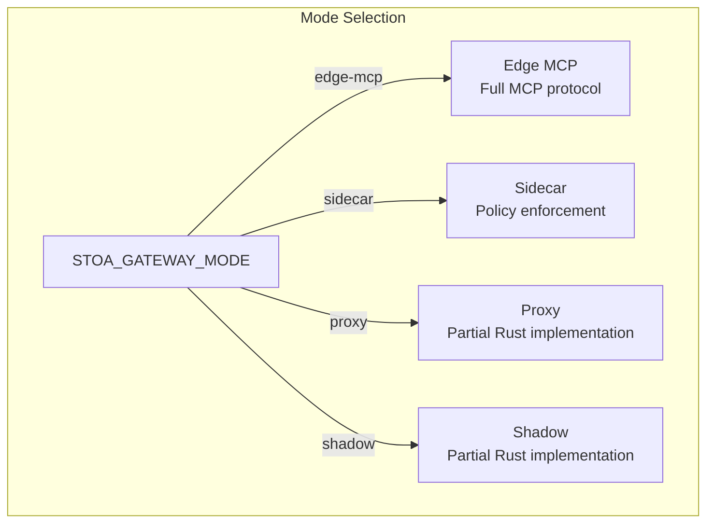

import EnvSetup from '@site/docs/_partials/_env-setup.mdx';

# Gateway Modes

The Rust gateway has four mode values, selected with `STOA_GATEWAY_MODE`. The table distinguishes the available Edge-MCP and Sidecar runtimes from the partial Rust implementations of Proxy and Shadow.

## Mode Overview

| Mode | Default HTTP Port | MCP Support | Use Case | Status |
|------|------|-------------|----------|--------|
| **edge-mcp** | 8080 | Yes | Standalone MCP gateway with full protocol support (+ optional Envoy `ext_authz` gRPC listener) | Production (Maintenance, [ADR-073](/docs/architecture/adr/adr-073-adopt-envoy-data-plane)) |
| **sidecar** | 8080 (companion Helm chart sets 8081) | No | Allow or deny on HTTP `POST /authz` for a host that calls it | Runtime present |
| **proxy** | 8080 | No | HTTP forwarding components | Partial Rust implementation. Envoy xDS target ([ADR-073 §8](/docs/architecture/adr/adr-073-adopt-envoy-data-plane)) |
| **shadow** | 8080 | No | Status and UAC generation endpoints | Partial Rust implementation. Envoy mirroring target ([ADR-073 §8](/docs/architecture/adr/adr-073-adopt-envoy-data-plane)) |



## Mode Capabilities

| Capability | edge-mcp | sidecar | proxy | shadow |
|-----------|----------|---------|-------|--------|
| MCP protocol (SSE) | Yes | No | No | No |
| Tool discovery/invocation | Yes | No | No | No |
| JWT authentication | Yes | No. `/authz` trusts the JSON `user` | Not wired | No |
| Rate limiting | Yes | Optional, in-memory, per process | Not wired | No |
| Circuit breaker | Yes | No | Not wired | No |
| Request transformation | No | No | Component only | No |
| Traffic capture | No | No | No | No capture source wired |
| UAC generation | No | No | No | Manual endpoint requires data |
| Requires upstream | No | No | Forwarding requires a registered upstream route | GitLab only for UAC submission |
| Passive (read-only) | No | No | No | Status and analysis only. UAC submission writes to GitLab |

## Edge-MCP Mode (Production)

The default and primary production mode. Implements the full MCP protocol with SSE transport, OAuth 2.1 discovery, tool management, and session handling.

### Configuration

```bash
# Environment variables
STOA_GATEWAY_MODE=edge-mcp

# Edge-MCP specific settings
STOA_SSE_KEEPALIVE=true
STOA_SSE_KEEPALIVE_INTERVAL_SECS=30
STOA_MAX_SESSIONS=10000
STOA_SESSION_TIMEOUT_SECS=3600
```

### Helm Values

```yaml
stoaGateway:
  mode: edge-mcp
  edgeMcp:
    sseKeepalive: true
    sseKeepaliveIntervalSecs: 30
    maxSessions: 10000
    sessionTimeoutSecs: 3600
```

### Exposed Routes

| Path | Method | Purpose |
|------|--------|---------|
| `/.well-known/oauth-authorization-server` | GET | OAuth 2.1 discovery |
| `/.well-known/oauth-protected-resource` | GET | Protected resource metadata |
| `/mcp` | GET, POST | Discovery (`GET`) & Streamable HTTP JSON-RPC 2.0 (`POST`) |
| `/mcp/sse` | GET, POST, DELETE | SSE transport & JSON-RPC session endpoint |
| `/mcp/ws` | GET | Opt-in WebSocket JSON-RPC (`STOA_WEBSOCKET_ENABLED=true`) |
| `/oauth/token` | POST | Token proxy (to Keycloak `stoa` realm) |
| `/oauth/par` | POST | Pushed Authorization Request proxy (to Keycloak `stoa` realm) |
| `/oauth/register` | POST | Dynamic client registration |
| `/admin/*` | Various | [Gateway Admin API](/docs/api/gateway-admin-api) (Bearer `STOA_ADMIN_API_TOKEN`) |
| `/health`, `/ready` | GET | Liveness and fail-closed readiness checks |
| `/metrics` | GET | Prometheus metrics |

*(Note: `GET /oauth/authorize` returns `404` on `stoa-gateway`; `/.well-known/oauth-authorization-server` directs clients directly to Keycloak's `/realms/stoa/protocol/openid-connect/auth`. When `STOA_EXT_AUTHZ_GRPC_ADDR`, `STOA_EXT_AUTHZ_AUDIENCE`, and non-empty `STOA_EXT_AUTHZ_REQUIRED_SCOPES` in `prod` are set, `stoa-gateway` also supervises a gRPC `envoy.service.auth.v3.Authorization` listener for upstream Envoy per [ADR-073](/docs/architecture/adr/adr-073-adopt-envoy-data-plane).)*

### When to Use

- Standalone MCP gateway deployment
- AI agent integration (Claude, GPT, custom agents)
- Full API management with rate limiting, quotas, and circuit breaking
- Production workloads requiring SSE transport

## Sidecar Mode

Starts the same binary with `STOA_GATEWAY_MODE=sidecar`. The process exposes `POST /authz` and does not mount MCP routes. The host keeps authentication, routing, and enforcement. A same-pod Helm template exists and is off by default. Live calls from Kong, webMethods, or Envoy are not demonstrated in the repository.

Read [Companion usage](./companion-usage.md) for the three integration shapes (same-pod gateway, application callout, mesh) and the current limits. Mesh adapters are design notes only.

### Configuration

```bash
STOA_GATEWAY_MODE=sidecar
STOA_PORT=8081
```

`STOA_UPSTREAM_TYPE`, `STOA_USER_INFO_HEADER`, and `STOA_TENANT_ID_HEADER` are read into sidecar settings and are not used by `/authz`. `STOA_DECISION_FORMAT` is not read. The response format is status code only: `200`, `401`, `403`, or `429`, with an empty body. JSON, Envoy, and Kong formatters exist in the binary and cannot be selected.

The HTTP listener binds `0.0.0.0` and `STOA_PORT`. `STOA_HOST` does not change that bind. The chart's `STOA_HOST=127.0.0.1` does not make `/authz` loopback-only.

### Exposed Routes

| Path | Method | Purpose |
|------|--------|---------|
| `/authz` | POST | Allow or deny from the shared decision engine |
| `/health`, `/ready` | GET | Health and readiness |
| `/metrics` | GET | Generic Prometheus metrics for the process |

There is no `stoa_sidecar_*` metric in the gateway source.

### When to Use

- A host in the same pod can build the JSON body and call `POST /authz` before it forwards.
- An application can make the same callout. That is not a same-pod companion deployment.
- GitOps synchronization of Kong, Gravitee, webMethods, or Envoy is [`stoa-connect`](./stoa-connect-quickstart.md), which stays off the request path.

## Proxy Mode

The Rust binary starts this mode with an empty route registry and no request or response transformers attached. The repository tests routing and transformation components in isolation. Those tests do not cover a working proxy running from the binary.

[ADR-073 §8](/docs/architecture/adr/adr-073-adopt-envoy-data-plane) defines the Envoy target. UAC contracts provide the routes through xDS, with STOA processing in external services.

## Shadow Mode

The Rust binary exposes the endpoints below and starts without a traffic capture source attached. UAC generation needs captured samples. The repository tests analysis and generation with data passed directly to the service.

Submitting a UAC is a separate operation that requires a configured GitLab client. [ADR-073 §8](/docs/architecture/adr/adr-073-adopt-envoy-data-plane) defines the Envoy target, where request mirroring and access logs supply the data for UAC generation.

### Exposed Routes

| Path | Method | Purpose |
|------|--------|---------|
| `/shadow/status` | GET | Report capture and analysis statistics |
| `/shadow/generate` | POST | Trigger UAC generation. Reports `insufficient_data` when there are too few samples |
| `/shadow/submit-uac` | POST | Submit a UAC to GitLab when the GitLab client is configured |
| `/health` | GET | Health check |
| `/metrics` | GET | Prometheus metrics |

## Mode Selection Guide

| Scenario | Recommended Mode |
|----------|-----------------|
| Greenfield MCP deployment | `edge-mcp` |
| Allow or deny beside a host that calls `POST /authz` | Companion (`sidecar` runtime). See [Companion usage](./companion-usage.md) |
| API transformation layer | Envoy routing profile defined in [ADR-073 §8](/docs/architecture/adr/adr-073-adopt-envoy-data-plane) |
| Legacy API discovery | Envoy traffic mirroring defined in [ADR-073 §8](/docs/architecture/adr/adr-073-adopt-envoy-data-plane) |
| Keep a third-party gateway and sync desired state | [`stoa-connect`](./stoa-connect-quickstart.md). A same-pod companion is a separate callout and is not a recorded webMethods integration |

## Runtime Configuration

Set the mode via environment variable or Helm values:

```bash
# Environment variable (highest priority)
export STOA_GATEWAY_MODE=edge-mcp

# Helm values
stoaGateway:
  mode: edge-mcp
```

The mode is logged at startup:

```
INFO Starting STOA Gateway version=2.0.0 mode=edge-mcp
```

The Rust binary uses HTTP port `8080` by default in all four modes. Set `STOA_PORT` to change the listen port. If you also set the legacy `PORT` variable, it takes precedence.

- **Helm** sets port `8080` in the main gateway container and `8081` in the companion container.
- **Docker Compose** maps host port `8081` by default to container port `8080` in the main stack. `PORT_GATEWAY` changes the host port.

## Troubleshooting

| Problem | Cause | Fix |
|---------|-------|-----|
| "Unknown mode" on startup | Invalid `STOA_GATEWAY_MODE` value | Use: `edge-mcp`, `sidecar`, `proxy`, or `shadow` |
| MCP endpoints return 404 | Wrong mode selected | Only `edge-mcp` serves MCP routes |
| Sidecar answers with a status and an empty body | `/authz` format is fixed to status code | Send the JSON body in [Companion usage](./companion-usage.md). `STOA_DECISION_FORMAT` is not read |
| Shadow not capturing traffic | The Rust mode has no input wired to its capture service | See [Shadow Mode](#shadow-mode) for the current runtime and the Envoy target |
| Proxy dropping WebSocket | The Rust mode does not wire WebSocket passthrough | See [Proxy Mode](#proxy-mode) for the current runtime and the Envoy target |

## Related

- [Companion usage](./companion-usage.md) -- Same-pod, application, and mesh limits
- [Multi-Gateway Orchestration](/docs/guides/multi-gateway-setup) -- Multi-gateway adapter pattern
- [MCP Gateway API](/docs/api/mcp-gateway) -- Edge-MCP protocol reference
- [Gateway Admin API](/docs/api/gateway-admin-api) -- Admin endpoints
- [Installation Guide](/docs/admin/installation) -- Helm chart configuration
- [Architecture Overview](/docs/concepts/architecture) -- Platform architecture
