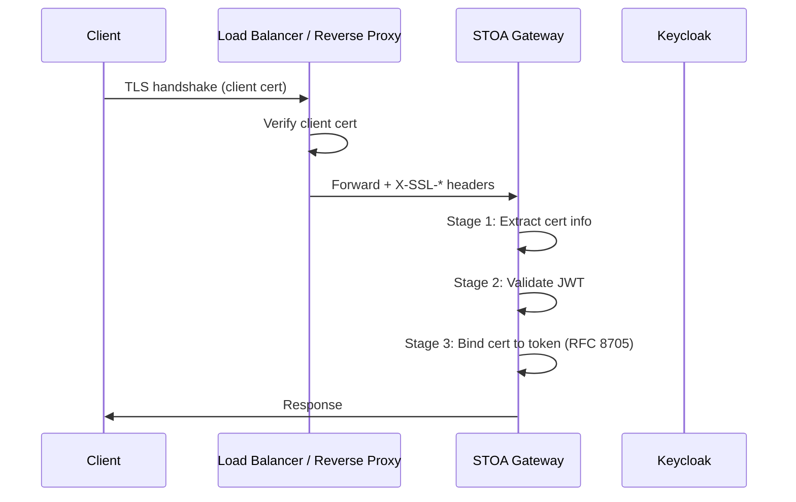

import EnvSetup from '@site/docs/_partials/_env-setup.mdx';

# mTLS Configuration

STOA Gateway supports mutual TLS (mTLS) with RFC 8705 certificate-bound token validation. Client certificates are validated at the gateway, and their fingerprints are bound to JWT tokens for end-to-end proof of possession.

## Architecture



The load balancer (nginx, HAProxy, F5) terminates TLS and forwards certificate details via `X-SSL-*` headers. The gateway validates these headers and binds them to JWT tokens.

## Configuration

### Environment Variables

mTLS settings live in the nested `mtls` section of the gateway configuration. Environment variables use a **double underscore** (`__`) between the `MTLS` prefix and the field name, for example `STOA_MTLS__ENABLED` sets `mtls.enabled`.

| Variable | Default | Description |
|----------|---------|-------------|
| `STOA_MTLS__ENABLED` | `false` | Enable mTLS processing |
| `STOA_MTLS__REQUIRE_BINDING` | `true` | Require JWT `cnf` claim when cert present |
| `STOA_MTLS__TRUSTED_PROXIES` | (empty) | CIDRs or IPs of trusted proxies (comma-separated or JSON array). Matched against the rightmost `X-Forwarded-For` entry when it is a valid IP address, otherwise against the connection address (see [Trusted Proxy Configuration](#trusted-proxy-configuration)). **Required (non-empty) when mTLS is enabled.** |
| `STOA_MTLS__ALLOWED_ISSUERS` | (empty) | Issuer DNs, compared exactly against `X-SSL-Client-I-DN`. Empty accepts any issuer. The comma-separated form splits on every comma, so a DN containing commas must be given as a JSON array (or a YAML list in the config file). |
| `STOA_MTLS__REQUIRED_ROUTES` | (empty) | Glob patterns for routes requiring certs (comma-separated or JSON array) |
| `STOA_MTLS__TENANT_FROM_DN` | `true` | Accepted and parsed, but currently unused: the gateway does not extract a tenant from the certificate subject DN, so this setting has no effect |

:::warning Single-underscore names are ignored
Names with a single underscore, such as `STOA_MTLS_ENABLED`, do not set any mTLS field. The gateway only binds nested fields through the `STOA_MTLS__*` form (or the `mtls:` section of its YAML config file). If you used the single-underscore names, mTLS was never enabled.
:::

### Header Mapping

The gateway reads certificate data from these headers (configurable):

| Header | Default | Content |
|--------|---------|---------|
| `X-SSL-Client-Verify` | -- | `SUCCESS` if cert verified |
| `X-SSL-Client-Fingerprint` | -- | SHA-256 fingerprint |
| `X-SSL-Client-S-DN` | -- | Subject DN (RFC 2253) |
| `X-SSL-Client-I-DN` | -- | Issuer DN |
| `X-SSL-Client-Serial` | -- | Serial number (hex) |
| `X-SSL-Client-NotBefore` | -- | Validity start |
| `X-SSL-Client-NotAfter` | -- | Validity end |

## RFC 8705 Certificate-Bound Tokens

When a client presents both a certificate and a JWT, the gateway verifies that the token was issued for that specific certificate:

1. Extract certificate fingerprint (SHA-256) from `X-SSL-Client-Fingerprint`
2. Extract `cnf.x5t#S256` claim from the JWT
3. Compare using timing-safe comparison (`subtle::ConstantTimeEq`)
4. If mismatch: reject with `403 MTLS_BINDING_MISMATCH`

### JWT Token with cnf Claim

```json
{
  "sub": "user-123",
  "iss": "https://auth.<YOUR_DOMAIN>/realms/stoa",
  "cnf": {
    "x5t#S256": "base64url-encoded-sha256-thumbprint"
  }
}
```

### Fingerprint Format Normalization

The gateway automatically normalizes fingerprints from three formats:

| Input Format | Example | Output |
|-------------|---------|--------|
| Hex with colons | `a1:b2:c3:...` | `a1b2c3...` (lowercase hex) |
| Raw hex | `A1B2C3...` | `a1b2c3...` (lowercase hex) |
| Base64url | `obsz...` | Decoded to hex |

## Phased Rollout

### Phase 1: Monitoring Only

Enable mTLS processing without enforcement. A trusted-proxy list is mandatory as soon as `STOA_MTLS__ENABLED=true`, otherwise the gateway refuses to start:

```bash
STOA_MTLS__ENABLED=true
STOA_MTLS__REQUIRE_BINDING=false
STOA_MTLS__TRUSTED_PROXIES=<TRUSTED_PROXY_CIDR>
```

Certificates are extracted and logged, but requests without certificates are still allowed.

### Phase 2: Required on Test Routes

```bash
STOA_MTLS__ENABLED=true
STOA_MTLS__REQUIRE_BINDING=true
STOA_MTLS__TRUSTED_PROXIES=<TRUSTED_PROXY_CIDR>
STOA_MTLS__REQUIRED_ROUTES=/api/v1/test-mtls/*
```

### Phase 3: Production Enforcement

```bash
STOA_MTLS__ENABLED=true
STOA_MTLS__REQUIRE_BINDING=true
STOA_MTLS__TRUSTED_PROXIES=<TRUSTED_PROXY_CIDR>
STOA_MTLS__REQUIRED_ROUTES=/api/v1/payments/*,/api/v1/transfers/*
STOA_MTLS__ALLOWED_ISSUERS='["CN=<YOUR_ISSUING_CA>,O=<YOUR_ORG>,C=<COUNTRY_CODE>"]'
```

The issuer DN contains commas, so it is passed as a JSON array. The comma-separated form would split it into three separate entries (`CN=...`, `O=...`, `C=...`), none of which equals the full DN, and every certificate from that CA would be rejected with `403 MTLS_ISSUER_DENIED`. In the YAML config file, use a list under `mtls.allowed_issuers`.

## Trusted Proxy Configuration

The gateway only accepts `X-SSL-*` headers from requests originating from the IPs listed in `STOA_MTLS__TRUSTED_PROXIES`. This list is a startup prerequisite: when `STOA_MTLS__ENABLED=true` and the list is empty, configuration validation fails and the gateway does not start. An empty list would mean accepting certificate headers from any source, which is an authentication bypass, so there is no "accept all" mode.

```bash
# Trust specific CIDR ranges (comma-separated)
STOA_MTLS__TRUSTED_PROXIES=<TRUSTED_PROXY_CIDR_1>,<TRUSTED_PROXY_CIDR_2>

# Trust a single IP
STOA_MTLS__TRUSTED_PROXIES=<TRUSTED_PROXY_IP>

# JSON array form is also accepted
STOA_MTLS__TRUSTED_PROXIES='["<TRUSTED_PROXY_CIDR_1>","<TRUSTED_PROXY_CIDR_2>"]'
```

List the addresses of the TLS terminators that forward `X-SSL-*` headers to the gateway (ingress controller, F5, HAProxy, nginx). Untrusted sources sending `X-SSL-*` headers receive `403 MTLS_UNTRUSTED_PROXY`.

The gateway evaluates exactly one address per request, and the allowlist must match that address:

- When the request carries an `X-Forwarded-For` header and its **rightmost** entry is a valid IP address, the gateway uses that entry and ignores the connection address.
- Otherwise (the header is absent, or its rightmost entry is not a valid IP address), the gateway uses the source address of the TCP connection, that is, the egress address of the hop that connected to it.

This determines how the last hop before the gateway must handle `X-Forwarded-For`:

- If the terminator connects directly to the gateway and does not send `X-Forwarded-For`, allowlist its egress address.
- If the terminator appends to `X-Forwarded-For` in the usual way, the rightmost entry is the address of the hop in front of it, or the original client when the terminator is the first hop. Allowlisting only the terminator's egress address then fails with `403 MTLS_UNTRUSTED_PROXY`. Either strip `X-Forwarded-For` at the terminator, or allowlist the address it places in the rightmost position.
- Never pass a client-supplied `X-Forwarded-For` through unchanged: the caller could then choose which address the gateway evaluates. The last hop must strip or overwrite the header itself.

## Error Responses

| Error Code | HTTP Status | Cause |
|------------|-------------|-------|
| `MTLS_CERT_REQUIRED` | 401 | Certificate required on this route |
| `MTLS_CERT_INVALID` | 403 | Verify header is not `SUCCESS` |
| `MTLS_CERT_EXPIRED` | 403 | Certificate `NotAfter` is in the past |
| `MTLS_ISSUER_DENIED` | 403 | Issuer not in allowed list |
| `MTLS_BINDING_REQUIRED` | 403 | JWT lacks `cnf` claim (binding required) |
| `MTLS_BINDING_MISMATCH` | 403 | Certificate fingerprint does not match JWT |
| `MTLS_UNTRUSTED_PROXY` | 403 | X-SSL-* headers from untrusted IP |

## Downstream Headers

The gateway does not currently add certificate-derived identity headers to the requests it forwards to backend services. Client-supplied `X-Authenticated-Client-*` headers may still be forwarded; backends must not trust them as authenticated client identity unless they are known to have been set by a trusted gateway.

## Related

- [Security Hardening](/docs/admin/security-hardening) -- Production security
- [Authentication Guide](/docs/guides/authentication) -- OIDC flow
- [Security Configuration](/docs/reference/security-configuration) -- JWT and CORS settings
- [Consumer Onboarding](/docs/guides/consumer-onboarding) -- mTLS certificate provisioning
