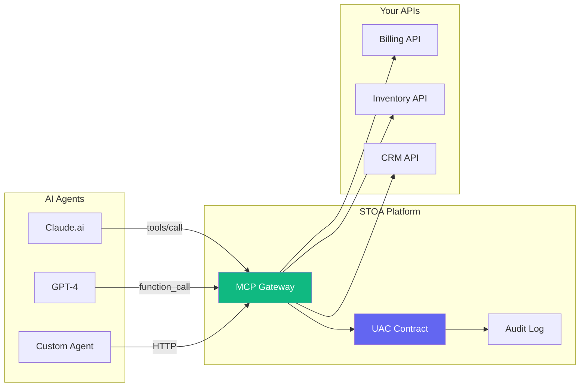
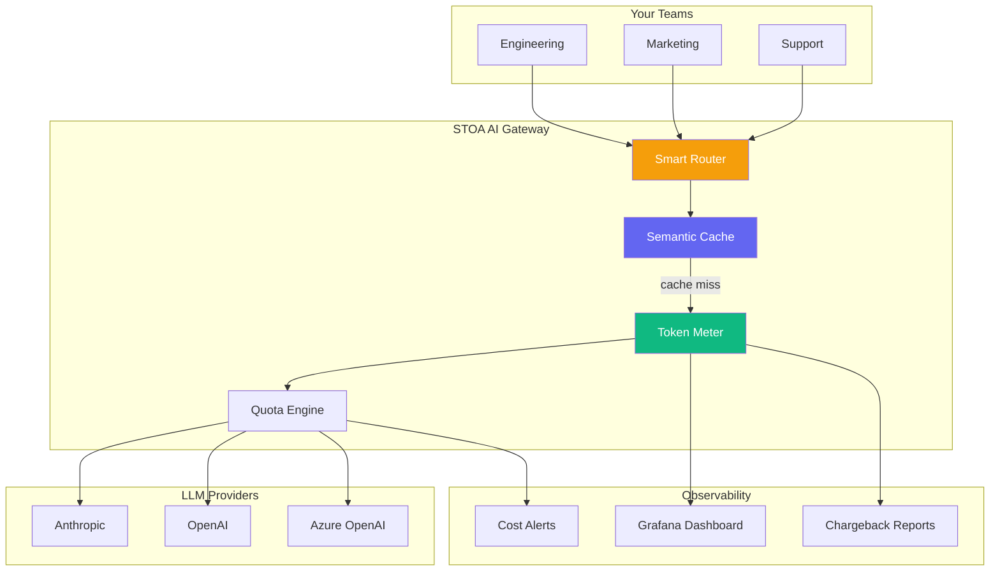
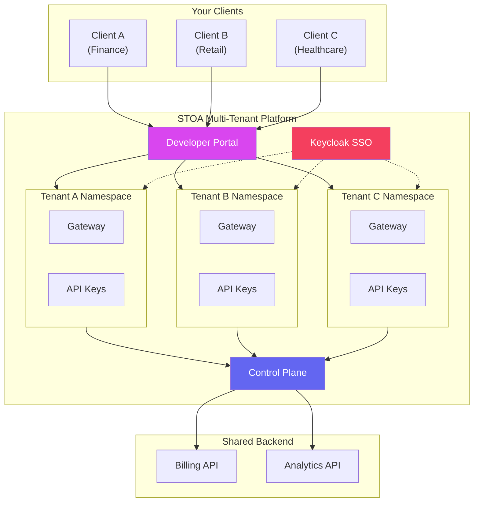

import Tabs from '@theme/Tabs';
import TabItem from '@theme/TabItem';

# Use Cases

Discover how STOA Platform solves real challenges for enterprises adopting AI and managing APIs at scale.

---

## 🤖 Use Case 1: AI Agent API Gateway

**Challenge:** Your AI agents (Claude, GPT, custom LLMs) need to call internal APIs, but you lack governance, audit trails, and access control.

**Solution:** STOA's MCP Gateway provides a unified entry point for all AI-to-API interactions.



### Benefits

| Without STOA | With STOA |
|--------------|-----------|
| Direct API access, no governance | Centralized policy enforcement |
| No visibility on AI calls | Full audit trail per agent |
| Manual API key management | Auto-discovery via MCP |
| Scattered rate limiting | Unified quotas per tenant |

### Quick Implementation

```bash
# 1. Bridge your OpenAPI spec to MCP Tool manifests and apply via stoactl
stoactl bridge ./billing-openapi.yaml --namespace default --output ./tools/
for f in tools/*.yaml; do stoactl apply -f "$f"; done

# 2. AI agent discovers registered tools over MCP (Streamable HTTP / SSE)
# Client calls JSON-RPC tools/list and tools/call on POST /mcp with Bearer JWT
```

---

## 📊 Use Case 2: AI Cost Management & Token Metering

**Challenge:** Multiple teams use LLMs, but you have no visibility on token consumption, costs spiral, and there's no chargeback mechanism.

**Solution:** STOA's AI Gateway tracks every token, provides real-time dashboards, and enables per-team quotas.



### Benefits

| Metric | Before STOA | After STOA |
|--------|-------------|------------|
| Cost visibility | None | Real-time per team |
| Token waste | Redundant LLM calls | Reduced with semantic cache* |
| Budget control | Monthly surprise bills | Automatic quota enforcement |
| Provider lock-in | Single provider | Multi-provider failover |

*Semantic caching can significantly reduce redundant LLM calls. Actual savings vary based on query patterns and use case.*

### Dashboard Preview

```
┌─────────────────────────────────────────────────────────┐
│  Token Usage by Team (January 2026)                     │
├─────────────────────────────────────────────────────────┤
│  Engineering  ████████████████████░░░░  2.4M tokens     │
│  Marketing    ████████░░░░░░░░░░░░░░░░  800K tokens     │
│  Support      ████████████░░░░░░░░░░░░  1.2M tokens     │
├─────────────────────────────────────────────────────────┤
│  Total Cost: €1,240  |  Cache Savings: €520 (30%)       │
└─────────────────────────────────────────────────────────┘
```

---

## 🏢 Use Case 3: Multi-Tenant API Platform

**Challenge:** You're an ESN/ISV exposing APIs to multiple clients. You need isolation, per-client quotas, billing, and compliance (NIS2/DORA).

**Solution:** STOA provides native multi-tenancy with complete isolation and European sovereignty.



### Tenant Isolation Architecture

| Aspect | Implementation |
|--------|----------------|
| **Auth** | Single Keycloak realm (`stoa`), one Keycloak group per tenant, and verified `tenant_id` JWT claim ([ADR-074](/docs/architecture/adr/adr-074-tenant-model)) |
| **Data** | Shared PostgreSQL schema logically scoped by `tenant_id` |
| **Tool Policies** | Fail-closed, Control Plane-signed per-tenant tool policies ([ADR-070](/docs/architecture/adr/adr-070-gateway-fail-closed-posture)) |
| **Secrets** | Tenant-scoped Vault / OpenBao paths ([ADR-075](/docs/architecture/adr/adr-075-secrets-backend-openbao)) |
| **Quotas** | Independent per-tenant and per-consumer rate limits and token budgets |

### Compliance Features

- **NIS2** — Security incident reporting, access controls
- **DORA** — ICT risk management, resilience testing
- **GDPR** — Data residency in EU, audit trails
- **European Hosting** — EU data residency option available*

*Legal jurisdiction depends on multiple factors. Consult your legal counsel for compliance advice.*

---

## Getting Started

Ready to evaluate or deploy these use cases? STOA Platform is open source (Apache 2.0) at [`stoa-platform/stoa`](https://github.com/stoa-platform/stoa); hosted access is available on request at [sales@gostoa.dev](mailto:sales@gostoa.dev).

<Tabs>
  <TabItem value="local" label="🐳 Local Evaluation (Compose)" default>

```bash
# Minimal 5-container R1 access verifier (401/401/200 proof via POST /admin/contracts)
git clone https://github.com/stoa-platform/stoa.git
cd stoa/quickstart
# Set required env vars (POSTGRES_PASSWORD, KC_BOOTSTRAP_ADMIN_PASSWORD, etc.), then:
perl -e 'alarm shift; exec @ARGV' 300 docker compose up --wait
./verify.sh
```

For the 19-service local stack with Console, Portal, and Observability, follow the [Quickstart Guide](/docs/guides/quickstart).

  </TabItem>
  <TabItem value="k8s" label="☸️ Self-Hosted Gateway (Helm)">

```bash
# Install the gateway-scoped Helm chart from a repository checkout (no charts.gostoa.dev repo)
git clone https://github.com/stoa-platform/stoa.git
cd stoa
git checkout 639e8b9a2217695cfc2f590e246ed9d4ce4d4913
helm upgrade --install stoa-platform ./charts/stoa-platform \
  -n stoa-system --create-namespace \
  -f my-values.yaml
```

See the [Installation Guide](/docs/admin/installation) for `stoaGateway.image.{repository,digest}`, `stoaGateway.policyBootTenants`, and separately deployed Control Plane prerequisites.

  </TabItem>
</Tabs>

---

## Need Help?

- 📚 [Quick Start Guide](/docs/guides/quickstart)
- 💬 [Discord Community](https://discord.gostoa.dev)
- 📧 [Contact Sales](mailto:sales@gostoa.dev) for enterprise use cases

---

*Claude is a trademark of Anthropic, PBC. GPT-4 and Azure OpenAI are trademarks of OpenAI/Microsoft. All other product names are trademarks of their respective owners.*
