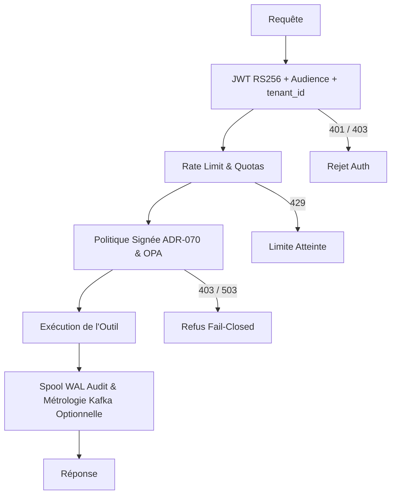

import EnvSetup from '@site/docs/_partials/_env-setup.mdx';

# API MCP Gateway

Référence complète de la surface MCP de `stoa-gateway` (`stoa-gateway/src/lib.rs`, `src/mcp/`).

<EnvSetup />

## Vue d'Ensemble & Séparation des Surfaces

`stoa-gateway` implémente la spécification [Model Context Protocol](https://modelcontextprotocol.io) (`2025-11-25` par défaut, avec négociation ascendante pour `2025-03-26` et `2024-11-05`). Trois **surfaces HTTP distinctes** coexistent et ne doivent pas être confondues :

| Surface | Points d'entrée | Encapsulation | Authentification |
|---------|-----------------|---------------|------------------|
| **1. Protocole MCP JSON-RPC** | `POST /mcp` (Streamable HTTP, en-tête `Mcp-Session-Id`), `GET/POST/DELETE /mcp/sse` (`?sessionId=`), et `GET /mcp/ws` sur option (`STOA_WEBSOCKET_ENABLED=true`) | JSON-RPC 2.0 (unitaire ou batch) ; flux `text/event-stream` optionnel sur `POST` unitaire | Un `POST` unitaire (hors batch) sans en-tête `Authorization` autorise en anonyme sans état `initialize`, `ping`, `notifications/initialized`, `notifications/cancelled` ; **JWT Bearer requis** pour les requêtes batch (`[...]`), `GET /mcp/sse`, `DELETE /mcp/sse`, `GET /mcp/ws` et toutes les autres méthodes |
| **2. Routes REST Compagnons** | `POST /mcp/tools/*`, `POST /mcp/resources/*`, `POST /mcp/prompts/*`, `POST /mcp/completion/complete`, `GET /mcp/v1/tools`, `POST /mcp/v1/tools/invoke`, `GET /mcp/events` | JSON REST pur (hors enveloppe JSON-RPC) | **Barrière JWT stricte (`mcp_jwt_required`)** sur chaque route (`STOA_MCP_AUDIENCE` + claim `tenant_id` vérifié) |
| **3. Découverte Publique & OAuth 2.1** | `GET /mcp`, `GET /mcp/capabilities`, `GET /mcp/health`, `/.well-known/*`, `/oauth/*` | JSON HTTP standard | Public (sans jeton Bearer ; `GET /mcp` n'énumère aucun outil) |

## Authentification

Les appels authentifiés exigent un JWT Keycloak émis par le realm partagé `stoa` ([ADR-074](/docs/architecture/adr/adr-074-tenant-model)) portant l'audience `STOA_MCP_AUDIENCE` (`aud`) et un claim `tenant_id` vérifié. Pour les flux machine-à-machine `client_credentials`, provisionnez un **client Keycloak confidentiel** doté d'un mapper d'audience `STOA_MCP_AUDIENCE` et d'un mapper de protocole `tenant_id` :

```bash
# Obtenir un jeton d'accès depuis un client confidentiel configuré avec STOA_MCP_AUDIENCE + tenant_id
TOKEN=$(curl -sS -X POST "${STOA_AUTH_URL}/realms/stoa/protocol/openid-connect/token" \
  -d "client_id=my-app" \
  -d "client_secret=${CLIENT_SECRET}" \
  -d "grant_type=client_credentials" | jq -r '.access_token')

# Exemple 1 : Streamable HTTP MCP (JSON-RPC 2.0 sur POST /mcp)
curl -sS -X POST "${STOA_GATEWAY_URL}/mcp" \
  -H "Authorization: Bearer ${TOKEN}" \
  -H "Content-Type: application/json" \
  -d '{"jsonrpc":"2.0","id":1,"method":"tools/list"}'

# Exemple 2 : Route REST compagnon (JSON simple sur POST /mcp/tools/list)
curl -sS -X POST "${STOA_GATEWAY_URL}/mcp/tools/list" \
  -H "Authorization: Bearer ${TOKEN}" \
  -H "Content-Type: application/json" \
  -d '{}'
```

---

## 1. Transports du Protocole MCP JSON-RPC

### Streamable HTTP (`POST /mcp`) — Transport Principal

Implémente le transport Streamable HTTP MCP `2025-03-26` / `2025-11-25` (`handle_streamable_http_post` dans `stoa-gateway/src/mcp/sse.rs`) :

- **Handshake anonyme vs session authentifiée** : Une requête `POST` unitaire (hors batch) **sans** en-tête `Authorization` traite `initialize`, `ping`, `notifications/initialized` et `notifications/cancelled` sans état ni création de session (pas d'en-tête `Mcp-Session-Id`). Une requête unitaire authentifiée résout ou crée une session rattachée au tenant et renvoie `Mcp-Session-Id`.
- **Format de réponse** : Pour une requête **unitaire**, retourne `application/json` par défaut ou encapsule la réponse JSON-RPC dans une trame SSE `data:` si le client envoie `Accept: text/event-stream`.
- **Requêtes par lot (`[...]`)** : Les tableaux JSON-RPC batch **exigent un JWT Bearer valide** (`handle_batch_request`) et **répondent toujours en `application/json`**, même lorsque l'en-tête `Accept: text/event-stream` est présent.

### Transport SSE (`GET /mcp/sse`, `POST /mcp/sse`, `DELETE /mcp/sse`)

- `GET /mcp/sse?sessionId=<id>` — Ouvre un flux Server-Sent Events persistant (**JWT Bearer requis**).
- `POST /mcp/sse?sessionId=<id>` — Envoie des messages JSON-RPC 2.0 unitaires ou en lot (mêmes règles d'authentification et de batch que `POST /mcp`).
- `DELETE /mcp/sse?sessionId=<id>` — Ferme explicitement la session (**JWT Bearer requis**).

### Transport WebSocket (`GET /mcp/ws`) — Sur Option

Le transport JSON-RPC 2.0 bidirectionnel sur WebSocket (`stoa-gateway/src/mcp/ws.rs`) est **désactivé par défaut** :

- Retourne `404 Not Found` tant que `STOA_WEBSOCKET_ENABLED=true` n'est pas défini.
- **Authentification requise dès l'upgrade** : `GET /mcp/ws` valide le jeton Bearer (ou le jeton transmis en sous-protocole WebSocket) et le claim `tenant_id` avant d'ouvrir la connexion (`websocket_identity`), dont la durée est bornée par l'expiration `exp` du jeton.

### Handshake `initialize`

```http
POST /mcp
Content-Type: application/json

{
  "jsonrpc": "2.0",
  "method": "initialize",
  "params": {
    "protocolVersion": "2025-11-25",
    "capabilities": { "tools": {} },
    "clientInfo": { "name": "my-agent", "version": "1.0.0" }
  },
  "id": 1
}
```

**Réponse :**

```json
{
  "jsonrpc": "2.0",
  "result": {
    "protocolVersion": "2025-11-25",
    "capabilities": {
      "tools": { "listChanged": true },
      "resources": { "subscribe": false, "listChanged": false },
      "prompts": { "listChanged": false },
      "logging": {},
      "tokenOptimization": {
        "supported": true,
        "levels": ["none", "moderate", "aggressive"]
      },
      "elicitation": {}
    },
    "serverInfo": {
      "name": "STOA Gateway",
      "version": "<gateway-version>"
    }
  },
  "id": 1
}
```

### Méthodes JSON-RPC sur `POST /mcp` & `POST /mcp/sse`

| Méthode JSON-RPC | Auth Requise | Route REST Compagnon ? | Comportement Effectif en Exécution |
|------------------|--------------|------------------------|------------------------------------|
| `initialize` | Non (`POST` unitaire uniquement ; JWT requis en batch ou `/mcp/ws`) | Non | Négocie `2025-11-25` / `2025-03-26` / `2024-11-05` ; crée une session tenant uniquement si authentifié |
| `ping` | Non (`POST` unitaire uniquement ; JWT requis en batch ou `/mcp/ws`) | Non | Sonde de maintien de connexion (`{}`) |
| `notifications/initialized` | Non (`POST` unitaire uniquement ; JWT requis en batch ou `/mcp/ws`) | Non | Accusé de réception du handshake client (HTTP `204` sans `id`) |
| `notifications/cancelled` | Non (`POST` unitaire uniquement ; JWT requis en batch ou `/mcp/ws`) | Non | Notification d'annulation de requête (HTTP `204` sans `id`) |
| `tools/list` | **Oui (JWT)** | `POST /mcp/tools/list` | Liste les outils visibles pour le `tenant_id` vérifié |
| `tools/call` | **Oui (JWT)** | `POST /mcp/tools/call` | Vérifie la politique tenant signée ([ADR-070](/docs/architecture/adr/adr-070-gateway-fail-closed-posture)) + OPA et exécute l'outil |
| `resources/list` | **Oui (JWT)** | `POST /mcp/resources/list` | Expose les outils enregistrés sous `stoa://tools/{name}` (filtrés par `tenant_id` en JSON-RPC) |
| `resources/read` | **Oui (JWT)** | `POST /mcp/resources/read` | Lit le descripteur JSON de `stoa://tools/{name}` |
| `resources/templates/list` | **Oui (JWT)** | `POST /mcp/resources/templates/list` | Retourne l'unique modèle d'URI `stoa://tools/{name}` |
| `prompts/list` | **Oui (JWT)** | `POST /mcp/prompts/list` | Retourne `{"prompts": []}` (registre de prompts non peuplé à ce stade) |
| `prompts/get` | **Oui (JWT)** | `POST /mcp/prompts/get` | Retourne systématiquement `-32002` `Prompt '<name>' not found` (`404` en REST) |
| `completion/complete` | **Oui (JWT)** | `POST /mcp/completion/complete` | Retourne une liste de complétion vide (`values: []`, `hasMore: false`) |
| `logging/setLevel` | **Oui (JWT)** | *JSON-RPC uniquement* | Accepte un niveau de log MCP (`debug`..`emergency`) et retourne `{}` |
| `roots/list` | **Oui (JWT)** | *JSON-RPC uniquement* | Retourne `{"roots": []}` |

### Appeler un outil & Requêtes par lot (JSON-RPC)

```http
POST /mcp
Authorization: Bearer <token>
Content-Type: application/json

{
  "jsonrpc": "2.0",
  "method": "tools/call",
  "params": {
    "name": "get-weather",
    "arguments": { "q": "London" }
  },
  "id": 3
}
```

Les requêtes par lot (`POST /mcp` ou `POST /mcp/sse`) sont exécutées concurremment, **exigent `Authorization: Bearer <token>`** et répondent toujours sous forme de tableau JSON (`application/json`) :

```http
POST /mcp
Authorization: Bearer <token>
Content-Type: application/json

[
  {
    "jsonrpc": "2.0",
    "method": "tools/call",
    "params": { "name": "get-weather", "arguments": { "q": "Paris" } },
    "id": 1
  },
  {
    "jsonrpc": "2.0",
    "method": "tools/call",
    "params": { "name": "get-weather", "arguments": { "q": "London" } },
    "id": 2
  }
]
```

---

## 2. Capacités Déclarées vs Réponses Effectives

Il convient de distinguer le document statique de découverte (`GET /mcp/capabilities`), la réponse `initialize` JSON-RPC (`sse.rs`) et le comportement effectif des handlers (`resources.rs`) :

| Domaine | `GET /mcp/capabilities` | `initialize` JSON-RPC | État Effectif sur `main` |
|---------|-------------------------|-----------------------|--------------------------|
| **`tools`** | `listChanged: true` (+ en-tête `X-MCP-Tool-Count`) | `listChanged: true` | **Pleinement actif** : alimenté par `ToolRegistry` (CRD, contrats UAC, serveurs MCP fédérés) et protégé par politiques signées fail-closed |
| **`resources`** | `subscribe: false, listChanged: true` | `subscribe: false, listChanged: false` | **Adossé aux outils** : expose les outils sous `stoa://tools/{name}`. En JSON-RPC, `resources/list` filtre par `tenant_id` ; la route REST `POST /mcp/resources/list` liste actuellement sans filtre tenant |
| **`prompts`** | `listChanged: true` | `listChanged: false` | **Squelette** : `prompts/list` retourne `[]` ; `prompts/get` retourne `-32002` / HTTP `404` |
| **`completion`** | Non annoncé | Non annoncé | Monté en JSON-RPC et REST ; retourne `values: []` |
| **`logging`** | `{}` | `{}` | `logging/setLevel` pris en charge en JSON-RPC |
| **`roots`** | Non annoncé | Non annoncé | `roots/list` pris en charge en JSON-RPC ; retourne `{"roots": []}` |
| **`tokenOptimization`** | Non annoncé | `levels: ["none","moderate","aggressive"]` | Actif via l'en-tête `X-Token-Optimization` |

---

## 3. Routes REST Compagnons (Protégées par JWT)

Toutes les routes REST compagnons sont protégées par le middleware `mcp_jwt_required` (`stoa-gateway/src/lib.rs`) et échangent du JSON simple (sans enveloppe `"jsonrpc": "2.0"`) :

| Endpoint | Méthode | Objectif |
|----------|---------|----------|
| `/mcp/tools/list` | `POST` | Lister les outils visibles pour le tenant authentifié |
| `/mcp/tools/call` | `POST` | Invoquer un outil (`{"name": "...", "arguments": {...}}`) |
| `/mcp/resources/list` | `POST` | Lister les ressources `stoa://tools/{name}` |
| `/mcp/resources/read` | `POST` | Lire une ressource `stoa://tools/{name}` (`{"uri": "stoa://tools/..."}`) |
| `/mcp/resources/templates/list` | `POST` | Lister les modèles d'URI (`stoa://tools/{name}`) |
| `/mcp/prompts/list` | `POST` | Retourne `{"prompts": []}` |
| `/mcp/prompts/get` | `POST` | Retourne `404` (`Prompt '<name>' not found`) |
| `/mcp/completion/complete` | `POST` | Retourne une liste `completion.values` vide |
| `/mcp/v1/tools` | `GET` | Alias REST historique de liste d'outils |
| `/mcp/v1/tools/invoke` | `POST` | Alias REST historique d'invocation d'outil |
| `/mcp/events` | `GET` | Polling HTTP d'événements pour clients sans SSE |

### Lister les Outils {#lister-les-outils}

```http
POST /mcp/tools/list
Authorization: Bearer <token>
Content-Type: application/json

{}
```

**Réponse** (`next_cursor` n'est présent qu'en cas de pagination) :

```json
{
  "tools": [
    {
      "name": "get-weather",
      "description": "Returns current weather for a given city",
      "inputSchema": {
        "type": "object",
        "properties": {
          "q": { "type": "string", "description": "City name" }
        },
        "required": ["q"]
      },
      "annotations": {
        "readOnlyHint": true,
        "destructiveHint": false,
        "idempotentHint": true,
        "openWorldHint": true
      }
    }
  ]
}
```

### Invoquer un Outil {#invoquer-un-outil}

```http
POST /mcp/tools/call
Authorization: Bearer <token>
Content-Type: application/json

{
  "name": "get-weather",
  "arguments": { "q": "Paris" }
}
```

**Réponse :**

```json
{
  "content": [
    {
      "type": "text",
      "text": "{\"location\":{\"name\":\"Paris\"},\"current\":{\"temp_c\":12.0}}"
    }
  ],
  "isError": false
}
```

---

## 4. Découverte Publique, OAuth 2.1 & A2A

### Découverte MCP

- `GET /mcp` — Métadonnées publiques du serveur (nom, version, version du protocole, endpoints ; n'expose aucun outil).
- `GET /mcp/capabilities` — Manifeste de capacités + en-tête `X-MCP-Tool-Count`.
- `GET /mcp/health` — Santé du sous-système MCP, nombre d'outils enregistrés et sessions actives.

### Découverte OAuth 2.1 & Proxy Keycloak

STOA implémente les RFC 9728 et RFC 8414 pour permettre l'authentification automatique des agents IA auprès du realm partagé `stoa` :

| Endpoint | Méthode | Spécification / Rôle |
|----------|---------|----------------------|
| `/.well-known/oauth-protected-resource` | `GET` | Métadonnées de ressource protégée (RFC 9728) |
| `/.well-known/oauth-authorization-server` | `GET` | Métadonnées du serveur d'autorisation (RFC 8414) |
| `/.well-known/openid-configuration` | `GET` | Découverte OpenID Connect |
| `/oauth/token` | `POST` | Proxy transparent vers l'endpoint token de Keycloak |
| `/oauth/par` | `POST` | Requêtes d'autorisation poussées RFC 9126 (FAPI 2.0) |
| `/oauth/register` | `POST` | Enregistrement dynamique de client (RFC 7591) |
| `/oauth/register/:client_id` | `GET`, `PUT`, `DELETE` | Gestion des clients enregistrés dynamiquement (RFC 7592) |

*(La découverte Agent-to-Agent est également exposée sur `GET /.well-known/agent.json` et `GET /a2a/agents`, avec invocation protégée par JWT sur `POST /a2a`.)*

---

## Pipeline d'Exécution

Chaque invocation d'outil (`tools/call` ou `POST /mcp/tools/call`) traverse le même pipeline :



### Correspondance des Scopes RBAC

| Rôle | Scopes |
|------|--------|
| `cpi-admin` | `admin`, `read`, `write`, `execute`, `deploy`, `audit` |
| `tenant-admin` | `read`, `write`, `execute` |
| `devops` | `read`, `write`, `deploy` |
| `viewer` | `read` |

---

## Optimisation des Tokens

Réduisez la taille des réponses d'outils pour le contexte LLM via l'en-tête `X-Token-Optimization` (`none`, `moderate`, `aggressive`) :

```bash
curl -X POST "${STOA_GATEWAY_URL}/mcp/tools/call" \
  -H "Authorization: Bearer ${TOKEN}" \
  -H "X-Token-Optimization: aggressive" \
  -H "Content-Type: application/json" \
  -d '{"name": "get-weather", "arguments": {"q": "Paris"}}'
```

---

## Gestion des Sessions

Les sessions MCP ont un TTL par défaut de 30 minutes (`STOA_MCP_SESSION_TTL_MINUTES`) avec nettoyage automatique des sessions inactives. Consultez les compteurs via [`GET /admin/sessions/stats`](/docs/api/gateway-admin-api#get-adminsessionsstats).

---

## Réponses d'Erreur

### Erreurs d'Outil (REST)

Après le contrôle JWT, les rejets passent par un statut HTTP hors `2xx` avec `isError: true` :

```json
{
  "content": [
    { "type": "text", "text": "Tool 'unknown-tool' not found" }
  ],
  "isError": true
}
```

| Statut | Cause |
|--------|-------|
| `400` | Requête malformée ou arguments invalides |
| `403` | Appel rejeté par la politique tenant signée ([ADR-070](/docs/architecture/adr/adr-070-gateway-fail-closed-posture)) ou RBAC/OPA |
| `404` | Outil introuvable pour le `tenant_id` vérifié de l'appelant |
| `429` | Limite de débit ou quota dépassé |
| `500` | Échec d'exécution de l'outil upstream |
| `503` | Dépendance de sécurité requise indisponible |

Une erreur applicative renvoyée par le backend (ex. erreur GraphQL) retourne **HTTP `200` avec `isError: true`** ; les clients doivent systématiquement inspecter `isError`.

### Erreurs d'Authentification (`mcp_jwt_required`)

- En-tête `Authorization` absent → `401` avec `WWW-Authenticate: Bearer resource_metadata="/.well-known/oauth-protected-resource"` et `{"error": "unauthorized", "message": "Missing Authorization header"}`.
- Jeton invalide ou expiré → `401` avec `WWW-Authenticate: Bearer error="invalid_token", resource_metadata="/.well-known/oauth-protected-resource"`.
- Claim `tenant_id` absent → `403` avec `{"error": "forbidden", "message": "A tenant claim is required"}`.

### Erreurs JSON-RPC

Sur `POST /mcp` et `POST /mcp/sse`, les appels rejetés utilisent l'objet `error` JSON-RPC 2.0 :

| Statut HTTP sous-jacent | `code` JSON-RPC |
|-------------------------|-----------------|
| `400`, `401`, `403`, `503` | `-32001` |
| `404` (outil introuvable) | `-32601` |
| `404` (prompt introuvable) | `-32002` |
| `429` | `-32029` |
| Autre | `-32603` |

---

## Exemples

Les exemples ci-dessous supposent que `my-app` est un client Keycloak confidentiel dans le realm `stoa` configuré avec un mapper d'audience correspondant à `STOA_MCP_AUDIENCE` et un mapper de protocole `tenant_id` :

### Client Python

```python
import os
import requests

STOA_AUTH_URL = os.environ['STOA_AUTH_URL']
STOA_GATEWAY_URL = os.environ['STOA_GATEWAY_URL']

# Authentification auprès du realm partagé 'stoa'
auth = requests.post(
    f'{STOA_AUTH_URL}/realms/stoa/protocol/openid-connect/token',
    data={
        'client_id': 'my-app',
        'client_secret': os.environ['STOA_CLIENT_SECRET'],
        'grant_type': 'client_credentials'
    }
)
auth.raise_for_status()
token = auth.json()['access_token']

# Invoquer un outil via la route REST compagnon
response = requests.post(
    f'{STOA_GATEWAY_URL}/mcp/tools/call',
    headers={'Authorization': f'Bearer {token}'},
    json={'name': 'get-weather', 'arguments': {'q': 'Paris'}}
)
response.raise_for_status()

result = response.json()
print(result['content'][0]['text'])
```

### Client JavaScript

```javascript
const STOA_GATEWAY_URL = process.env.STOA_GATEWAY_URL;

const response = await fetch(`${STOA_GATEWAY_URL}/mcp/tools/call`, {
  method: 'POST',
  headers: {
    'Authorization': `Bearer ${token}`,
    'Content-Type': 'application/json'
  },
  body: JSON.stringify({
    name: 'get-weather',
    arguments: { q: 'Paris' }
  })
});

const result = await response.json();
console.log(result.content[0].text);
```

---

## Voir Aussi

- [Démarrer avec MCP](/docs/guides/mcp-getting-started) — Tutoriel pratique
- [API Admin du Gateway](/docs/api/gateway-admin-api) — `/admin/contracts`, `/admin/skills`, `/admin/federation`
- [Référence des CRDs Kubernetes](/docs/reference/crds) — `Tool`, `ToolSet`, `Skill`, `GatewayInstance`, `GatewayBinding`
