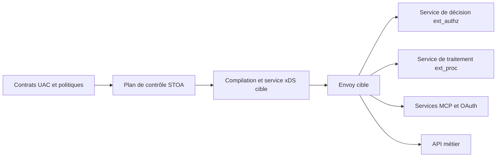

# ADR-098 : Envoy comme data plane cible

- **Statut : Accepted** — choix architectural uniquement.
- **Remplace pour la direction cible :** [ADR-034](/docs/architecture/adr/adr-034-python-rust-migration/), [ADR-058](/docs/architecture/adr/adr-058-pingora-integration/) et les prescriptions de runtime de [l’ADR-057](/docs/architecture/adr/adr-057-product-lineup-gateway-link-connect/).

## Contexte

La passerelle actuelle de R1 est en Rust. Le choix d’Envoy est accepté comme direction architecturale ; il ne prouve pas une migration livrée. Les décisions historiques Rust et Pingora sont conservées avec ce contexte.

## Décision

STOA, avec sa passerelle et son plan de contrôle, retient **Envoy comme moteur cible du plan de données**. Envoy prend en charge le transport, le routage, les connexions amont et les mécanismes usuels de résilience. STOA conserve les contrats UAC, les politiques métier et les services agents.

Le plan de contrôle FastAPI reste propriétaire du modèle métier. La cible prévoit une compilation UAC vers des ressources Envoy et un service xDS dédié, avec snapshots durables, réconciliation et suivi ACK/NACK. Un état publié dans le plan de contrôle ne doit pas être présenté comme appliqué sans preuve d’acceptation et de routage.

Les décisions métier sont appelées par `ext_authz` ; les traitements de requête et réponse qui le nécessitent passent par `ext_proc`. Les services MCP et OAuth restent applicatifs derrière Envoy. Wasm reste une option à qualifier après portage ; les extensions existantes ne sont pas supposées compatibles.

Ce schéma décrit la cible, pas l’état livré. Une autorité unique configure chaque Envoy ; un maillage existant garde son propre plan de contrôle. Administration et diagnostics restent séparés de l’exposition publique.

## Conditions de migration

- Démontrer la parité des routes, politiques, audiences par contrat et refus d’accès entre tenants.
- Qualifier les pannes des services d’autorisation et d’identité avec refus par défaut.
- Conserver le dernier snapshot accepté, y compris après redémarrage et sans accès externe lorsque ce mode est requis.
- Distinguer configuration acceptée, requête routée et contrat effectivement appliqué.
- Répéter le repli à partir des contrats et politiques durables avant chaque bascule.

Les interfaces d’adaptation et la parité restent à implémenter et à valider. La migration n’a ni date ni promesse chiffrée publiée. Les mesures historiques Rust ne constituent pas des performances Envoy.

## Conséquences et alternatives

Le proxy Rust/Pingora reste le chemin transitoire et un repli à qualifier. Son retrait dépend des critères de migration ; les services métier Rust peuvent rester derrière Envoy. Un repli ne consiste pas à donner la configuration native d’un moteur à un autre.

Le pilotage direct par xDS est la direction retenue. Envoy Gateway reste une option d’implémentation à évaluer ; il ne change pas le choix du moteur. Construire et exploiter la compilation, la réconciliation et les snapshots ajoute du travail et exige une preuve de fonctionnement.

## Licence

Le code publié de STOA est open source, sous licence Apache 2.0

Les dépendances et extensions conservent leurs licences et obligations d’attribution propres.
