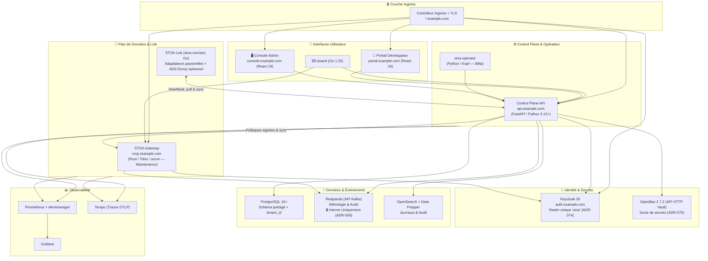
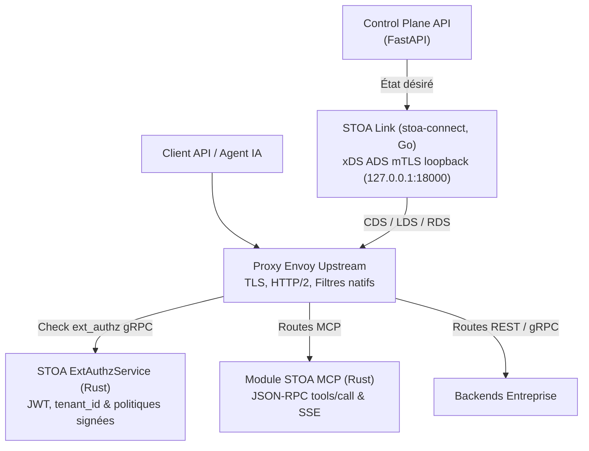

# Vue d'Ensemble de l'Architecture

> **Production actuelle & Plan de données cible** — Vérifié sur `stoa-platform/stoa` (`main`)

La plateforme STOA est une plateforme de passerelle open source, cloud-native et multi-tenant conçue pour les API traditionnelles et les agents IA. Ce document distingue explicitement deux vues :

1. **Stack de production actuelle** — Ce qui s'exécute aujourd'hui sur `stoa-platform/stoa` (`main`)
2. **Plan de données cible Envoy ([ADR-073](/docs/architecture/adr/adr-073-adopt-envoy-data-plane))** — La convergence des fonctions proxy L4/L7 vers Envoy upstream tandis que STOA conserve le Plan de contrôle, l'autorisation, le protocole MCP et la boucle de contrôle Link

---

## Architecture de Production Actuelle



### Services Principaux sur `main`

| Composant | Point d'entrée / Périmètre | Cycle de vie | Stack |
|-----------|----------------------------|--------------|-------|
| **Portail Développeur** | `portal.<domaine>` | ✅ Production | React 19, TypeScript (`portal/`) |
| **Console Admin** | `console.<domaine>` | ✅ Production | React 19, TypeScript (`control-plane-ui/`) |
| **Control Plane API** | `api.<domaine>` | ✅ Production | Python 3.12+, FastAPI, SQLAlchemy (`control-plane-api/`) |
| **STOA Gateway** | `mcp.<domaine>` / `:8080` | ✅ Production / Maintenance ([ADR-073](/docs/architecture/adr/adr-073-adopt-envoy-data-plane)) | Rust, Tokio, axum, tonic (`stoa-gateway/`) |
| **STOA Link (`stoa-connect`)** | Agent sur site / cluster (`:8090`) | ✅ Production (adaptateurs) / ADS Envoy sur option | Go 1.25 (`stoa-go/cmd/stoa-connect`) |
| **CLI `stoactl`** | Poste opérateur / CI | ✅ Production (compilé depuis `stoa-go/`) | Go 1.25 (`stoa-go/cmd/stoactl`) |
| **`stoa-operator`** | Intra-cluster (`GatewayInstance`, `GatewayBinding`) | 🧪 Bêta | Python, Kopf (`stoa-operator/`) |
| **Keycloak** | `auth.<domaine>` (realm `stoa`) | ✅ Production | Keycloak 26 ([ADR-074](/docs/architecture/adr/adr-074-tenant-model)) |
| **OpenBao** | API HTTP Vault interne | 🔄 Déploiement partiel | OpenBao 2.7.2 ([ADR-075](/docs/architecture/adr/adr-075-secrets-backend-openbao)) |
| **Redpanda** | Réseau interne du cluster uniquement | ✅ Production | Redpanda / API Kafka ([ADR-005](/docs/architecture/adr/adr-005-event-driven-kafka)) |
| **PostgreSQL** | Réseau interne du cluster uniquement | ✅ Production | PostgreSQL 16+ (schéma partagé, colonne `tenant_id`) |
| **Observabilité** | Réseau interne / ingress opérateur | ✅ Production | Prometheus, Grafana, OpenSearch, Data Prepper, Tempo |

### Garanties Architecturales Implémentées sur `main`

- **Identité tenant sur realm unique ([ADR-074](/docs/architecture/adr/adr-074-tenant-model))** : Un unique realm Keycloak partagé (`stoa`), un groupe Keycloak par tenant (`setup_tenant_group`), des claims JWT `tenant_id` vérifiés (`require_tenant_access` en Python, `enforce_tenant_isolation` en Rust) et un schéma PostgreSQL partagé filtré par `tenant_id` (remplaçant l'ancienne ébauche d'un realm par tenant d'ADR-026).
- **Posture passerelle fail-closed ([ADR-070](/docs/architecture/adr/adr-070-gateway-fail-closed-posture))** : `stoa-gateway` vérifie les artefacts de politiques signés Ed25519 par tenant (`STOA_POLICY_BOOT_TENANTS`), impose `STOA_MCP_AUDIENCE` et maintient un spool WAL d'audit durable (`STOA_AUDIT_SPOOL_DIR`).
- **MCP `2025-11-25` & Routes de contrats** : Streamable HTTP (`POST /mcp`), SSE (`/mcp/sse`), WebSocket sur option (`/mcp/ws` via `STOA_WEBSOCKET_ENABLED=true`) et déclaration transactionnelle REST + MCP (`POST /admin/contracts`).
- **Orchestration multi-passerelles ([ADR-035](/docs/architecture/adr/adr-035-gateway-adapter-pattern))** : Les adaptateurs du Control Plane et `stoa-connect` synchronisent les API et politiques vers Kong, Gravitee, webMethods, Apigee, AWS API Gateway et Azure APIM sans faire transiter l'orchestration par Kafka.
- **Aucune dépendance Redis** : Les caches de limitation de débit, JWKS et jetons résident en mémoire dans chaque processus ; STOA n'utilise pas Redis.

### Dépôts Git Publics

| Dépôt | Objectif |
|-------|----------|
| `stoa-platform/stoa` | Monorepo : Control Plane API, UI, `stoa-gateway`, `stoa-go` (`stoactl` + `stoa-connect`), `stoa-operator`, `quickstart/`, `deploy/docker-compose/` et charts Helm (`charts/stoa-platform`, `charts/stoa-observability`) |
| `stoa-platform/stoa-docs` | Site de documentation (`docs.gostoa.dev`) |
| `stoa-platform/stoa-web` | Site vitrine (`gostoa.dev`) |

*(Note : les charts Helm résident directement dans `stoa-platform/stoa/charts/` ; il n'existe pas de dépôt de chart actif distinct `stoa-helm`.)*

### Flux de Synchronisation

```mermaid
sequenceDiagram
    participant Dev as Opérateur / GitOps
    participant CP as Control Plane API
    participant Link as STOA Link / Adaptateur
    participant GW as Passerelle Cible (STOA / Envoy / Tierce)

    Dev->>CP: Déclarer API / Contrat / Binding
    CP->>Link: Synchronisation politiques & routes (HTTPS / pull ou push adaptateur)
    Link->>GW: Appliquer routes & politiques (Admin API ou ADS mTLS loopback)
    GW-->>Link: Acquittement de synchronisation
    Link-->>CP: Heartbeat & statut de réconciliation
```

:::caution Bus d'événements vs Synchronisation de configuration
La synchronisation du Plan de contrôle n'est **pas** pilotée par Kafka. Redpanda/Kafka est strictement interne pour la métrologie asynchrone, l'audit et les snapshots d'erreurs ([ADR-005](/docs/architecture/adr/adr-005-event-driven-kafka)).
:::

---

## Plan de Données Cible Envoy ([ADR-073](/docs/architecture/adr/adr-073-adopt-envoy-data-plane))

Plutôt que de maintenir un proxy noyau/eBPF sur mesure ou de réécrire le Control Plane en Go, [ADR-073](/docs/architecture/adr/adr-073-adopt-envoy-data-plane) délègue les fonctions proxy L4/L7 commoditisées (TLS/mTLS, HTTP/1-2-3, pools de connexions, retries, circuit breaking) à **Envoy upstream**, tout en conservant la valeur différenciante de STOA dans des services dédiés :



### Briques Livrées vs Migration Restante sur `main`

| Capacité | Statut sur `main` | Preuve d'implémentation |
|----------|-------------------|-------------------------|
| **Serveur xDS ADS mTLS loopback dans `stoa-connect`** | ✅ Implémenté (sur option via `STOA_GATEWAY_TYPE=envoy`) | `stoa-go/cmd/stoa-connect/envoy.go`, `stoa-go/cmd/stoa-connect/ENVOY.md` ; traduit en v1 `cors`, `rate_limit` par processus et `ip_filter` pair direct |
| **`ExtAuthzService` gRPC dans `stoa-gateway`** | ✅ Implémenté (sur option via `STOA_EXT_AUTHZ_GRPC_ADDR` + `STOA_EXT_AUTHZ_AUDIENCE`) | `stoa-gateway/src/authz/ext_authz_grpc.rs`, supervisé dans `stoa-gateway/src/main.rs` |
| **Preuve d'intégration hors ligne Envoy + Link + gRPC** | ✅ Vérifiée en CI | `.github/workflows/o1-envoy-real-proof.yml`, `docs/testing/o1-offline-envoy.md` |
| **Parité complète du traducteur de politiques** | 🚧 En cours | `jwt_validation`, OIDC, `logging`, `caching` et `transform` ne sont pas encore traduits en filtres Envoy par `stoa-connect` |
| **`ext_proc` streaming & découplage MCP autonome** | 📋 Prévu ([ADR-073](/docs/architecture/adr/adr-073-adopt-envoy-data-plane)) | Métrologie jetons / garde-fous `ext_proc` et séparation du module MCP |
| **Bascule de topologie par défaut Helm & Compose** | 📋 Prévu | `charts/stoa-platform` et `deploy/docker-compose/` déploient encore `stoa-gateway` directement comme passerelle d'entrée par défaut |

Consultez [Architecture du plan de données](/docs/architecture/data-plane) pour les références fichier/ligne exactes et les étapes de migration.

---

## CRD Kubernetes Déployées (`gostoa.dev/v1alpha1`)

Cinq Custom Resource Definitions sont livrées aujourd'hui dans `charts/stoa-platform/crds/` sous le groupe d'API `gostoa.dev/v1alpha1` :

- **Surveillées par `stoa-gateway`** (`STOA_K8S_WATCHER_ENABLED=true`) : `Tool`, `ToolSet`, `Skill`
- **Réconciliées par `stoa-operator`** : `GatewayInstance`, `GatewayBinding`

```yaml
apiVersion: gostoa.dev/v1alpha1
kind: Tool
metadata:
  name: billing-api
  namespace: stoa-system
spec:
  displayName: Billing API
  description: Consulter les factures client
  endpoint: https://billing.internal.example.com/v1/invoices
  method: GET
---
apiVersion: gostoa.dev/v1alpha1
kind: GatewayInstance
metadata:
  name: prod-edge-mcp
  namespace: stoa-system
spec:
  displayName: Production Edge MCP Gateway
  gatewayType: stoa_edge_mcp
  environment: prod
  baseUrl: https://mcp.example.com
```

Consultez la [Référence des CRD Kubernetes](/docs/reference/crds) pour les schémas complets et les enums imposés.

---

## Comparaison de la Stack Technologique

| Couche | Production actuelle (`main`) | Évolution cible |
|--------|------------------------------|-----------------|
| **Plan de données L4/L7** | `stoa-gateway` (Rust, Tokio, axum — Maintenance) | Envoy upstream + `stoa-connect` ADS mTLS loopback ([ADR-073](/docs/architecture/adr/adr-073-adopt-envoy-data-plane)) |
| **Moteur d'autorisation** | Middleware Rust embarqué + OPA + politiques signées ([ADR-070](/docs/architecture/adr/adr-070-gateway-fail-closed-posture)) | Serveur gRPC Rust `ExtAuthzService` appelé par Envoy (`STOA_EXT_AUTHZ_GRPC_ADDR`) |
| **Couche protocole MCP** | Intégrée dans `stoa-gateway` (Rust) | Service Rust MCP dédié derrière Envoy |
| **Control Plane API** | Python 3.12+, FastAPI | Python 3.12+, FastAPI |
| **CLI & Agent Link** | Go 1.25 (`stoactl`, `stoa-connect`) | Go 1.25 (`stoactl`, `stoa-connect` / STOA Link) |
| **Opérateur Kubernetes** | Python, Kopf (`stoa-operator`, Bêta) | Python, Kopf (`stoa-operator`) |
| **Frontend** | React 19, TypeScript, Tailwind | React 19, TypeScript, Tailwind |
| **Base de données** | PostgreSQL 16+ (schéma partagé, `tenant_id`) | PostgreSQL 16+ ([ADR-074](/docs/architecture/adr/adr-074-tenant-model)) |
| **Bus d'événements** | Redpanda (API Kafka, interne uniquement) | Redpanda ([ADR-005](/docs/architecture/adr/adr-005-event-driven-kafka)) |
| **Identité** | Keycloak 26 (realm unique `stoa`, groupes par tenant) | Keycloak 26 ([ADR-074](/docs/architecture/adr/adr-074-tenant-model)) |
| **Secrets** | OpenBao 2.7.2 / API HTTP Vault (déploiement partiel) | Couverture complète OpenBao / API HTTP Vault ([ADR-075](/docs/architecture/adr/adr-075-secrets-backend-openbao)) |
| **Observabilité** | Prometheus, Grafana, OpenSearch, Data Prepper, Tempo | Métriques, journaux et traces OpenTelemetry |

---

## Zones de Sécurité

| Zone | Niveau de Confiance | Composants |
|------|---------------------|------------|
| **Externe** | Non fiable | Clients API, Agents IA, Interfaces Web |
| **DMZ** | Semi-fiable | Contrôleur Ingress, `stoa-gateway`, Envoy + `stoa-connect` |
| **Interne** | Fiable | Control Plane API, `stoa-operator`, Keycloak, PostgreSQL, Redpanda, OpenBao, OpenSearch |

Principes de sécurité clés :
- Redpanda/Kafka n'a **aucune exposition externe** ([ADR-005](/docs/architecture/adr/adr-005-event-driven-kafka))
- L'isolation multi-tenant repose sur le realm unique Keycloak `stoa`, un groupe par tenant et le claim JWT `tenant_id` vérifié ([ADR-074](/docs/architecture/adr/adr-074-tenant-model))
- L'autorisation d'outils passerelle opère en mode fail-closed si un artefact de politique signé est absent ou invalide ([ADR-070](/docs/architecture/adr/adr-070-gateway-fail-closed-posture))
- Livraison GitOps déclarative avec Argo CD ([ADR-007](/docs/architecture/adr/adr-007-gitops-argocd)) et images Helm épinglées par digest
- Secrets gérés via l'API HTTP Vault : OpenBao par défaut ([ADR-075](/docs/architecture/adr/adr-075-secrets-backend-openbao))

---

## Documents Associés

- [Architecture du plan de données](/docs/architecture/data-plane) — Architecture détaillée Envoy + STOA Link + `ext_authz`
- [Modes de déploiement de la passerelle](/docs/concepts/gateway) — `edge-mcp`, `sidecar`, `proxy` et `shadow`
- [Décisions d'Architecture (ADR)](/docs/architecture/adr) — Index complet des ADR
- [Référence des CRD Kubernetes](/docs/reference/crds) — Schémas `gostoa.dev/v1alpha1`
