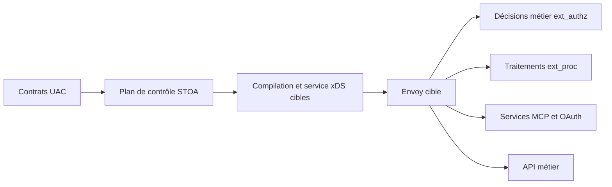

# Architecture actuelle et cible

:::info État actuel et direction cible
La passerelle de R1 est actuellement en **Rust**. **Envoy est la cible décidée**, avec une migration à venir. Cette page ne constitue pas une attestation de disponibilité ou de performance. Voir [l’ADR Envoy](/docs/architecture/adr/adr-073-adopt-envoy-data-plane/).
:::

## Architecture actuelle

Le parcours R1 utilise une passerelle Rust, un plan de contrôle FastAPI, PostgreSQL, Keycloak et un backend fictif. Le script de vérification déclare directement un contrat sur la passerelle. Le plan de contrôle y répond au contrôle de santé ; cela ne prouve pas la publication d’API par celui-ci.

## Architecture cible

Cette cible reste à implémenter et à qualifier. Envoy assure le moteur de proxy ; les services STOA conservent contrats, politiques et logique agents. Le plan de contrôle du maillage existant, s’il y en a un, reste distinct.

## Différences et migration

| Périmètre | R1 actuel | Direction cible |
|---|---|---|
| Moteur de proxy | Passerelle Rust | Envoy |
| Déclaration du scénario local | Directement sur la passerelle | Compilation et réconciliation via le plan de contrôle |
| Services métier et MCP | Capacités à valider selon le parcours | Services applicatifs derrière Envoy |
| Preuve d’application | Script local à exécuter | ACK/NACK et vérification du routage et des politiques |

La migration doit démontrer la parité des contrats, audiences et refus d’accès, les pannes des services et le repli. Aucune date ni mesure de performance Envoy n’est annoncée.

## Dépôts publics et configuration

Seuls [stoa](https://github.com/stoa-platform/stoa) et [stoa-quickstart](https://github.com/stoa-platform/stoa-quickstart) sont cités comme dépôts publics du produit. Les autres composants ne sont pas publiés.

Les coordonnées d’environnement sont fournies par l’exploitant, par exemple `STOA_API_URL`, `STOA_GATEWAY_URL`, `STOA_AUTH_URL`. Les secrets restent hors du dépôt et des journaux.

## Documents associés

- [Décision Envoy](/docs/architecture/adr/adr-073-adopt-envoy-data-plane/)
- [Quickstart local R1](/docs/guides/quickstart/)
- [État d’implémentation](/docs/concepts/implementation-status/)
