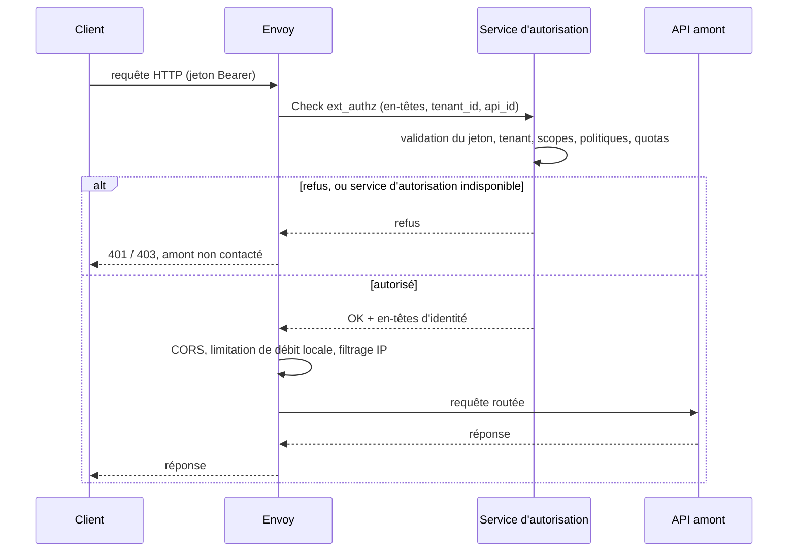

# Plan de données

Ce document décrit comment le plan de données STOA traite une requête. STOA est une plateforme souveraine d'API et d'intégration (iPaaS) dotée d'un module MCP ; l'[ADR-073](./adr/adr-073-adopt-envoy-data-plane.md) décide que le plan de données utilise Envoy amont, configuré uniquement par xDS par STOA Link, la logique STOA s'exécutant dans des services externes appelés par Envoy. L'ADR-073 laisse ouverts le périmètre détaillé de l'iPaaS et plusieurs détails d'implémentation.

Deux niveaux sont distingués tout au long du document :

- **Décidé** — ce que l'ADR-073 et l'[ADR-070](/docs/architecture/adr/adr-070-gateway-fail-closed-posture) fixent comme cible.
- **Dans le dépôt** — ce que contient le dépôt public `stoa` à une révision épinglée ; chaque lien vers le code ci-dessous pointe vers cette révision.

Aucun chiffre de performance ne figure ici. L'ADR-073 indique que toute affirmation de performance sur le plan de données Envoy viendra d'un benchmark exécuté selon la méthodologie de l'[ADR-049](./adr/adr-049-enterprise-ai-native-benchmark.md) ; les mesures réalisées sur l'ancienne passerelle maison ne sont pas reprises.

## Composants

| Composant | Rôle | Décidé (ADR-073) | Dans le dépôt |
|---|---|---|---|
| **Envoy** | Écoute, route, répartit la charge, termine TLS, exécute les filtres natifs | Version amont non modifiée, aucune extension chargée (ni Wasm, ni Lua, ni module dynamique), configurée uniquement par xDS (§1, §2) | Une image amont épinglée est exercée par le [harnais d'acceptation hors ligne][o1-doc] |
| **STOA Link** (`stoa-connect`) | Agent sur site : connexion SSE sortante vers le plan de contrôle, serveur xDS local, remontée `SYNCED` / `FAILED` | §2, §7 | [Mode Envoy][envoy-md], [constructeur d'instantanés xDS][snapshot], [serveur ADS][ads] |
| **Service d'autorisation** | Appelé par le filtre `ext_authz` d'Envoy avant le routage | Clés d'API, abonnements, isolation des tenants, politiques OPA, quotas consommateur, liaison du jeton quand Envoy ne la contrôle pas (§4, §5, §10) | Adaptateur gRPC `envoy.service.auth.v3` placé devant la logique de politiques existante : [`ExtAuthzService`][ext-authz] |
| **Service de traitement** | Appelé par `ext_proc` pour les fonctions qui ont besoin du corps des requêtes ou des réponses (garde-fous, budgets de jetons, compression, transformation) | §4 | Absent de l'instantané de référence |
| **Module MCP** | Service amont derrière Envoy : protocole MCP, registre d'outils, autorisation par outil | §4, §10 ; permissions d'outils refusées par défaut selon l'ADR-070 | Vérification de l'artefact de politique signé : [`policy_artifact.rs`][artifact], [`tool_permissions.rs`][tool-perms] |
| **Collecteur de comptage d'usage** | Service de journaux d'accès produisant les événements d'usage vers Kafka | §4, transport à confirmer | Absent de l'instantané de référence |

Community et Enterprise utilisent la même version d'Envoy ; elles ne diffèrent que par la configuration générée et par les services STOA déployés (ADR-073 §6).

## Livraison de la configuration

Envoy reçoit sa configuration uniquement par xDS, servie sur le site client par STOA Link. Le chemin de déploiement est le chemin unique de l'[ADR-059](./adr/adr-059-simplified-deployment-sse.md), et le plan de contrôle n'ouvre jamais de connexion vers le site (ADR-073 §2) :

```text
Console → API du plan de contrôle → SSE → STOA Link → xDS → Envoy
                                             ↓
                          rappel SYNCED / FAILED → API du plan de contrôle
```

Dans le dépôt, le [mode Envoy][envoy-md] de `stoa-connect` doit être sélectionné explicitement au moyen de `STOA_GATEWAY_TYPE` ; la détection automatique ne le choisit jamais. L'[écouteur ADS][ads-main] du Link n'écoute que sur une adresse de bouclage, exige du TLS mutuel (TLS 1.3 au minimum) et identifie le client Envoy par l'unique SAN de type URI de sa chaîne de certificats vérifiée ; l'identifiant de nœud déclaré dans les requêtes de découverte n'est jamais une donnée d'authentification. Chaque publication est un instantané complet (state-of-the-world) des clusters, de l'écouteur et des routes, versionné par un condensat de son contenu. Le Link attend les acquittements CDS, LDS et RDS ; un NACK ou un délai dépassé est une erreur de déploiement, et les dernières routes et politiques acquittées sont conservées ([constructeur d'instantanés][snapshot], [serveur ADS][ads]). Les routes et les politiques arrivent par le point d'accès de configuration des passerelles du plan de contrôle et par les événements SSE. L'[adaptateur Envoy][adapter] refuse les générations périmées et toute perte de route sans marqueur de suppression explicite (tombstone), et réconcilie atomiquement l'ensemble complet des politiques applicables : un inventaire rejeté n'est jamais appliqué partiellement ([inventaire du plan de contrôle][inventory]).

Décidé mais absent du dépôt à cette révision : la traduction UAC → xDS dans un composant dédié du plan de contrôle (§2), le JWKS diffusé par xDS (§10) et le contenu de l'amorçage de chaque instance Envoy (§2, à confirmer). Aujourd'hui, le Link construit l'instantané à partir de l'inventaire de routes et de politiques qu'il reçoit.

## Chaîne de traitement d'une requête

Le diagramme représente l’implémentation de référence à la révision épinglée, pas la cible décidée.



L'[instantané de référence][snapshot] installe cette chaîne de filtres HTTP sur l'écouteur : `ext_authz` d'abord, puis `cors`, `local_ratelimit` et `rbac` dès qu'une route porte une politique, puis le routeur. Le filtre d'autorisation externe refuse les requêtes en cas de défaillance du service d’autorisation et utilise un service gRPC sur un cluster HTTP/2 dédié, et chaque route transmet `tenant_id` et `api_id` au service d'autorisation en tant qu'extensions de contexte. L'autorisation s'exécute donc avant CORS et peut refuser une requête de pré-vérification (preflight) sans contacter l'amont ([mode Envoy][envoy-md]).

### Validation des jetons

- **Décidé.** Le filtre `jwt_authn` d'Envoy valide les signatures et les revendications standard contre le JWKS de Keycloak, diffusé localement par xDS (ADR-073 §5, §10). Reste à vérifier si ce filtre contrôle les jetons liés à un certificat (RFC 8705) et les preuves DPoP (RFC 9449) ; sinon, le service d'autorisation effectue ce contrôle en conservant le contrat d'erreurs de l'[ADR-039](./adr/adr-039-mtls-cert-bound-tokens.md).
- **Dans le dépôt.** L'instantané de référence ne contient pas de filtre `jwt_authn` ; le [service d'autorisation][ext-authz] valide lui-même le jeton. Il exige une audience configurée (sinon toute requête est refusée et la passerelle se déclare non prête), valide le jeton Bearer contre le JWKS du fournisseur OIDC avec un délai borné, exige une revendication de tenant égale au `tenant_id` de la route et exige chaque scope configuré (revendications `scope` et `scp`). Un jeton absent donne 401 avec `WWW-Authenticate: Bearer` ; un jeton invalide 401 ; un tenant ou un scope non conforme 403. En production, lorsque l’écouteur d’autorisation externe est activé, la passerelle [refuse de démarrer][loader] si l’audience manque ou si la liste de scopes est vide ou contient une entrée blanche.

### Autorisation et propagation de l'identité

Le service d'autorisation normalise les en-têtes (minuscules, pas de doublon, pas de CRLF), puis retire de l'entrée de décision tout en-tête d'identité entrant (`x-stoa-*`, `x-user-*`, `x-tenant-id`, …) ainsi que les en-têtes `authorization`, `cookie` et `proxy-authorization` : un client ne peut pas forger une identité à destination de l'amont. Le [moteur de décision][decision] partagé évalue politiques et quotas sur une entrée indépendante de la passerelle. En cas d'autorisation, Envoy ajoute `x-stoa-tenant-id` et `x-stoa-api-id` à la requête amont et retire les en-têtes d'identité entrants. Chaque décision est journalisée comme événement `ext_authz_decision` avec un ensemble fermé de motifs de refus, jamais le jeton ni une revendication ([`ExtAuthzService`][ext-authz]).

### Limitation de débit et quotas

- **Décidé.** Il n'y a pas de service de limitation de débit séparé. Les quotas consommateur sont contrôlés par le service d'autorisation : quotas facturés et budgets MCP par une mise à jour atomique dans PostgreSQL en échec fermé, quotas non facturés par des compteurs écrits par lots avec un mode dégradé borné. Le filtre `local_ratelimit` d'Envoy ne sert qu'à la protection grossière (ADR-073 §4, §10).
- **Dans le dépôt.** Une politique `rate_limit` (`maxRequests`, `intervalSeconds`) devient un seau à jetons local par route et par processus Envoy ; ce n'est ni un quota distribué ni une fenêtre fixe ([traduction des politiques][policy]). Les décisions de quota consommateur du service d'autorisation portent un en-tête `Retry-After` calculé à partir de la réinitialisation de la fenêtre ([`ExtAuthzService`][ext-authz]).

### Politiques

Les politiques sont générées à partir des objets du plan de contrôle et ne sont jamais modifiées à la main sur Envoy (ADR-073 §3). Le traducteur v1 du dépôt prend en charge trois types ; tout le reste est refusé explicitement plutôt qu'ignoré ([mode Envoy][envoy-md], [traduction des politiques][policy]) :

| Politique | Filtre Envoy | Comportement |
|---|---|---|
| `cors` | `envoy.filters.http.cors` | Les six clés du contrat, par route ; `OPTIONS` est accepté sur les routes à méthodes restreintes pour la pré-vérification |
| `rate_limit` | `envoy.filters.http.local_ratelimit` | Seau à jetons par route et par processus Envoy |
| `ip_filter` | `envoy.filters.http.rbac` | Autorisation ou refus sur l'adresse du pair direct (CIDR ou adresse seule) ; les en-têtes d'adresse transmise ne sont pas pris en compte |
| `jwt_validation`, `logging`, `caching`, `transform`, OIDC | — | Non pris en charge : l'inventaire est rejeté et rien n'est publié |

Les portées `gateway` et `tenant` s'étendent aux routes correspondantes ; la portée `api` cible des identifiants exacts du catalogue. Deux règles du même type sur une route sont rejetées plutôt que fusionnées ou ordonnées par priorité. Le plan de contrôle attribue à chaque politique `scope`, cibles, `tenant_id` et `applicable`, et une liaison d'API vide n'est jamais élargie à la portée passerelle ([inventaire][inventory]).

### Routage

Chaque route activée devient une correspondance de préfixe sur son chemin (`path_prefix`, ou `/apis/{api_id}` par défaut) avec une entrée par méthode autorisée, et un cluster amont par route résolu par adresse statique ou par DNS strict. Un backend `https` reçoit un contexte TLS amont avec le SNI positionné sur l'hôte et le magasin d'autorités du système comme ancre de confiance ([constructeur d'instantanés][snapshot]). Les positions `edge-mcp`, `proxy`, `sidecar` et `shadow` de l'[ADR-024](./adr/adr-024-gateway-unified-modes.md) deviennent des profils de configuration générés par STOA plus l'ensemble des services STOA déployés (ADR-073 §8) ; dans le dépôt, le serveur ADS sert un seul nœud vérifié.

## Comportement en cas de panne

| Situation | Décidé | Dans le dépôt |
|---|---|---|
| Service d'autorisation injoignable ou délai dépassé | Envoy refuse avec HTTP 503, corps neutre identique au 403, `Retry-After` borné, aucune relance automatique des méthodes non idempotentes ni des appels MCP `tools/call` (ADR-073 §10) | Les requêtes sont refusées en cas de défaillance de l’autorisation, avec un délai borné fixé par le Link ; le harnais vérifie qu'un échec gRPC ou un délai dépassé renvoie 403 sans atteindre l'amont ([constructeur d'instantanés][snapshot], [harnais][o1-doc]) |
| Envoy rejette une configuration (NACK) | Le Link remonte `FAILED` ; la détection de dérive s'appuie sur la version acquittée (§2) | Erreur de déploiement ; les dernières routes et politiques acquittées sont conservées ([adaptateur][adapter]) |
| Plan de contrôle injoignable | Les permissions d'outils sont refusées par défaut : autorisation uniquement selon un artefact de politique signé et de courte durée, jusqu'à son expiration, jamais prolongé localement ; une révocation prime sur le cache ; la disponibilité (readiness) reflète l'état réel de l'application des politiques ([ADR-070](/docs/architecture/adr/adr-070-gateway-fail-closed-posture)) | Vérification d'un artefact JWS compact avec des clés Ed25519 épinglées ([`policy_artifact.rs`][artifact]) ; rien n'est autorisé après le démarrage tant qu'une politique fraîche n'est pas chargée ([`tool_permissions.rs`][tool-perms]) |
| Audience absente hors production, écouteur d’autorisation externe activé | — | Requêtes refusées, `/ready` renvoie 503, la santé gRPC se déclare hors service ([disponibilité][ready], [démarrage][main]) |
| Liste de scopes vide hors production, audience valide | — | Le démarrage émet un avertissement ; les contrôles de scopes sont ignorés et les requêtes peuvent être autorisées. La santé gRPC se déclare en service ; la disponibilité HTTP dépend toujours de ses autres contrôles ([validation de configuration][loader], [moteur de décision][decision], [disponibilité][ready], [démarrage][main]) |
| Audience absente ou liste de scopes vide ou contenant une entrée blanche en production, écouteur d’autorisation externe activé | — | La validation de configuration refuse le démarrage ; aucun serveur démarré ne produit de réponse ([validation de configuration][loader]) |
| JWKS injoignable au démarrage | — | Le démarrage émet un avertissement et les requêtes restent en échec fermé ([démarrage][main]) |

L'écouteur gRPC `ext_authz` du service d'autorisation n'a pas de TLS propre : le code de démarrage avertit lorsqu'il est lié à une adresse autre que de bouclage et suppose un réseau privé de confiance ([démarrage][main]).

## Vérification dans le dépôt

Le [harnais d'acceptation hors ligne][o1-doc] exécute le routeur de déploiement du plan de contrôle, l'agent Go et ses adaptateurs, le serveur ADS en TLS mutuel, un processus Envoy réel issu d'une image épinglée et un témoin gRPC `Check` indépendant, sans accès réseau externe ; les connexions locales et le pont Docker sont utilisés. Il vérifie, entre autres, que le nombre de routes ne diminue jamais pendant une publication, que seuls des marqueurs de suppression explicites retirent des routes, que la publication d'une passerelle étrangère laisse l'instantané inchangé, que l'ancien instantané continue de servir pendant une coupure SSE, que les comportements CORS, seau à jetons et filtrage d'adresses sont observés sur de vraies réponses, que `Check` précède le routage et qu'une pré-vérification CORS ne peut pas contourner un refus. Un workflow CI manuel ([`o1-envoy-real-proof.yml`][o1-ci]) exécute le même harnais à la demande. Le harnais valide le contrat d'intégration, pas l'autorisation métier STOA ; ses relevés de temps sont des délais de test, pas des affirmations de performance.

## Notes de périmètre

- La passerelle Rust maison n'est plus le plan de données stratégique et entre en maintenance (ADR-073 §9) ; sa logique de politiques est réutilisée derrière l'adaptateur `ext_authz` décrit ci-dessus.
- Les passerelles tierces raccordées par des adaptateurs ([ADR-035](./adr/adr-035-gateway-adapter-pattern.md)) n'appellent pas directement le service d'autorisation STOA pour l'instant (ADR-073 §8).

[envoy-md]: https://github.com/stoa-platform/stoa/blob/4290bb39fe57de7516c46ea675a5c90ce4ed13f8/stoa-go/cmd/stoa-connect/ENVOY.md
[ads-main]: https://github.com/stoa-platform/stoa/blob/4290bb39fe57de7516c46ea675a5c90ce4ed13f8/stoa-go/cmd/stoa-connect/envoy.go
[ads]: https://github.com/stoa-platform/stoa/blob/4290bb39fe57de7516c46ea675a5c90ce4ed13f8/stoa-go/internal/xds/server.go
[snapshot]: https://github.com/stoa-platform/stoa/blob/4290bb39fe57de7516c46ea675a5c90ce4ed13f8/stoa-go/internal/xds/snapshot.go
[policy]: https://github.com/stoa-platform/stoa/blob/4290bb39fe57de7516c46ea675a5c90ce4ed13f8/stoa-go/internal/xds/policy.go
[adapter]: https://github.com/stoa-platform/stoa/blob/4290bb39fe57de7516c46ea675a5c90ce4ed13f8/stoa-go/internal/connect/adapters/envoy.go
[inventory]: https://github.com/stoa-platform/stoa/blob/4290bb39fe57de7516c46ea675a5c90ce4ed13f8/control-plane-api/src/services/envoy_policy_inventory.py
[ext-authz]: https://github.com/stoa-platform/stoa/blob/4290bb39fe57de7516c46ea675a5c90ce4ed13f8/stoa-gateway/src/authz/ext_authz_grpc.rs
[decision]: https://github.com/stoa-platform/stoa/blob/4290bb39fe57de7516c46ea675a5c90ce4ed13f8/stoa-gateway/src/mode/decision.rs
[loader]: https://github.com/stoa-platform/stoa/blob/4290bb39fe57de7516c46ea675a5c90ce4ed13f8/stoa-gateway/src/config/loader.rs
[main]: https://github.com/stoa-platform/stoa/blob/4290bb39fe57de7516c46ea675a5c90ce4ed13f8/stoa-gateway/src/main.rs
[ready]: https://github.com/stoa-platform/stoa/blob/4290bb39fe57de7516c46ea675a5c90ce4ed13f8/stoa-gateway/src/lib.rs
[artifact]: https://github.com/stoa-platform/stoa/blob/4290bb39fe57de7516c46ea675a5c90ce4ed13f8/stoa-gateway/src/control_plane/policy_artifact.rs
[tool-perms]: https://github.com/stoa-platform/stoa/blob/4290bb39fe57de7516c46ea675a5c90ce4ed13f8/stoa-gateway/src/control_plane/tool_permissions.rs
[o1-doc]: https://github.com/stoa-platform/stoa/blob/4290bb39fe57de7516c46ea675a5c90ce4ed13f8/docs/testing/o1-offline-envoy.md
[o1-ci]: https://github.com/stoa-platform/stoa/blob/4290bb39fe57de7516c46ea675a5c90ce4ed13f8/.github/workflows/o1-envoy-real-proof.yml
