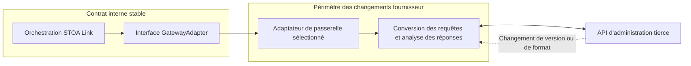

## Objectif et public concerné

Ce document explique la frontière des adaptateurs aux architectes et responsables d'intégration qui évaluent le positionnement **Sovereign iPaaS — API & integration platform** de STOA, avec son module MCP. Il distingue les implémentations existantes de l'architecture cible Envoy. Il s'appuie sur [ADR-035](./adr/adr-035-gateway-adapter-pattern.md) et [ADR-073](./adr/adr-073-adopt-envoy-data-plane.md) ; ADR-073 laisse le périmètre détaillé de l'iPaaS ouvert.

## Sources et périmètre

Les liens d'implémentation ci-dessous ciblent une révision examinée du dépôt public `stoa`. La lecture ne nécessite aucune passerelle active ni aucun identifiant d'accès. L'interface Python du plan de contrôle et l'interface Go utilisée par STOA Link sont des contrats distincts, qui ne sont pas interchangeables.

- [Interface Python et type de résultat][python-interface], [registre des adaptateurs][registry] et [conversion des requêtes et réponses][mappers].
- [Interface Go et types partagés][go-interface], [synchronisation des routes par Link][route-sync] et [implémentation propre à une passerelle][go-adapter].
- [ADR-059 : déploiement via STOA Link](./adr/adr-059-simplified-deployment-sse.md).

## Frontière d'isolation

Un adaptateur traduit une opération interne vers l'API d'administration de la passerelle, puis traduit la réponse en retour. ADR-035 place le comportement propre au fournisseur derrière une interface abstraite et désigne explicitement les fonctions de conversion spécifiques à chaque version comme réponse aux changements d'API. Il s'agit d'une **isolation du code et du contrat** : cela ne promet pas un processus ou un environnement cloisonné par adaptateur.

Le schéma représente la frontière Go de Link, pas le chemin du trafic des requêtes. Le synchroniseur de routes reçoit un `GatewayAdapter` et appelle `SyncRoutes` ; l'implémentation contient les requêtes HTTP et l'analyse propres à la passerelle ([interface][go-interface], [appelant][route-sync], [implémentation][go-adapter]).

| Couche | Responsabilité | Source |
|--------|----------------|--------|
| Orchestration interne | Appeler les opérations communes et interpréter leurs résultats | [Synchroniseur de routes Link][route-sync] |
| Contrat interne | Définir les opérations et les types communs d'entrée et de sortie | [Interface Go][go-interface], [interface Python][python-interface] |
| Adaptateur et conversions | Traduire les données, appeler l'API d'administration, normaliser les réponses | [Implémentation Go][go-adapter], [conversions Python][mappers] |
| Sélection de l'adaptateur | Résoudre une implémentation concrète selon le type de passerelle | [Registre Python][registry] |

## Ce qui reste stable

Le contrat Python couvre le cycle de vie, les API, les politiques, les applications, la configuration d'authentification, les alias, la configuration globale de la passerelle et les archives. `AdapterResult` contient `success`, `resource_id`, `data` et `error`. Les types de retour varient selon la méthode : les opérations de liste retournent des listes, certaines méthodes de cycle de vie ne retournent rien et l'export d'archive retourne des octets. L'interface exige des opérations idempotentes ; c'est une exigence du contrat, pas l'affirmation que chaque implémentation a démontré son idempotence ([interface Python][python-interface]).

Le contrat Go définit `Detect`, `Discover`, `ApplyPolicy`, `RemovePolicy`, `SyncRoutes` et `InjectCredentials`. Il utilise des types partagés comme `Route`, `DiscoveredAPI` et `SyncResult`. `SyncRoutes` retourne un résultat et une erreur ; les appelants doivent examiner les deux. Les opérations OIDC et d'alias disposent d'interfaces d'extension distinctes ([interface Go][go-interface]).

La stabilité consiste à préserver ces opérations et leur sémantique pour les appelants, tout en absorbant un changement d'API fournisseur dans l'adaptateur concerné. Elle n'implique pas des capacités identiques pour toutes les passerelles : ADR-035 reconnaît explicitement que certaines fonctions se traduisent mal dans l'abstraction.

## Lorsqu'une passerelle tierce évolue

Pour un changement d'API d'administration qui exprime toujours la même opération interne, le périmètre prévu comprend l'adaptateur concerné, ses conversions ou fonctions d'analyse et ses tests. L'orchestration et l'interface partagée restent inchangées. Cela découle de la maintenance indépendante et des conversions par version prévues par ADR-035 ; le code sépare l'[appelant][route-sync] de l'[implémentation fournisseur][go-adapter].

La revue de maintenance peut suivre ces étapes :

1. Identifier l'opération et le format ou point d'accès fournisseur concernés dans l'adaptateur. Comparer le comportement à l'interface partagée plutôt que d'exposer un champ fournisseur aux appelants ([interface Go][go-interface], [implémentation][go-adapter]).
2. Adapter la conversion des requêtes et la normalisation des réponses dans ce périmètre. Le module Python illustre les deux sens : spécification interne d'API vers service de passerelle, puis service vers données d'API normalisées ([conversions][mappers]).
3. Vérifier les mêmes résultats visibles par l'appelant avec des réponses fournisseur de test actualisées. Les tests Go de l'adaptateur utilisent un serveur HTTP de test ; ceux du synchroniseur de routes vérifient séparément l'orchestration ([tests de l'adaptateur][adapter-tests], [tests d'orchestration][route-tests]).
4. Exécuter les vérifications pertinentes avant d'accepter le changement. Le workflow CI Go compile les deux binaires et exécute les tests avec le détecteur de courses de données ([workflow][go-ci]). Ce document n'affirme pas qu'une future version fournisseur a déjà passé ces vérifications.

Si une nouvelle fonction fournisseur dépasse la sémantique actuelle, modifier seulement l'adaptateur ne suffit pas. Il faut traiter cela comme une évolution du contrat, examiner ses appelants et les limites de capacité, et conserver un comportement explicitement non pris en charge lorsque nécessaire. Les interfaces d'extension Go et le résultat Python par défaut de `deploy_contract`, non pris en charge, illustrent ces limites ([interface Go][go-interface], [interface Python][python-interface]).

## Articulation avec la décision Envoy

Selon la décision du 22 octobre 2026, le plan de données STOA doit utiliser Envoy amont. La logique STOA s'exécutera dans des services externes et le module MCP sera placé derrière Envoy. Le chemin de configuration décidé est plan de contrôle → STOA Link → xDS → Envoy ; pour les passerelles tierces, Link continue d'appliquer l'état souhaité via l'interface de chaque passerelle ([ADR-073](./adr/adr-073-adopt-envoy-data-plane.md)).

La traduction des API tierces reste ainsi distincte du chemin de configuration Envoy. ADR-073 place la traduction du [Universal API Contract (UAC)](../concepts/uac.md) vers xDS dans un composant dédié du plan de contrôle, tandis que Link sert des instantanés versionnés. Il précise que le serveur xDS de Link est **non encore implémenté**. La décision décrit donc l'architecture cible ; elle ne prouve ni un déploiement Envoy livré ni une implémentation Envoy existante de l'interface Go des adaptateurs.

## Voir aussi

- [Décision d'orchestration multi-passerelles](./adr/adr-004-gateway-adapter-pattern.md)
- [Décision sur les adaptateurs de passerelle](./adr/adr-035-gateway-adapter-pattern.md)
- [Chemin de déploiement unique](./adr/adr-059-simplified-deployment-sse.md)
- [Décision sur le plan de données Envoy](./adr/adr-073-adopt-envoy-data-plane.md)
- [Guide de l'adaptateur de passerelle hybride : apportez votre propre passerelle](../guides/hybrid-gateway-adapter.md)
- [Usage du compagnon](../guides/companion-usage.md) — `POST /authz` à côté d'un hôte. Distinct de ces adaptateurs d'API de gestion. La synchro GitOps d'une passerelle tierce reste `stoa-connect`.

[python-interface]: https://github.com/stoa-platform/stoa/blob/4290bb39fe57de7516c46ea675a5c90ce4ed13f8/control-plane-api/src/adapters/gateway_adapter_interface.py
[registry]: https://github.com/stoa-platform/stoa/blob/4290bb39fe57de7516c46ea675a5c90ce4ed13f8/control-plane-api/src/adapters/registry.py
[mappers]: https://github.com/stoa-platform/stoa/blob/4290bb39fe57de7516c46ea675a5c90ce4ed13f8/control-plane-api/src/adapters/kong/mappers.py
[go-interface]: https://github.com/stoa-platform/stoa/blob/4290bb39fe57de7516c46ea675a5c90ce4ed13f8/stoa-go/internal/connect/adapters/adapter.go
[route-sync]: https://github.com/stoa-platform/stoa/blob/4290bb39fe57de7516c46ea675a5c90ce4ed13f8/stoa-go/internal/connect/sync_route.go
[go-adapter]: https://github.com/stoa-platform/stoa/blob/4290bb39fe57de7516c46ea675a5c90ce4ed13f8/stoa-go/internal/connect/adapters/kong.go
[adapter-tests]: https://github.com/stoa-platform/stoa/blob/4290bb39fe57de7516c46ea675a5c90ce4ed13f8/stoa-go/internal/connect/adapters/kong_test.go
[route-tests]: https://github.com/stoa-platform/stoa/blob/4290bb39fe57de7516c46ea675a5c90ce4ed13f8/stoa-go/internal/connect/sync_route_test.go
[go-ci]: https://github.com/stoa-platform/stoa/blob/4290bb39fe57de7516c46ea675a5c90ce4ed13f8/.github/workflows/stoa-go-ci.yml
