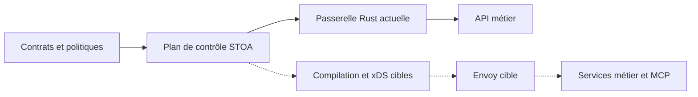

# Architecture de STOA

:::info État actuel et direction cible
La passerelle de R1 est actuellement en **Rust**. **Envoy est la cible décidée**, avec une migration à venir. Cette page ne constitue pas une attestation de disponibilité ou de performance. Voir [l’ADR Envoy](/docs/architecture/adr/adr-098-envoy-data-plane/).
:::

STOA est un iPaaS Souverain au positionnement européen, avec sa passerelle et son plan de contrôle.

## Architecture générale

Le plan de contrôle gère les contrats UAC, les politiques et la publication. Le plan de données exécute les requêtes. La publication d’un contrat n’atteste pas à elle seule son application effective.

Les flèches en pointillés représentent la cible, sans intégration livrée présumée.

## Composants

| Rôle | Périmètre |
|---|---|
| Plan de contrôle FastAPI | Contrats, politiques, orchestration |
| Passerelle actuelle Rust | Exécution du parcours R1 |
| Envoy cible | Transport et routage après migration |
| Keycloak | Identité dans le parcours local |
| PostgreSQL | Base du plan de contrôle dans le Compose |
| Interfaces de gestion | Console et Portal hors du quickstart R1 |

## Sécurité et données

La migration doit préserver isolation des tenants et audiences par contrat, avec refus par défaut en cas d’indisponibilité d’une décision de sécurité. Les secrets sont fournis par l’exploitant et ne sont pas publiés dans les contrats ou journaux.

Le quickstart ne nécessite pas de broker. Les intégrations événementielles d’autres parcours ne sont pas une dépendance à ajouter au Compose R1.

## Déploiement

Le [quickstart local](/docs/guides/quickstart/) est le point d’entrée principal. Les autres déploiements demandent une validation propre à leur environnement. Les URL et paramètres sont fournis par le lecteur ; aucun inventaire d’exploitation n’est publié ici.

## Pour aller plus loin

- [Vue détaillée actuelle et cible](/docs/architecture/architecture-overview/)
- [État d’implémentation](/docs/concepts/implementation-status/)
