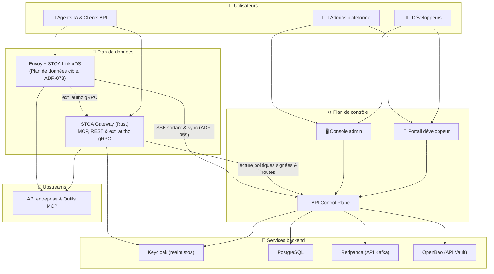
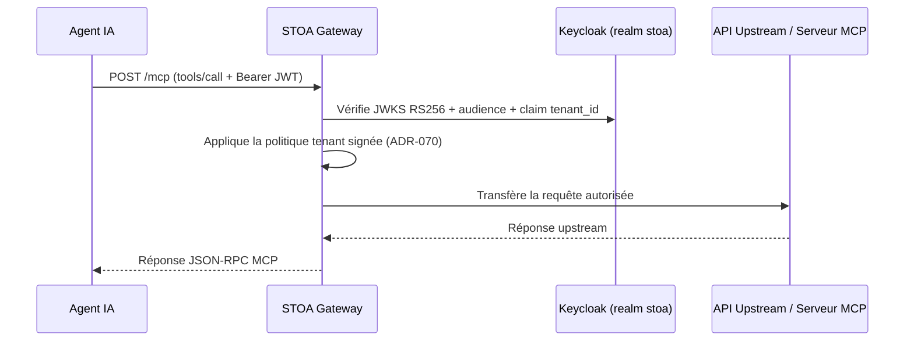

# Vue d'ensemble de l'architecture

STOA Platform est conçue comme une plateforme de passerelle cloud-native et multi-tenant, construite pour les API traditionnelles et les agents IA.

## Architecture de haut niveau

STOA suit un modèle de séparation **Plan de contrôle / Plan de données**, similaire à Kubernetes et Istio.



### Plan de contrôle vs Plan de données

| Aspect | Plan de contrôle | Plan de données |
|--------|------------------|-----------------|
| **Rôle** | Configuration, catalogue & gouvernance | Exécution du trafic & application des politiques |
| **Composants** | API Control Plane, Portail, Console, `stoa-operator` | `stoa-gateway` (Rust, maintenance) & Envoy upstream + `stoa-connect` (STOA Link, [ADR-073](/docs/architecture/adr/adr-073-adopt-envoy-data-plane)) |
| **Latence** | Échelle humaine (ms OK) | Échelle machine (quelques ms) |
| **Mise à l'échelle** | Modérée | Élevée (par requête, horizontale) |

:::tip Décisions d'architecture
Cette séparation et l'évolution du plan de données sont documentées dans [ADR-001 : Stratégie d'exposition des API](/docs/architecture/adr/adr-001-api-exposure-strategy) et [ADR-073 : Adoption d'Envoy comme plan de données principal](/docs/architecture/adr/adr-073-adopt-envoy-data-plane).
:::

## Composants principaux

### API du Plan de contrôle

L'API centrale de gestion construite avec **Python** et **FastAPI** (`control-plane-api/`).

| Aspect | Détails |
|--------|---------|
| Langage | Python 3.11 (`requires-python >= 3.11`) |
| Framework | FastAPI (asynchrone) |
| Base de données | PostgreSQL 15 / 16 + SQLAlchemy (schéma partagé filtré par `tenant_id`) |
| Streaming d'événements | Redpanda / Kafka ([ADR-005](/docs/architecture/adr/adr-005-event-driven-kafka)) |
| Auth | Keycloak OIDC (realm `stoa`, [ADR-074](/docs/architecture/adr/adr-074-tenant-model)) |

**Responsabilités :**
- Gestion des abonnements et du catalogue d'API
- Provisionnement des tenants (`setup_tenant_group` dans Keycloak)
- Émission des artefacts de politiques passerelle signés Ed25519 ([ADR-070](/docs/architecture/adr/adr-070-gateway-fail-closed-posture))
- Orchestration multi-passerelles via les 6 adaptateurs du Control Plane : Kong, Gravitee, webMethods, Apigee, AWS API Gateway et Azure APIM ([ADR-035](/docs/architecture/adr/adr-035-gateway-adapter-pattern))
- Suivi de l'utilisation et pistes d'audit

### STOA Gateway & Plan de données Envoy

STOA exploite une passerelle Rust en production tout en faisant converger la couche proxy L4/L7 vers Envoy upstream ([ADR-073](/docs/architecture/adr/adr-073-adopt-envoy-data-plane)) :

| Aspect | Production actuelle (`stoa-gateway`) | Plan de données cible (`Envoy` + `STOA Link`) |
|--------|--------------------------------------|-----------------------------------------------|
| Implémentation | Rust (`Tokio` + `axum`) | Envoy upstream + `stoa-connect` (Go xDS ADS) + `ext_authz` gRPC Rust |
| Cycle de vie | Production / Maintenance | Briques activables implémentées ; bascule de topologie en cours |
| Moteur de politiques | Politiques signées Ed25519 ([ADR-070](/docs/architecture/adr/adr-070-gateway-fail-closed-posture)) + OPA | Filtres natifs Envoy (`cors`, `rate_limit`, `ip_filter`) + `ExtAuthzService` gRPC (JWT, `tenant_id`, audience/scopes & `DecisionEngine` ; permissions d'outils MCP distinctes selon [ADR-070](/docs/architecture/adr/adr-070-gateway-fail-closed-posture)) |
| Protocoles | MCP (`POST /mcp`, `/mcp/sse`, `/mcp/ws` sur option), REST, A2A | HTTP/1.1, HTTP/2, gRPC, module MCP derrière Envoy |

**Briques livrées sur `main` :**
- **`stoa-gateway` (Rust)** assure les sessions MCP, les routes de contrats REST, l'application fail-closed des politiques par tenant, et supervise sur option un serveur gRPC `envoy.service.auth.v3.Authorization` (`ExtAuthzService`, activé via `STOA_EXT_AUTHZ_GRPC_ADDR`, `STOA_EXT_AUTHZ_AUDIENCE` et `STOA_EXT_AUTHZ_REQUIRED_SCOPES` non vide en `prod`).
- **STOA Link (`stoa-connect`)** ouvre une connexion SSE sortante ([ADR-059](/docs/architecture/adr/adr-059-simplified-deployment-sse)) vers le Control Plane pour recevoir les notifications de déploiement, et embarque un serveur ADS mTLS sur loopback opt-in explicite (`STOA_GATEWAY_TYPE=envoy`) aux côtés de ses adaptateurs Go de routes pour **Kong, Gravitee et webMethods** (l'application des politiques par Link étant refusée pour Kong et Gravitee dans `policy_contract.go`, tandis que les 6 adaptateurs complets résident dans le Control Plane). La parité complète des politiques et la migration de topologie par défaut restent des jalons distincts ([Architecture du plan de données](/docs/architecture/data-plane)).

### Portail UI

Portail développeur en libre-service construit avec **React 19** et **TypeScript** (`portal/`).

**Fonctionnalités :**
- Navigation dans le catalogue d'API et d'outils MCP
- Gestion des abonnements et des clés API
- Tableaux de bord d'utilisation et documentation interactive

### Console UI

Console d'administration construite avec **React 19** et **TypeScript** (`control-plane-ui/`).

**Fonctionnalités :**
- Administration des tenants et des utilisateurs
- Gestion des instances de passerelle et des liaisons (`GatewayBinding`)
- Configuration des politiques, supervision système et journaux d'audit

## Couche de sécurité

### Keycloak

Gestion des identités et des accès ([ADR-074](/docs/architecture/adr/adr-074-tenant-model)) fournissant :
- Realm unique partagé `stoa` (`KEYCLOAK_REALM=stoa`) avec un groupe Keycloak par tenant
- Authentification OIDC/OAuth2, PKCE et claim JWT `tenant_id` vérifié
- RBAC plateforme et scopé par tenant (`cpi-admin`, `tenant-admin`, `devops`, `viewer`)
- Courtage multi-IdP démontré séparément dans la topologie de fédération (profil `federation` de `deploy/docker-compose/`)

### Socle de secrets (OpenBao)

Accessible par l'API HTTP de Vault : **OpenBao 2.7.2** par défaut, ou un HashiCorp Vault existant ([ADR-075](/docs/architecture/adr/adr-075-secrets-backend-openbao), déploiement partiel selon les composants). Utilisé pour :
- Chiffrement des clés API et identifiants
- Secrets des adaptateurs de passerelles
- Matériel TLS et jetons de service

## Couche de données

### PostgreSQL

Base relationnelle principale utilisant un **schéma partagé filtré par `tenant_id`** ([ADR-074](/docs/architecture/adr/adr-074-tenant-model)) :
- Tenants, utilisateurs et abonnements
- API, contrats et définitions de serveurs/outils MCP
- Journaux d'audit du Plan de contrôle

*(Note : STOA n'utilise pas Redis ; les caches de limitation de débit et de jetons s'exécutent en mémoire dans chaque processus.)*

### Redpanda (API Kafka)

Bus d'événements asynchrone ([ADR-005](/docs/architecture/adr/adr-005-event-driven-kafka)) pour :
- Événements de métrologie et d'utilisation
- Pipelines d'audit et de snapshots d'erreurs
- Notifications asynchrones inter-services

:::warning Usage interne uniquement
Redpanda/Kafka est strictement interne sans aucune exposition externe ([ADR-005](/docs/architecture/adr/adr-005-event-driven-kafka)). Toutes les intégrations clientes et agents passent par des API HTTPS/gRPC.
:::

## Stack d'observabilité

| Composant | Usage |
|-----------|-------|
| **Prometheus** | Collecte des métriques et règles d'alerte |
| **Grafana** | Tableaux de bord & visualisation par tenant |
| **OpenSearch** (+ Data Prepper / Fluent Bit) | Journaux structurés, analytique et recherche d'audit |
| **Tempo** | Stockage des traces distribuées OpenTelemetry |
| **Alertmanager** | Routage des alertes |

## Flux d'une requête



1. L'**Agent IA** envoie une requête `POST /mcp` (`tools/call`) accompagnée d'un JWT Bearer Keycloak
2. **STOA Gateway** valide la signature RS256 via le cache JWKS, l'audience (`STOA_MCP_AUDIENCE`) et le claim `tenant_id` ([ADR-074](/docs/architecture/adr/adr-074-tenant-model))
3. La **Gateway** évalue en mode fail-closed l'artefact de politique signé du tenant ([ADR-070](/docs/architecture/adr/adr-070-gateway-fail-closed-posture)) ainsi que les règles OPA
4. La **Gateway** achemine l'appel autorisé vers l'API backend ou le serveur MCP cible
5. La **Gateway** renvoie la réponse JSON-RPC et enregistre la télémétrie

## Déploiement

STOA Platform s'exécute sur **Kubernetes** (ou Docker Compose pour l'évaluation locale) :

- **Charts Helm** : Situés dans `charts/stoa-platform` (charge de travail centrée sur la passerelle + 5 CRD ; Control Plane, UI, Keycloak, PostgreSQL, Redpanda et OpenBao se déploient séparément) et `charts/stoa-observability` dans `stoa-platform/stoa`
- **GitOps** : Compatible ArgoCD
- **IaC** : Modules Terraform prévus (`infra/terraform`)

### Namespace Kubernetes

Les charges de travail passerelle s'exécutent par défaut dans le namespace `stoa-system` :

```bash
kubectl get pods -n stoa-system
```

### Points d'entrée Ingress

| Service | Modèle d'URL |
|---------|--------------|
| Portail | `portal.<domaine>` |
| Console | `console.<domaine>` |
| API Control Plane | `api.<domaine>` |
| Passerelle | `mcp.<domaine>` / `gateway.<domaine>` |
| Auth | `auth.<domaine>` |

## Résumé de la stack technologique

| Couche | Technologie | Notes |
|--------|-------------|-------|
| Plan de contrôle | Python 3.11, FastAPI | API de gestion (`control-plane-api/`) |
| Plan de données (actuel) | Rust, Tokio, axum | `stoa-gateway` (maintenance, MCP + REST + `ext_authz` gRPC) |
| Plan de données (cible) | Envoy upstream + Go (`stoa-connect`) | xDS ADS mTLS loopback + services externes ([ADR-073](/docs/architecture/adr/adr-073-adopt-envoy-data-plane)) |
| Opérateur Kubernetes | Python, Kopf | `stoa-operator` (Bêta, réconcilie `GatewayInstance` / `GatewayBinding`) |
| CLI & Agent Link | Go 1.25 | `stoactl` & `stoa-connect` (`stoa-go/`) |
| Frontend | React 19, TypeScript, Tailwind | Portail développeur & Console admin |
| Base de données | PostgreSQL 15 / 16 | 15 dans le Compose complet / catalogue prod, 16 dans R1 minimal ; schéma partagé filtré par `tenant_id` ([ADR-074](/docs/architecture/adr/adr-074-tenant-model)) |
| Streaming d'événements | Redpanda (API Kafka) | Bus interne d'événements ([ADR-005](/docs/architecture/adr/adr-005-event-driven-kafka)) |
| Auth | Keycloak 26 | Realm unique `stoa` + groupes par tenant ([ADR-074](/docs/architecture/adr/adr-074-tenant-model)) |
| Secrets | OpenBao 2.7.2 / HashiCorp Vault | API HTTP Vault ([ADR-075](/docs/architecture/adr/adr-075-secrets-backend-openbao), déploiement partiel) |
| Observabilité | Prometheus, Grafana, OpenSearch, Tempo | Métriques, journaux, traces |
| Infrastructure | Kubernetes, Helm, ArgoCD | Déploiement déclaratif |

## Étapes suivantes

- [Guide de démarrage rapide](/docs/guides/quickstart) — Lancer STOA en local
- [Architecture du plan de données](/docs/architecture/data-plane) — Détails sur le plan de données actuel et la cible Envoy
- [Référence API](/docs/api/control-plane) — Explorer l'API du Plan de contrôle
- [Passerelle MCP](/docs/concepts/mcp-gateway) — Plongée dans l'intégration MCP
