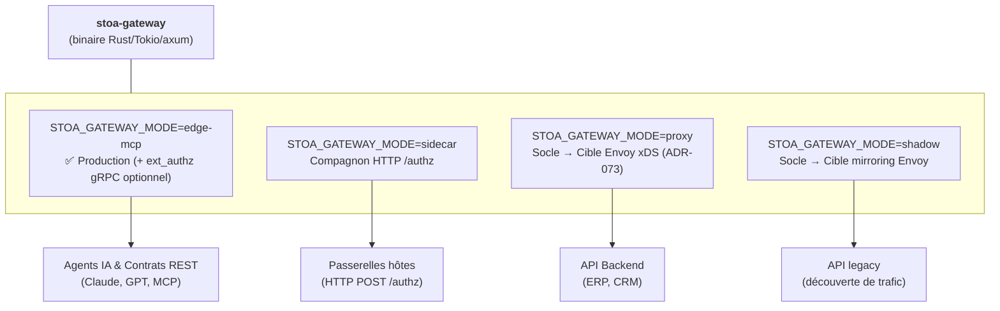

# Passerelle STOA

## Vue d'ensemble

STOA Gateway (`stoa-gateway/`, Rust/Tokio/axum) est le runtime de passerelle AI-native unifié en production depuis février 2026. Il expose quatre profils `STOA_GATEWAY_MODE` ([ADR-024](../architecture/adr/adr-024-gateway-unified-modes)) ainsi qu'un écouteur gRPC `ExtAuthzService` optionnel pour Envoy.

:::info Évolution du plan de données (ADR-073)
Dans le cadre d'[ADR-073 : Adoption d'Envoy comme plan de données principal](../architecture/adr/adr-073-adopt-envoy-data-plane), `stoa-gateway` est en **Production / Maintenance** tandis que les fonctions de proxy L4/L7 convergent vers **Envoy** upstream configuré via **STOA Link** (`stoa-connect` en ADS mTLS loopback) et autorisé par le serveur gRPC `ExtAuthzService` intégré à `stoa-gateway` (`STOA_EXT_AUTHZ_GRPC_ADDR` + `STOA_EXT_AUTHZ_AUDIENCE`). La parité complète des politiques et la bascule de topologie par défaut sont en cours ([Architecture du plan de données](../architecture/data-plane)).
:::

## Vision architecturale



## Modes de déploiement {#deployment-modes}

### Mode Edge-MCP (défaut actuel)

**Statut** : ✅ Production (Maintenance selon [ADR-073](../architecture/adr/adr-073-adopt-envoy-data-plane))

Le mode principal pour l'intégration des agents IA via le Model Context Protocol (MCP) et les routes REST pilotées par contrat.

**Cas d'usage** :
- Intégration Claude.ai et Claude Desktop
- Accès d'agents LLM personnalisés aux API d'entreprise
- Contrats transactionnels REST + MCP (`POST /admin/contracts`)

**Fonctionnalités** :
- Streamable HTTP (`POST /mcp`), SSE (`GET/POST/DELETE /mcp/sse`) et WebSocket sur option (`GET /mcp/ws` lorsque `STOA_WEBSOCKET_ENABLED=true`)
- Gestion des messages JSON-RPC 2.0 unitaires et par lot (`2025-11-25`, `2025-03-26`, `2024-11-05`)
- Registre dynamique d'outils depuis les CRD Kubernetes (`Tool`, `ToolSet`, `Skill`) et synchronisation Control Plane
- Authentification OAuth2/OIDC via Keycloak (realm `stoa`, claim `tenant_id` vérifié, [ADR-074](../architecture/adr/adr-074-tenant-model))
- Application fail-closed des politiques signées Ed25519 par tenant ([ADR-070](/docs/architecture/adr/adr-070-gateway-fail-closed-posture)) et évaluation OPA
- Serveur gRPC `envoy.service.auth.v3.Authorization` optionnel (`STOA_EXT_AUTHZ_GRPC_ADDR` + `STOA_EXT_AUTHZ_AUDIENCE`)

**Exemple** :
```bash
STOA_GATEWAY_MODE=edge-mcp \
STOA_PORT=8080 \
STOA_KEYCLOAK_URL=https://auth.example.com \
STOA_KEYCLOAK_REALM=stoa \
STOA_MCP_AUDIENCE=stoa-mcp \
stoa-gateway
```

**Points d'entrée principaux** :
- `POST /mcp` — Point d'entrée Streamable HTTP JSON-RPC 2.0
- `GET /mcp/sse` & `POST /mcp/sse` — Transport SSE
- `GET /mcp/v1/tools` & `POST /mcp/v1/tools/invoke` — Routes REST compagnons protégées par JWT

---

### Mode sidecar (runtime compagnon)

**Statut** : Runtime présent. Le packaging dans le même pod existe dans `charts/stoa-platform` (`stoaSidecar.enabled=false` par défaut).

Le même binaire démarre avec `STOA_GATEWAY_MODE=sidecar` et répond à `POST /authz` en HTTP. La passerelle hôte conserve l'authentification, le routage et l'application du verdict. Le moteur de décision HTTP compagnon n'évalue pas OPA et n'émet pas d'événements de métrologie Kafka.

:::note Envoy `ext_authz` gRPC vs Compagnon HTTP
`stoa-gateway` se configure exclusivement via les variables d'environnement `STOA_*` ou `config.yaml` (pas d'options CLI `--mode`). Pour le filtre natif gRPC `envoy.filters.http.ext_authz` d'Envoy ([ADR-073](../architecture/adr/adr-073-adopt-envoy-data-plane)), renseignez `STOA_EXT_AUTHZ_GRPC_ADDR` et `STOA_EXT_AUTHZ_AUDIENCE` plutôt que `POST /authz`. Voir [Usage du compagnon](../guides/companion-usage.md) pour les limites de `/authz` HTTP et [stoa-connect](../guides/stoa-connect-quickstart.md) pour la synchronisation Control Plane et l'ADS mTLS loopback.
:::

```text
Client → passerelle hôte → POST /authz → stoa-gateway (sidecar)
                └── sur 200 → backend
```

---

### Mode Proxy

**Statut** : Socle Rust présent ; proxy API L7 complet ciblé sur Envoy upstream via xDS ([ADR-073 §8](../architecture/adr/adr-073-adopt-envoy-data-plane))

Profil de passerelle API classique pour les flux REST/gRPC greenfield avec application complète des politiques.

**Cas d'usage** :
- Nouveaux déploiements d'API nécessitant une gouvernance centralisée
- Remplacement de passerelles legacy sans exposition d'outils MCP
- Plateformes API multi-tenant

**Capacités et trajectoire** :
- `stoa-gateway` sert déjà des routes de contrats dynamiques (`POST /admin/contracts`) et des backends proxy API en mode `edge-mcp`
- Selon [ADR-073 §8](../architecture/adr/adr-073-adopt-envoy-data-plane), le mode `proxy` autonome correspond à un profil listener/cluster Envoy réconcilié par xDS avec contrôle `ExtAuthzService` gRPC

---

### Mode Shadow {#shadow-mode}

**Statut** : ⏸️ Socle de capture Rust présent ; mirroring de trafic en production ciblé sur Envoy ([ADR-073 §8](../architecture/adr/adr-073-adopt-envoy-data-plane)) sous réserve de revue sécurité

Observation passive du trafic pour la découverte d'API legacy et la génération de contrats UAC sans modifier les réponses en ligne.

**Cas d'usage** :
- API legacy sans spécification OpenAPI à jour
- Progiciels black-box (SAP, Oracle, ERP)
- Découverte d'inventaire d'API

**Exigences de sécurité** (avant activation en production) :
- Détection et masquage des PII avant stockage
- Opt-in explicite par API et par tenant
- Rétention < 30 jours avec purge automatique
- Conformité RGPD Article 25

---

## Configuration

### Variables d'environnement

`stoa-gateway` lit les variables préfixées `STOA_*` (ainsi qu'un fichier `config.yaml` optionnel) :

| Variable | Description | Défaut |
|----------|-------------|--------|
| `STOA_GATEWAY_MODE` | Mode de déploiement (`edge-mcp`, `sidecar`, `proxy`, `shadow`) | `edge-mcp` |
| `STOA_PORT` | Port d'écoute HTTP | `8080` |
| `STOA_KEYCLOAK_URL` | URL de base canonique Keycloak | Optionnel (requis pour OIDC) |
| `STOA_KEYCLOAK_REALM` | Realm Keycloak partagé ([ADR-074](../architecture/adr/adr-074-tenant-model)) | `stoa` (dans Helm/Compose) |
| `STOA_MCP_AUDIENCE` | Audience JWT `aud` requise sur MCP (obligatoire si `STOA_ENVIRONMENT=prod`) | Non défini (fail-closed) |
| `STOA_POLICY_ENABLED` | Appliquer les politiques d'outils signées Ed25519 par tenant ([ADR-070](/docs/architecture/adr/adr-070-gateway-fail-closed-posture)) | `true` |
| `STOA_POLICY_BOOT_TENANTS` | Liste CSV de tenants dont la politique signée est exigée au démarrage | Vide |
| `STOA_EXT_AUTHZ_GRPC_ADDR` | Adresse socket gRPC `ExtAuthzService` optionnelle pour Envoy (`host:port`) | Non défini |
| `STOA_EXT_AUTHZ_AUDIENCE` | Audience JWT `aud` requise pour les vérifications gRPC `ext_authz` | Non défini (fail-closed) |
| `STOA_KAFKA_ENABLED` | Activer le producteur interne de métrologie Kafka/Redpanda | `false` |

### CRD Kubernetes

Lorsque `STOA_K8S_WATCHER_ENABLED=true`, `stoa-gateway` surveille les ressources `Tool`, `ToolSet` et `Skill` (`gostoa.dev/v1alpha1`) :

```yaml
apiVersion: gostoa.dev/v1alpha1
kind: Tool
metadata:
  name: my-api-tool
  namespace: stoa-system
spec:
  displayName: My API Tool
  description: A sample tool
  endpoint: https://api.example.com/v1/action
  method: POST
```

Voir la [Référence des CRD Kubernetes](../reference/crds) pour les cinq CRD (`Tool`, `ToolSet`, `Skill`, `GatewayInstance`, `GatewayBinding`).

## Synthèse d'implémentation

| Aspect | Détails |
|--------|---------|
| Répertoire | `stoa-gateway/` |
| Langage & Runtime | Rust (stable), Tokio + axum + tonic |
| Cycle de vie | Production / Maintenance ([ADR-073](../architecture/adr/adr-073-adopt-envoy-data-plane)) |
| Mode actif principal | `edge-mcp` (avec écouteur gRPC `ExtAuthzService` optionnel) |
| Mode compagnon | `sidecar` HTTP `POST /authz` ([Usage du compagnon](../guides/companion-usage.md)) |
| Proxy & Shadow cibles | Envoy upstream via `stoa-connect` xDS ADS ([ADR-073](../architecture/adr/adr-073-adopt-envoy-data-plane)) |

## Documentation associée

- [Architecture du plan de données](../architecture/data-plane)
- [ADR-073 : Adoption d'Envoy comme plan de données principal](../architecture/adr/adr-073-adopt-envoy-data-plane)
- [Usage du compagnon](../guides/companion-usage.md)
- [ADR-024 : Architecture unifiée de la passerelle](../architecture/adr/adr-024-gateway-unified-modes)
- [Référence API de la passerelle MCP](../api/mcp-gateway)
