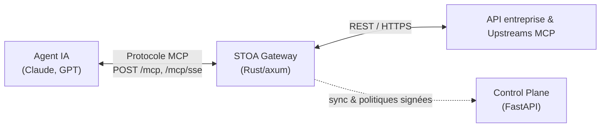
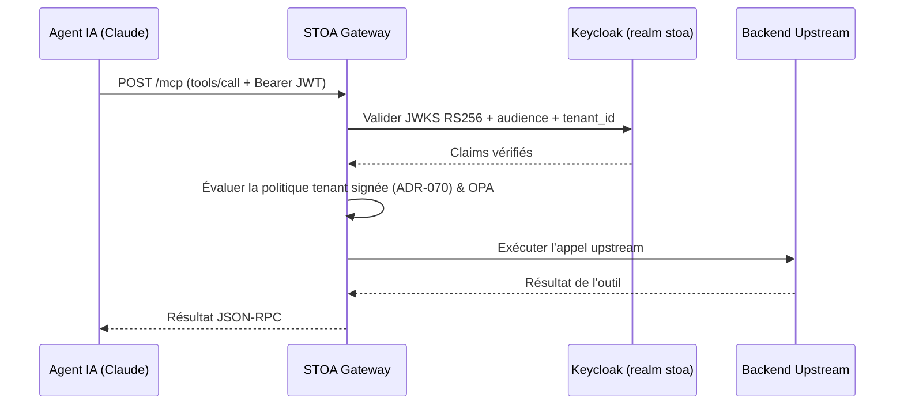

# Passerelle MCP

La passerelle MCP de STOA (`stoa-gateway`) est une **passerelle API MCP-native dédiée**, permettant aux agents IA comme Claude, GPT et les applications LLM personnalisées de consommer les API d'entreprise de manière sécurisée via le Model Context Protocol.

## Vue d'ensemble

La passerelle MCP constitue le pont gouverné entre les agents IA et votre écosystème d'API. Elle assure l'authentification OIDC, la vérification d'audience, l'autorisation d'outils fail-closed par tenant et la limitation de débit tout en parlant nativement le protocole MCP.



## Implémentation

La passerelle MCP est implémentée dans `stoa-gateway/` avec **Rust**, **Tokio** et **axum** — en production depuis février 2026 (en remplacement de l'ancien prototype Python archivé). Selon [ADR-073](/docs/architecture/adr/adr-073-adopt-envoy-data-plane), `stoa-gateway` est en **Production / Maintenance** et évolue vers un module protocole MCP opérant derrière Envoy upstream.

| Aspect | Détails |
|--------|---------|
| Langage | Rust (stable) |
| Framework | Tokio + axum |
| Moteur de politiques | Artefacts de politiques signés Ed25519 ([ADR-070](/docs/architecture/adr/adr-070-gateway-fail-closed-posture)) + OPA |
| Protocole | MCP `2025-11-25` (négociant `2025-03-26` et `2024-11-05`) |
| Statut | Production / Maintenance ([ADR-073](/docs/architecture/adr/adr-073-adopt-envoy-data-plane)) |

## Fonctionnalités clés

### 🔐 Sécurité entreprise
- **Intégration Keycloak OIDC** sur le realm unique partagé `stoa` avec un groupe par tenant et le claim JWT `tenant_id` vérifié ([ADR-074](/docs/architecture/adr/adr-074-tenant-model))
- Vérification d'audience obligatoire via `STOA_MCP_AUDIENCE` (fail-closed en production)
- Artefacts de politiques d'outils signés Ed25519 par tenant ([ADR-070](/docs/architecture/adr/adr-070-gateway-fail-closed-posture))

### 🏢 Isolation multi-tenant
- Filtrage par `tenant_id` JWT vérifié sur la découverte (`tools/list`), l'invocation (`tools/call`) et les ressources `stoa://tools/{name}`
- Namespaces Kubernetes dédiés et politiques réseau `NetworkPolicy` optionnels pour les charges de travail tenants
- Limitation de débit et quotas par tenant

### 📊 Observabilité complète
- Métriques Prometheus (`GET /metrics` sur le port HTTP de la passerelle)
- Propagation de traces OpenTelemetry avec identifiants de corrélation
- Spool WAL d'audit durable (`STOA_AUDIT_SPOOL_DIR`) et métrologie Redpanda/Kafka optionnelle

### ⚡ Prêt pour la production
- Traitement asynchrone en Rust/Tokio avec prise en charge JSON-RPC 2.0 unitaire et par lot (batch)
- Optimisation de jetons optionnelle (`X-Token-Optimization` / capacité `tokenOptimization`)
- Démarrage fail-closed (`STOA_POLICY_BOOT_TENANTS`)

## Support du protocole MCP

STOA implémente la [spécification MCP](https://modelcontextprotocol.io/) (`2025-11-25`, avec négociation de version pour `2025-03-26` et `2024-11-05`).

### Méthodes JSON-RPC supportées

| Méthode | Comportement effectif |
|---------|-----------------------|
| `initialize` / `ping` | Négociation de protocole et sonde de vivacité (autorisés avant authentification Bearer) |
| `tools/list` | Découvrir les outils visibles pour le `tenant_id` vérifié de l'appelant |
| `tools/call` | Invoquer un outil autorisé |
| `resources/list` / `resources/read` | Lister et lire les descripteurs d'outils exposés sous `stoa://tools/{name}` |
| `resources/templates/list` | Retourne le modèle d'URI `stoa://tools/{name}` |
| `prompts/list` / `prompts/get` | Déclarés au handshake ; `prompts/list` retourne actuellement `[]` et `prompts/get` retourne `-32002` (registre de prompts non peuplé) |

Consultez la [Référence API de la passerelle MCP](/docs/api/mcp-gateway) pour la distinction complète entre les méthodes JSON-RPC de `POST /mcp`, les routes REST compagnons protégées par JWT et les capacités déclarées vs réponses effectives.

### Options de transport

- **Streamable HTTP (`POST /mcp`)** : Transport principal MCP `2025-03-26+` utilisant l'en-tête `Mcp-Session-Id` (réponse JSON ou `text/event-stream` selon `Accept`)
- **HTTP + SSE (`GET /mcp/sse`, `POST /mcp/sse`, `DELETE /mcp/sse`)** : Transport Server-Sent Events (`?sessionId=`)
- **WebSocket (`GET /mcp/ws`)** : Transport JSON-RPC bidirectionnel activable via `STOA_WEBSOCKET_ENABLED=true` (retourne `404` lorsqu'il est désactivé par défaut)

## Flux d'authentification {#authentication-flow}



## Visibilité des outils multi-tenant

Sur `stoa-gateway`, l'appel MCP `tools/list` filtre systématiquement les outils selon le claim `tenant_id` vérifié de l'appelant (plus les outils globaux), y compris lorsque l'appelant détient le rôle `cpi-admin` (`mcp/handlers.rs`, `auth/tenant.rs` ; la visibilité inter-tenant `cpi-admin` s'applique uniquement aux routes d'administration du Control Plane) :

| Tenant | Outils visibles |
|--------|-----------------|
| **Parzival** (`high-five`) | `stoa_*`, `high-five:*` |
| **Sorrento** (`ioi`) | `stoa_*`, `ioi:*` |

## Configuration

### Variables d'environnement

```bash
# Écouteur HTTP
STOA_HOST=0.0.0.0
STOA_PORT=8080

# Control Plane
STOA_CONTROL_PLANE_URL=http://control-plane-api:8000

# Keycloak (realm partagé stoa — ADR-074)
STOA_KEYCLOAK_URL=https://auth.<YOUR_DOMAIN>
STOA_KEYCLOAK_REALM=stoa
STOA_MCP_AUDIENCE=stoa-mcp

# Application fail-closed des politiques par tenant (ADR-070)
STOA_POLICY_ENABLED=true
STOA_POLICY_BOOT_TENANTS=acme
```

### Déploiement Kubernetes

Déployez `stoa-gateway` via le chart Helm `./charts/stoa-platform` avec une image épinglée par digest (`repository` + digest `sha256`) :

```yaml
stoaGateway:
  image:
    repository: ghcr.io/stoa-platform/stoa-gateway
    digest: "sha256:<64-hex-digest>"
  policyBootTenants:
    - acme
```

## Intégration avec Claude.ai

1. **Configurer le serveur MCP** dans les paramètres Claude.ai / client MCP (`https://mcp.<YOUR_DOMAIN>/mcp` ou `/mcp/sse`)
2. **S'authentifier** via la découverte OAuth 2.1 PKCE (`/.well-known/oauth-protected-resource`) auprès du realm Keycloak `stoa`
3. **Découvrir les outils** automatiquement via `tools/list`
4. **Invoquer les outils** à travers une conversation naturelle

### Exemple d'invocation d'outil

```json
{
  "jsonrpc": "2.0",
  "id": 1,
  "method": "tools/call",
  "params": {
    "name": "stoa_catalog",
    "arguments": {
      "action": "list",
      "status": "active"
    }
  }
}
```

## Métriques et monitoring

### Métriques Prometheus

`stoa-gateway` expose ses métriques Prometheus sur `GET /metrics` via son port HTTP (`8080` par défaut), couvrant les requêtes JSON-RPC MCP, les histogrammes de latence d'outils, les sessions actives et les rejets de politique/authentification par tenant.

### Tableaux de bord Grafana

Les tableaux de bord fournis dans `charts/stoa-observability` permettent de suivre :
- Débit et percentiles de latence des requêtes
- Invocations d'outils par tenant
- Taux de rejet d'authentification et de politiques
- Événements de limitation de débit

## Étapes suivantes

- [Guide de démarrage rapide](/docs/guides/quickstart) — Lancer STOA en local
- [Référence API de la passerelle MCP](/docs/api/mcp-gateway) — Méthodes JSON-RPC, routes REST compagnons et capacités
- [Guide d'authentification](/docs/guides/authentication) — Configurer Keycloak OIDC (realm `stoa`)
