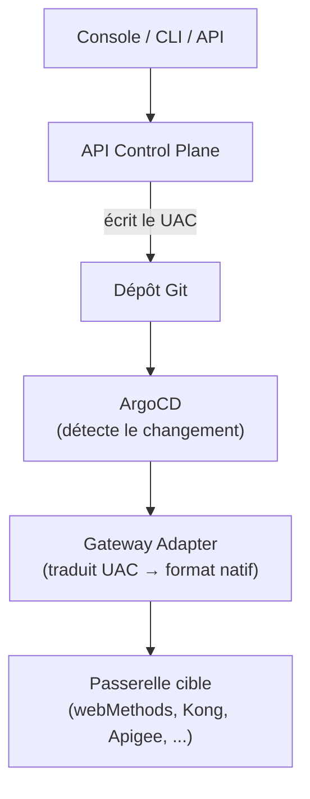

# Universal API Contract (UAC)

Le Universal API Contract (UAC) est le **format de définition d'API agnostique** de STOA. Il normalise les spécifications d'API dans un modèle commun qui peut être réconcilié vers n'importe quelle passerelle supportée.

## Pourquoi le UAC ?

Les différentes passerelles API utilisent des formats de configuration différents :

- webMethods utilise sa propre API REST avec des modèles de ressources spécifiques
- Kong utilise du YAML déclaratif avec des services, routes et plugins
- Apigee utilise des API proxies avec des endpoints proxy et des endpoints cibles

Le UAC fournit une définition unique que STOA traduit dans le format natif de chaque passerelle via le pattern [Gateway Adapter](../guides/console#adaptateurs-de-gateway).

## Structure du UAC {#uac-structure}

Un contrat UAC est un document JSON validé par le JSON Schema UAC v1 (`uac_contract_v1_schema.json` dans l'API Control Plane, reflété par les types Rust de la passerelle). Le YAML est utilisé ici pour la lisibilité et se convertit 1:1 en JSON :

```yaml
name: catalog-api                 # kebab-case, unique au sein du tenant
version: 1.0.0                    # version sémantique
tenant_id: example                # tenant propriétaire
display_name: Catalog API
description: Read access to the product catalog
classification: H                 # H | VH | VVH (niveau de risque TIC aligné DORA)
required_policies: [rate-limit, auth-jwt]   # dérivées de la classification
status: published                 # draft | published | deprecated

endpoints:
  - path: /catalog/items/{item_id}
    methods: [GET]
    backend_url: https://backend.example.local/v1/catalog
    operation_id: get_catalog_item
    # Métadonnées LLM optionnelles : pilotent la projection en outil MCP
    llm:
      summary: Fetch a catalog item by id.
      intent: Use when an agent needs read-only details about a known item.
      tool_name: catalog_get_item
      side_effects: read            # none | read | write | destructive
      safe_for_agents: true
      requires_human_approval: false
      examples:
        - input: { item_id: sku-1234 }
          expected_output_contains: { id: sku-1234 }
```

Sérialisé en JSON, ce document est accepté tel quel par l'endpoint `POST /admin/contracts` de la passerelle. Un contrat `published` doit déclarer au moins un endpoint avec un `backend_url`.

## Le UAC dans le flux GitOps {#uac-in-the-gitops-flow}

Le UAC est l'artefact qui circule dans le pipeline GitOps :



## Composants du UAC {#uac-components}

### Contrat {#contract}

| Champ | Requis | Description |
|-------|--------|-------------|
| `name` | Oui | Nom unique du contrat au sein du tenant (kebab-case) |
| `version` | Oui | Version sémantique (`MAJEUR.MINEUR.CORRECTIF`) |
| `tenant_id` | Oui | Identifiant du tenant propriétaire |
| `classification` | Oui | Niveau de risque TIC : `H`, `VH` ou `VVH` |
| `status` | Oui | Cycle de vie : `draft`, `published` ou `deprecated` |
| `display_name`, `description` | Non | Nom et description lisibles par un humain |
| `required_policies` | Non | Politiques dérivées de la classification (recalculées à chaque upsert) |
| `source_spec_url`, `spec_hash` | Non | URL de la spécification OpenAPI source et son hash pour la détection de dérive |
| `llm_config` | Non | Configuration du backend LLM pour les contrats pilotés par IA |

La classification détermine les politiques requises : `H` exige `rate-limit` et `auth-jwt` ; `VH` ajoute `mtls` et `audit-logging` ; `VVH` ajoute `data-encryption` et `geo-restriction`.

### Point d'entrée (Endpoint) {#endpoint}

Les opérations sont listées sous `endpoints[]`. Chaque entrée devient une route REST et, une fois projetée, un outil MCP.

| Champ | Requis | Description |
|-------|--------|-------------|
| `path` | Oui | Motif de chemin URL, par ex. `/catalog/items/{item_id}` |
| `methods` | Oui | Méthodes HTTP autorisées (`GET`, `POST`, `PUT`, `PATCH`, `DELETE`, `HEAD`, `OPTIONS`) |
| `backend_url` | Oui | URL du backend vers lequel les requêtes sont relayées |
| `operation_id` | Non | operationId OpenAPI, utilisé pour nommer l'outil MCP |
| `input_schema`, `output_schema` | Non | JSON Schema des corps de requête et de réponse |
| `llm` | Non | Métadonnées LLM pour la projection en outil MCP (voir ci-dessous) |

### Métadonnées LLM {#llm-metadata}

`endpoint.llm` est optionnel en v1 : un contrat `published` dont un endpoint en est dépourvu reçoit un avertissement de validation, tandis qu'un bloc malformé est une erreur. Lorsqu'il est présent, tous les champs sont requis :

| Champ | Description |
|-------|-------------|
| `summary` | Résumé court de l'outil, lisible par un humain |
| `intent` | Quand un agent doit utiliser cet endpoint |
| `tool_name` | Nom MCP stable, unique au sein du contrat |
| `side_effects` | `none`, `read`, `write` ou `destructive` |
| `safe_for_agents` | Si des agents autonomes peuvent appeler l'endpoint |
| `requires_human_approval` | Si une étape d'approbation humaine précède l'invocation |
| `examples` | Au moins un exemple avec `input` et un `expected_output_contains` optionnel |

Règle dure : `side_effects: destructive` exige `requires_human_approval: true`. Le validateur rejette le contrat dans le cas contraire.

## Traduction par le Gateway Adapter {#gateway-adapter-translation}

Chaque Gateway Adapter implémente la traduction du UAC vers le format natif :

```python
class GatewayAdapterInterface:
    def sync_api(self, api_spec: dict, tenant_id: str) -> AdapterResult:
        """Traduit le UAC et synchronise vers la passerelle cible."""

    def upsert_policy(self, policy_spec: dict) -> AdapterResult:
        """Traduit et applique la politique."""

    def provision_application(self, app_spec: dict) -> AdapterResult:
        """Provisionne l'accès consommateur."""
```

L'adapter garantit des opérations **idempotentes** — synchroniser le même UAC deux fois produit des résultats identiques sur la passerelle.

**Entrée adapter héritée.** Le dictionnaire `api_spec` passé à `sync_api` est l'état désiré du déploiement, une structure plate indexée par `api_name`/`apiName` que le Control Plane dérive pour chaque adapter. Ce n'est pas le format de contrat UAC présenté ci-dessus et il n'est pas accepté par les endpoints de contrats.

## Mode Shadow (futur) {#shadow-mode-future}

Dans le mode **shadow** prévu, STOA pourra auto-générer des définitions UAC en capturant passivement le trafic API. Cela permet l'onboarding d'API existantes sans spécification manuelle :

1. Déployer la passerelle STOA en mode shadow à côté du trafic existant
2. Capturer les patterns requête/réponse
3. Auto-générer le UAC avec des schémas et politiques inférés
4. Réviser et publier via la Console
