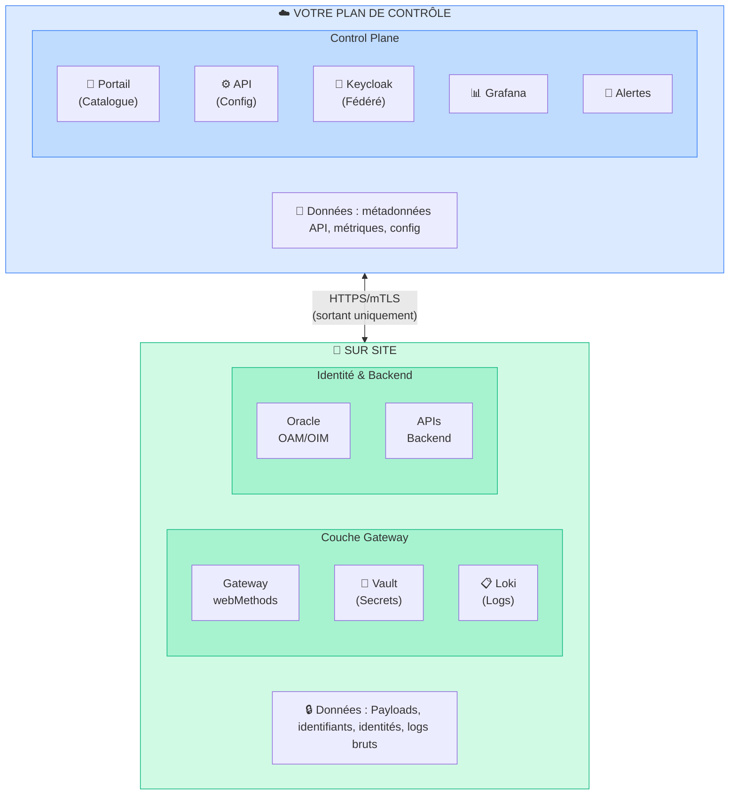
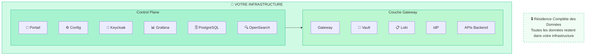
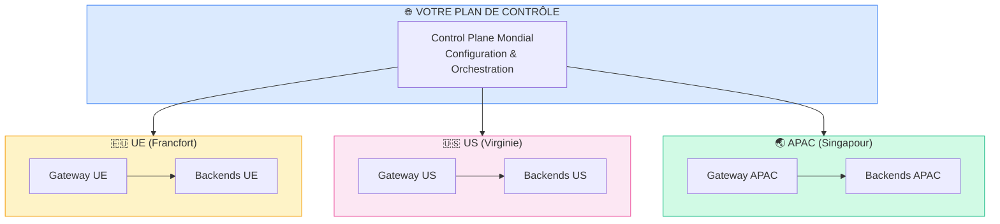
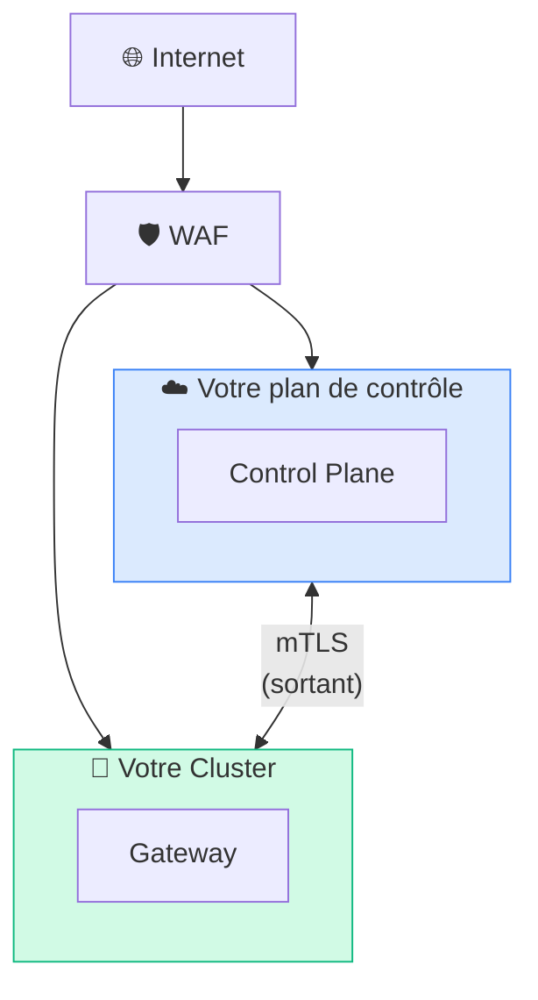

# Déploiement Hybride

:::caution Pas de cloud exploité par STOA
Le cloud public STOA a été éteint le 23 mai 2026. STOA n'exploite pas de plan de contrôle pour vous. Chaque modèle de cette page est un déploiement que **vous** installez et exploitez. Le placement séparé consiste à mettre le plan de contrôle et la passerelle sur des réseaux différents que vous exploitez.
:::

La Plateforme STOA supporte plusieurs modèles de déploiement pour répondre à vos exigences de sécurité, de souveraineté et d'exploitation.

## Modèles de Déploiement

| Modèle | Control Plane | Gateway | Résidence des Données | Idéal Pour |
|--------|---------------|---------|----------------------|------------|
| **Placement séparé** | Votre infrastructure | Votre infrastructure, près des API | Les charges utiles restent près de la passerelle | Réseau de plan de contrôle distinct |
| **Entièrement Sur Site** | Votre infrastructure | Votre infrastructure | 100% sur site | Souveraineté maximale |
| **Multi-site** | Votre infrastructure | Plusieurs sites que vous exploitez | Distribué | Plusieurs régions que vous exploitez |

---

## Modèle 1 : Placement séparé

**Votre plan de contrôle et votre passerelle**

Vous exploitez les deux. La passerelle reste près de vos API. Le plan de contrôle peut être sur un autre réseau que vous exploitez. STOA n'héberge aucun des deux plans.



### Ce Qui Reste Sur Site

| Type de Données | Description | Chiffrement |
|-----------------|-------------|-------------|
| **Payloads API** | Corps des requêtes/réponses | TLS en transit |
| **Identifiants** | Clés API, tokens, certificats | AES-256 au repos (Vault) |
| **Identités Utilisateurs** | Annuaire Oracle OAM/OIM | Contrôles existants |
| **Logs Bruts** | Détails complets des transactions | Contrôlés par le client |
| **Secrets** | Données HashiCorp Vault | AES-256-GCM |

### Ce Qui Va dans le Cloud

| Type de Données | Description | Sensibilité |
|-----------------|-------------|-------------|
| **Métadonnées API** | Noms, descriptions, specs OpenAPI | Faible |
| **Métriques Agrégées** | Compteurs de requêtes, latences, erreurs | Faible |
| **Configuration** | Règles de routage, politiques | Faible |
| **Tokens Fédérés** | Courte durée de vie, sans identifiants | Faible |

### Exigences Réseau

| Direction | Protocole | Ports | Objectif |
|-----------|----------|-------|---------|
| **Réseau passerelle → votre plan de contrôle** | HTTPS | 443 | Sync config, envoi métriques |
| **Plan de contrôle → réseau passerelle** | Aucun | — | Aucune connexion entrante requise |

**Avantage sécurité clé :** Aucune connexion entrante requise. Toute communication est initiée depuis votre infrastructure.

### Prérequis

- Cluster Kubernetes 1.28+ sur site
- HTTPS sortant uniquement vers des endpoints que vous exploitez (votre plan de contrôle, registre d'images, fournisseur d'identité)
- Résolution DNS pour les services STOA
- Fournisseur d'identité existant (OAM, Okta, Azure AD)

---

## Modèle 2 : Entièrement Sur Site

**Souveraineté Maximale**

Pour les organisations nécessitant un contrôle total sur tous les composants.



### Quand Choisir l'Option Entièrement Sur Site

- Exigence réglementaire de résidence des données à 100%
- Environnements air-gappés
- Secteur gouvernemental ou défense
- Exigences de conformité extrêmes (régulateurs bancaires)

### Exigences Supplémentaires

| Composant | Exigence Sur Site |
|-----------|------------------|
| **Kubernetes** | Cluster de production (3+ nœuds) |
| **PostgreSQL** | Configuration HA (primaire + réplica) |
| **OpenSearch** | Cluster pour logs et recherche |
| **Stockage Objet** | Compatible S3 (MinIO) |
| **Certificats TLS** | PKI ou Let's Encrypt |

### Compromis

| Aspect | Placement séparé | Entièrement sur site |
|--------|------------------|----------------------|
| Complexité opérationnelle | Deux réseaux que vous exploitez | Un seul périmètre |
| Mises à jour | Vous les appliquez des deux côtés | Vous les appliquez |
| Support | Communauté, ou un contrat de support | Communauté, ou un contrat de support |
| Résidence des données | Métadonnées sur le réseau de plan de contrôle que vous choisissez | 100 % dans un seul périmètre |
| Configuration initiale | Vous installez les deux plans | Vous installez la pile complète |

---

## Modèle 3 : Multi-Cloud (Futur)

**Distribution Mondiale**

Pour les organisations nécessitant une présence dans plusieurs régions ou clouds.



### Capacités Prévues

- Équilibrage de charge géographique
- Résidence des données par région
- Basculement inter-régions
- Tableau de bord mondial unifié

**Statut :** Feuille de route T4 2026

---

## Récapitulatif des Flux de Données

### Matrice de Données du Modèle Hybride

| Données | Direction | Chiffrement | Fréquence |
|---------|-----------|-------------|-----------|
| Config | Cloud → Sur site | mTLS | À chaque changement |
| Métriques (agrégées) | Sur site → Cloud | TLS | Toutes les 15s |
| Alertes | Cloud → Équipe Ops | TLS | Au déclenchement |
| Tokens (fédérés) | Cloud ↔ Sur site | TLS | Par requête |
| Payloads | Conçus pour rester sur site | N/A | N/A |
| Identifiants | Conçus pour rester sur site | N/A | N/A |

### Schéma Réseau



---

## Démarrage

### Démarrage Rapide Hybride

L'hôte de charts public et la bêta privée ont été retirés le 23 mai 2026. Installez depuis les sources, et pointez la passerelle vers un plan de contrôle que **vous** exploitez :

```bash
git clone https://github.com/stoa-platform/stoa.git
kubectl create namespace stoa-system
helm install stoa-platform ./stoa/charts/stoa-platform \
  --namespace stoa-system \
  --set stoaGateway.controlPlaneUrl="https://api.stoa.example"
kubectl get pods -n stoa-system
```

Remplacez `api.stoa.example` par votre plan de contrôle. Voir le [guide d'installation](/docs/admin/installation).

### Démarrage Rapide Entièrement Sur Site

```bash
# 1. Installer les prérequis
helm install postgresql bitnami/postgresql -n stoa-system
helm install opensearch opensearch/opensearch -n stoa-system
helm install vault hashicorp/vault -n stoa-system

# 2. Installer la stack complète STOA
helm install stoa stoa/stoa-full \
  --namespace stoa-system \
  --set mode=on-premises \
  --values your-values.yaml
```

---

## Étapes Suivantes

- [Sécurité & Conformité](/docs/enterprise/security-compliance) — Détails sur la résidence des données
- [Guides de Migration](/docs/guides/migration) — Migrer depuis des plateformes existantes
- [Architecture Globale](/docs/concepts/architecture) — Approfondissement des composants

---

*Besoin d'aide pour choisir le bon modèle de déploiement ? [Contactez-nous](mailto:contact@gostoa.dev) pour une consultation d'architecture.*
