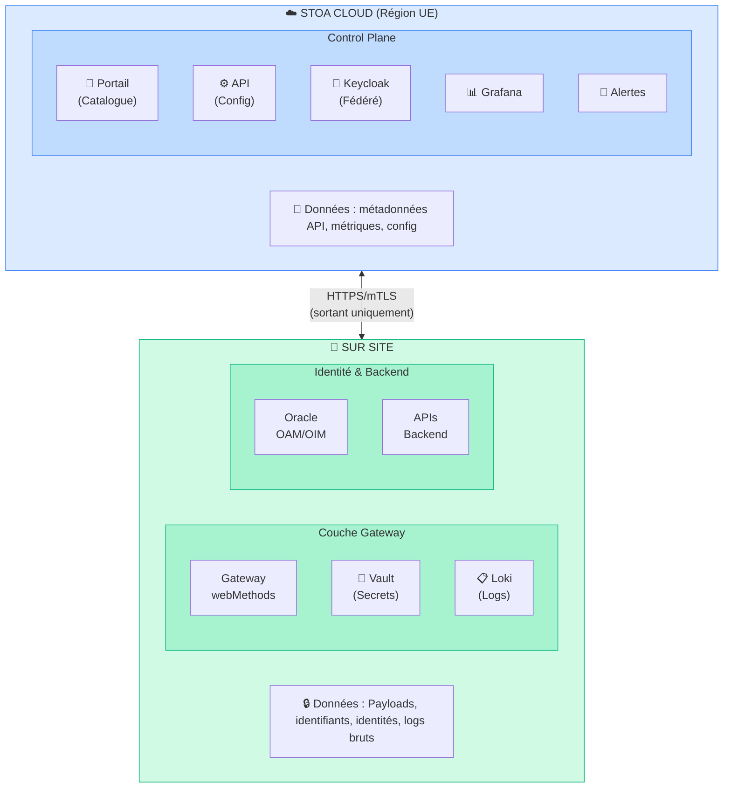
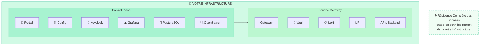
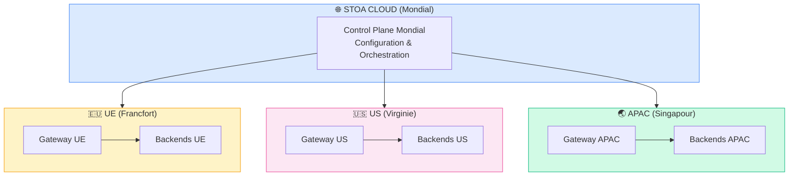
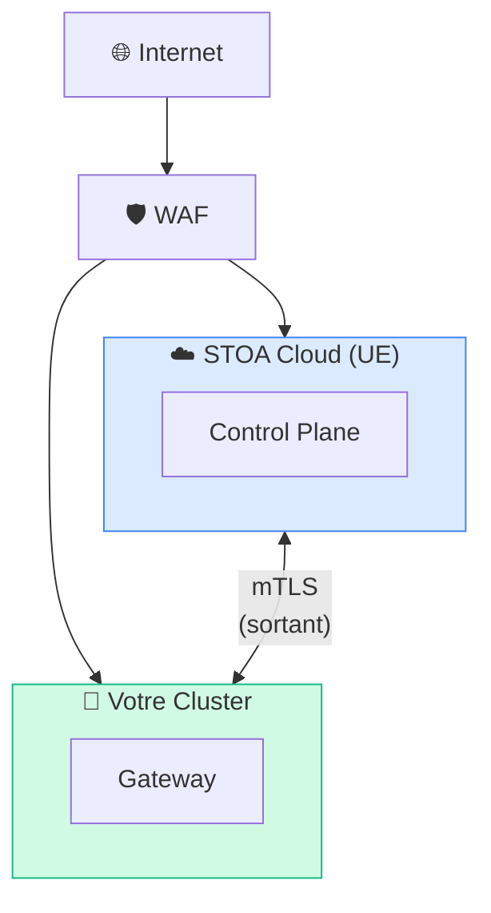

# Déploiement Hybride

La Plateforme STOA supporte plusieurs modèles de déploiement pour répondre à vos exigences de sécurité, de souveraineté et d'exploitation.

## Modèles de Déploiement

| Modèle | Control Plane | Gateway | Résidence des Données | Idéal Pour |
|--------|---------------|---------|----------------------|------------|
| **Hybride** | STOA Cloud (UE) | Sur site | Données métier sur site | La plupart des entreprises |
| **Entièrement Sur Site** | Votre infrastructure | Votre infrastructure | 100% sur site | Souveraineté maximale |
| **Multi-Cloud** | STOA Cloud | Plusieurs régions | Distribué | Organisations mondiales |

---

## Modèle 1 : Hybride (Recommandé)

**Control Plane Cloud + Gateway Sur Site**

Le modèle de déploiement par défaut équilibre la facilité de gestion avec la souveraineté des données.



### Ce Qui Reste Sur Site

| Type de Données | Description | Chiffrement |
|-----------------|-------------|-------------|
| **Payloads API** | Corps des requêtes/réponses | TLS en transit |
| **Identifiants** | Clés API, tokens, certificats | AES-256 au repos (Vault) |
| **Identités Utilisateurs** | Annuaire Oracle OAM/OIM | Contrôles existants |
| **Logs Bruts** | Détails complets des transactions | Contrôlés par le client |
| **Secrets** | Données du socle de secrets (OpenBao ou HashiCorp Vault) | AES-256-GCM |

### Ce Qui Va dans le Cloud

| Type de Données | Description | Sensibilité |
|-----------------|-------------|-------------|
| **Métadonnées API** | Noms, descriptions, specs OpenAPI | Faible |
| **Métriques Agrégées** | Compteurs de requêtes, latences, erreurs | Faible |
| **Configuration** | Règles de routage, politiques | Faible |
| **Tokens Fédérés** | Courte durée de vie, sans identifiants | Faible |

### Exigences Réseau

| Direction | Protocole | Ports | Objectif |
|-----------|----------|-------|---------|
| **Sur site → Cloud** | HTTPS | 443 | Sync config, envoi métriques |
| **Cloud → Sur site** | Aucun | — | Aucune connexion entrante requise |

**Avantage sécurité clé :** Aucune connexion entrante requise. Toute communication est initiée depuis votre infrastructure.

### Prérequis

- Cluster Kubernetes 1.28+ sur site
- HTTPS sortant vers les endpoints STOA Cloud
- Résolution DNS pour les services STOA
- Fournisseur d'identité existant (OAM, Okta, Azure AD)

---

## Modèle 2 : Entièrement Sur Site

**Souveraineté Maximale**

Pour les organisations nécessitant un contrôle total sur tous les composants.



### Quand Choisir l'Option Entièrement Sur Site

- Exigence réglementaire de résidence des données à 100%
- Environnements air-gappés
- Secteur gouvernemental ou défense
- Exigences de conformité extrêmes (régulateurs bancaires)

### Exigences Supplémentaires

| Composant | Exigence Sur Site |
|-----------|------------------|
| **Kubernetes** | Cluster de production (3+ nœuds) |
| **PostgreSQL** | Configuration HA (primaire + réplica) |
| **OpenSearch** | Cluster pour logs et recherche |
| **Stockage Objet** | Compatible S3 (MinIO) |
| **Certificats TLS** | PKI ou Let's Encrypt |

### Compromis

| Aspect | Hybride | Entièrement Sur Site |
|--------|---------|----------------------|
| Complexité opérationnelle | Faible | Élevée |
| Mises à jour | Automatiques | Manuelles |
| Support | Complet | Self-service limité |
| Résidence des données | Métadonnées dans le cloud | 100% sur site |
| Configuration initiale | 1-2 jours | 1-2 semaines |

---

## Modèle 3 : Multi-Cloud (Futur)

**Distribution Mondiale**

Pour les organisations nécessitant une présence dans plusieurs régions ou clouds.



### Capacités Prévues

- Équilibrage de charge géographique
- Résidence des données par région
- Basculement inter-régions
- Tableau de bord mondial unifié

**Statut :** Planifié

---

## Récapitulatif des Flux de Données

### Matrice de Données du Modèle Hybride

| Données | Direction | Chiffrement | Fréquence |
|---------|-----------|-------------|-----------|
| Config | Cloud → Sur site | mTLS | À chaque changement |
| Métriques (agrégées) | Sur site → Cloud | TLS | Toutes les 15s |
| Alertes | Cloud → Équipe Ops | TLS | Au déclenchement |
| Tokens (fédérés) | Cloud ↔ Sur site | TLS | Par requête |
| Payloads | Conçus pour rester sur site | N/A | N/A |
| Identifiants | Conçus pour rester sur site | N/A | N/A |

### Schéma Réseau



---

## Démarrage

### Déploiement Hybride du Gateway (Kubernetes)

Le chart `charts/stoa-platform` s'installe depuis un checkout de [`stoa-platform/stoa`](https://github.com/stoa-platform/stoa) (aucun index public `charts.gostoa.dev` n'est publié) et déploie le **STOA Gateway** ainsi que ses 5 CRDs. Pour relier une passerelle Kong, Gravitee ou webMethods existante sans Kubernetes, utilisez [`stoa-connect` (STOA Link)](/docs/guides/stoa-connect-quickstart). L'accès à un Control Plane hébergé est disponible sur demande via [sales@gostoa.dev](mailto:sales@gostoa.dev).

```bash
# 1. Cloner le dépôt sur une révision vérifiée
git clone https://github.com/stoa-platform/stoa.git
cd stoa
git checkout 639e8b9a2217695cfc2f590e246ed9d4ce4d4913

# 2. Installer le STOA Gateway sur site face aux URLs Control Plane et Keycloak
helm upgrade --install stoa-platform ./charts/stoa-platform \
  -n stoa-system --create-namespace \
  -f my-values.yaml
```

Exemple minimal de `my-values.yaml` pour un gateway hybride (`stoaGateway.image` exige à la fois `repository` et `digest` lorsqu'il est surchargé ; consultez le [Guide d'installation](/docs/admin/installation) pour les prérequis de readiness des politiques au démarrage) :

```yaml
stoa:
  domain: "<YOUR_DOMAIN>"

stoaGateway:
  controlPlaneUrl: "https://api.<YOUR_DOMAIN>"
  keycloakUrl: "https://auth.<YOUR_DOMAIN>"
  secretName: stoa-gateway-secrets
  policyBootTenants:
    - "<YOUR_TENANT_ID>"
  serviceMonitor:
    enabled: false
  otelEndpoint: ""

controlPlaneApi:
  serviceMonitor:
    enabled: false
gateway:
  edgeMcp:
    enabled: false
gatewaySync:
  enabled: false
```

:::warning Prérequis avant d'attendre `1/1 Ready`
Ce fichier minimal de valeurs ne suffit **pas** à amener les pods à `1/1 Ready` (`/health` teste uniquement la vivacité du processus, tandis que `/ready` vérifie `policyBootTenants` et la fraîcheur des permissions d'outils signées). Au commit `639e8b9a`, `charts/stoa-platform` ne monte que les volumes `tmp` (`emptyDir`) et `stoa-gateway-policies` (`ConfigMap`) — avant d'attendre `1/1 Ready`, montez le Secret contenant la clé de signature `private_key_jwt` (`STOA_KEYCLOAK_CLIENT_KEY_PATH`, plus `STOA_KEYCLOAK_CLIENT_KEY_ID` via `extraEnv`) au moyen d'un overlay Deployment, d'un patch Kustomize ou d'un `--post-renderer` Helm comme documenté dans [Politiques au Démarrage et Readiness](/docs/admin/installation#startup-policy-and-readiness).
:::

```bash
# 3. Vérifier l'état des pods (passage à 1/1 Ready uniquement après montage du Secret private_key_jwt et chargement des politiques signées)
kubectl get pods -n stoa-system
```

### Stack Entièrement Sur Site

Le chart `charts/stoa-platform` déploie **uniquement le STOA Gateway, les 5 CRDs et des hooks d'intégration optionnels** (`charts/stoa-observability` empaquette la télémétrie optionnelle Grafana Alloy/Tempo/Blackbox). Provisionnez PostgreSQL, Keycloak (realm unique `stoa`), OpenSearch, les workloads Control Plane API / Console / Portail Développeur et — **si** votre site utilise un gestionnaire externe de secrets ([ADR-075](/docs/architecture/adr/adr-075-secrets-backend-openbao)) — le service optionnel OpenBao séparément avant d'installer le chart gateway :

```bash
# 1. Optionnel : installer OpenBao uniquement si le site requiert ce service externe de secrets (ADR-075)
helm repo add openbao https://openbao.github.io/openbao-helm
helm repo update
helm install openbao openbao/openbao -n openbao --create-namespace

# 2. Déployer Control Plane API, Console, Portail, PostgreSQL et Keycloak selon vos manifestes site
#    (ou évaluer localement via deploy/docker-compose — voir /docs/guides/quickstart)

# 3. Installer le STOA Gateway depuis le checkout du dépôt (avec vos valeurs + overlay du volume private_key_jwt)
helm upgrade --install stoa-platform ./charts/stoa-platform \
  -n stoa-system --create-namespace \
  -f your-values.yaml
```

Pour les sites isolés sans accès Internet sortant, suivez le guide [Installation hors ligne](/docs/deployment/offline-install).

---

## Étapes Suivantes

- [Sécurité & Conformité](/docs/enterprise/security-compliance) — Détails sur la résidence des données
- [Guides de Migration](/docs/guides/migration) — Migrer depuis des plateformes existantes
- [Architecture Globale](/docs/concepts/architecture) — Approfondissement des composants

---

*Besoin d'aide pour choisir le bon modèle de déploiement ? [Contactez-nous](mailto:contact@gostoa.dev) pour une consultation d'architecture.*
