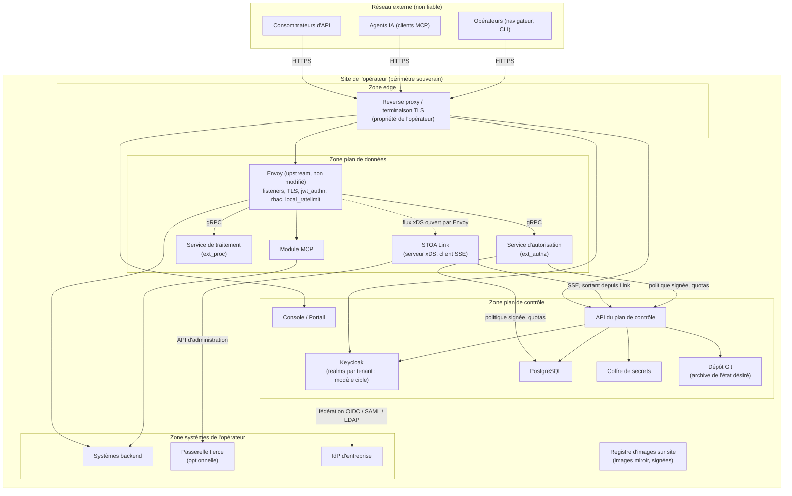
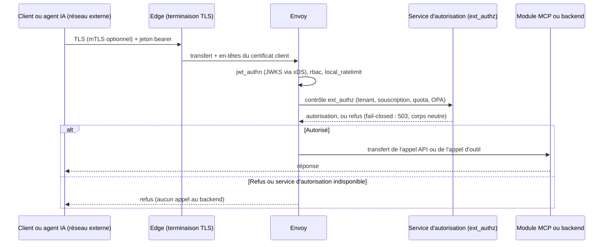
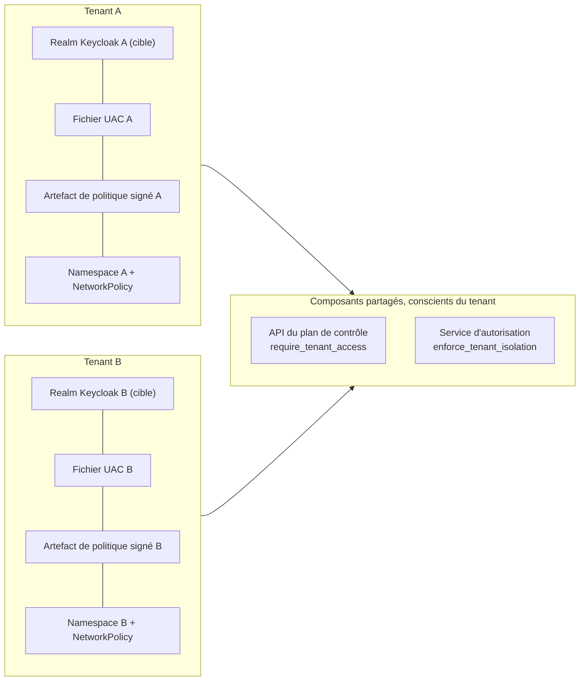

# Déploiement souverain

En mode souverain, le plan de contrôle et le plan de données s'exécutent tous deux à l'intérieur du périmètre de l'opérateur ([ADR-037](../architecture/adr/adr-037-deployment-modes-sovereign-first.md)). Le service hébergé a été arrêté le 23/05/2026 ; STOA se déploie sur site. Cette page est un schéma de référence générique : les noms sont des exemples, aucune infrastructure réelle n'est décrite, et chaque affirmation renvoie à un ADR publié ou à un fichier du dépôt `stoa`. Dimensionnement, ports et DNS sont dans les [Prérequis de déploiement](./prerequisites.md).

:::info Statut du plan de données
L'[ADR-073](../architecture/adr/adr-073-adopt-envoy-data-plane.md) (22/10/2026) décide que le plan de données utilise Envoy upstream, configuré uniquement par xDS servi sur site par STOA Link, la logique STOA s'exécutant dans des services externes appelés par Envoy. Le serveur xDS de Link est décidé mais pas encore implémenté (ADR-073 §7) ; les schémas ci-dessous montrent la cible décidée. Le plan de données actuel, STOA Gateway (Rust), est en maintenance (ADR-073 §9).
:::

## 1. Topologie réseau

| Flux | Direction et protocole | Source |
|------|------------------------|--------|
| Consommateurs, agents et opérateurs → edge | HTTPS, à l'initiative du client ; seule entrée entrante du site | [Prérequis §2](./prerequisites.md#2-matrice-des-flux-réseau) |
| Edge → Envoy, Console, Portail, API, Keycloak | TLS terminé à l'edge ; données du certificat client transmises en en-têtes depuis un proxy de confiance uniquement | [ADR-027](../architecture/adr/adr-027-x509-header-authentication.md), [ADR-039](../architecture/adr/adr-039-mtls-cert-bound-tokens.md) |
| Envoy → services d'autorisation et de traitement | gRPC `ext_authz` et `ext_proc` ; services co-localisés avec Envoy | ADR-073 §4, Mitigations |
| Envoy ↔ STOA Link | Envoy ouvre le flux xDS vers le Link local ; Link sert des snapshots versionnés générés depuis les contrats UAC | ADR-073 §2 |
| STOA Link → API du plan de contrôle | SSE sortant depuis Link plus callback HTTPS ; le plan de contrôle n'ouvre jamais de connexion vers le plan de données | [ADR-059](../architecture/adr/adr-059-simplified-deployment-sse.md), ADR-073 §2 |
| Point d'application → API du plan de contrôle | Récupération périodique de l'artefact de politique signé, à l'initiative du point d'application | [ADR-070 A7](/docs/architecture/adr/adr-070-gateway-fail-closed-posture) |
| Site → Internet | Aucun flux requis : le mode souverain n'exige jamais de connectivité sortante ; les images sont mises en miroir dans un registre sur site | ADR-037, [Prérequis §5](./prerequisites.md#air-gappé--registre-privé), ADR-073 Mitigations |

Chaque instance Envoy garde son interface d'administration sur loopback et n'est jamais configurée à la main ni par une API d'administration (ADR-073 §2 et Mitigations). Kafka, s'il est déployé, reste interne au site et ne transporte que des événements d'effets de bord (ADR-059).

## 2. Contrôle des accès depuis un réseau externe

| Étape | Contrôle | Source |
|-------|----------|--------|
| Identité | L'ADR-026 définit un modèle cible de fédération avec un realm dédié par tenant, fédéré vers l'IdP de l'opérateur (OIDC, SAML ou LDAP), sans comptes locaux, avec contrôles d'audience et de realm. Le provisioning actuel crée plutôt des groupes et un compte administrateur dans le realm configuré (voir Identité ci-dessous) ; il ne met pas en place ce modèle par realm. | [ADR-026](../architecture/adr/adr-026-multi-iam-federation.md) |
| Agents IA | Les clients MCP utilisent OAuth 2.1 avec PKCE ; la passerelle sert les métadonnées de découverte et relaie l'enregistrement dynamique des clients vers Keycloak. | [ADR-044](../architecture/adr/adr-044-mcp-oauth-gateway-proxy.md) |
| Transport | TLS à l'edge ; mTLS optionnel avec jetons liés au certificat (`cnf.x5t#S256`), vérifiés par le filtre JWT d'Envoy ou par le service d'autorisation. Les jetons « sender-constrained » (liés à une clé détenue par le client, via DPoP ou mTLS) sont conçus pour prendre en charge le profil FAPI 2.0 pour les clients qui l'exigent ; aucune certification de conformité n'est revendiquée. | ADR-039, ADR-073 §5, [ADR-056](../architecture/adr/adr-056-fapi-2-architecture.md) |
| Validation du jeton | Le filtre `jwt_authn` d'Envoy valide signature et claims contre un JWKS livré par xDS : la validation ne nécessite aucun appel hors du site ; suivent un `rbac` grossier et `local_ratelimit`. | ADR-073 §10 |
| Autorisation | Le service d'autorisation vérifie tenant, souscription active, clé d'API, politique OPA et quotas consommateur. En cas de défaillance, Envoy refuse avec un 503, un corps neutre identique au 403, et sans rejeu automatique des requêtes non idempotentes. | ADR-073 §4, §10 |
| Permissions d'outils | Refus par défaut. Un outil n'est autorisé que si un artefact signé par le plan de contrôle (JWS Ed25519, limité à un tenant, borné dans le temps) le liste ; la révocation prime sur le cache ; les outils marqués `requires_human_approval` exigent un jeton d'approbation. | ADR-070 §1, Annexe |
| Opérateurs | Console, Portail et CLI passent par Keycloak OIDC. Les rôles `cpi-admin`, `tenant-admin`, `devops` et `viewer` correspondent aux scopes `stoa:admin`, `stoa:write`, `stoa:read`. Les changements de configuration en production passent par une pull request Git, pas par une écriture dans l'interface. | [ADR-054](../architecture/adr/adr-054-rbac-taxonomy-v2.md), [ADR-040](../architecture/adr/adr-040-born-gitops-multi-environment.md) |

Dans les profils `prod` et `staging`, la passerelle Rust refuse de démarrer si son moteur de politiques ne peut pas se charger ([`state.rs`: `resolve_policy_engine`](https://github.com/stoa-platform/stoa/blob/4290bb39fe57de7516c46ea675a5c90ce4ed13f8/stoa-gateway/src/state.rs#L794-L841)), et la readiness échoue quand aucun artefact de politique vérifié n'est disponible (ADR-070 §4).

## 3. Isolation des tenants et des composants

| Couche | Mécanisme | Source |
|--------|-----------|--------|
| Identité | L'ADR-026 définit une cible avec un realm par tenant. Le provisioning livré crée des groupes de tenants dans le realm Keycloak configuré, pas des realms distincts ; il n'établit donc pas de séparation des clés de signature, des clients ou des sessions de realm par tenant. | ADR-026; [tenant creation](https://github.com/stoa-platform/stoa/blob/4290bb39fe57de7516c46ea675a5c90ce4ed13f8/control-plane-api/src/routers/tenants.py#L294-L303); [provisioning](https://github.com/stoa-platform/stoa/blob/4290bb39fe57de7516c46ea675a5c90ce4ed13f8/control-plane-api/src/services/tenant_provisioning_service.py#L100-L124); [configured realm](https://github.com/stoa-platform/stoa/blob/4290bb39fe57de7516c46ea675a5c90ce4ed13f8/control-plane-api/src/services/keycloak_service.py#L57-L66); [setup_tenant_group](https://github.com/stoa-platform/stoa/blob/4290bb39fe57de7516c46ea675a5c90ce4ed13f8/control-plane-api/src/services/keycloak_service.py#L945-L972) |
| Autorisation | L'API du plan de contrôle refuse l'accès à un autre tenant sauf si l'appelant est `cpi-admin` (`require_tenant_access`) ; la passerelle applique la même règle avec `enforce_tenant_isolation`, activé par défaut. | [Control Plane RBAC](https://github.com/stoa-platform/stoa/blob/4290bb39fe57de7516c46ea675a5c90ce4ed13f8/control-plane-api/src/auth/rbac.py#L25-L41); [require_tenant_access](https://github.com/stoa-platform/stoa/blob/4290bb39fe57de7516c46ea675a5c90ce4ed13f8/control-plane-api/src/auth/rbac.py#L258-L263); [gateway default](https://github.com/stoa-platform/stoa/blob/4290bb39fe57de7516c46ea675a5c90ce4ed13f8/stoa-gateway/src/auth/rbac.rs#L125-L138); [gateway tenant check](https://github.com/stoa-platform/stoa/blob/4290bb39fe57de7516c46ea675a5c90ce4ed13f8/stoa-gateway/src/auth/rbac.rs#L228-L257) |
| Contrat | Un fichier UAC complet et autonome par tenant, sans héritage ; les overlays par environnement vivent dans Git. | [ADR-022](../architecture/adr/adr-022-uac-tenant-architecture.md), ADR-040 |
| Politique | Chaque artefact de politique signé porte un seul `tenant_id` ; un artefact manquant pour un tenant ne refuse que ce tenant, jamais les autres. | ADR-070 §4, Annexe A2 |
| Réseau | Pour ce schéma de référence, l'opérateur doit isoler les charges de travail des tenants avec des namespaces et des objets NetworkPolicy. Le chart inclut des politiques egress conditionnelles pour bootstrap et first-admin, mais elles ne fournissent pas une isolation générale des charges de travail des tenants. Exemples : [Durcissement sécurité](../admin/security-hardening.md#politiques-réseau). | [Helm templates](https://github.com/stoa-platform/stoa/tree/4290bb39fe57de7516c46ea675a5c90ce4ed13f8/charts/stoa-platform/templates); [bootstrap policy](https://github.com/stoa-platform/stoa/blob/4290bb39fe57de7516c46ea675a5c90ce4ed13f8/charts/stoa-platform/templates/bootstrap-networkpolicy.yaml#L1-L17); [first-admin policy](https://github.com/stoa-platform/stoa/blob/4290bb39fe57de7516c46ea675a5c90ce4ed13f8/charts/stoa-platform/templates/first-admin-networkpolicy.yaml#L1-L15); ADR-026 Security Considerations |
| Composants | Plan de contrôle et plan de données sont des processus distincts avec un chemin de déploiement unique ; Envoy ne charge aucune extension et la logique STOA s'exécute dans des services séparés ; la clé de signature des politiques est montée en lecture seule et lisible uniquement par l'API du plan de contrôle ; les conteneurs de passerelle tournent sans root, avec système de fichiers en lecture seule et toutes les capacités retirées. | ADR-073 §1, §4 ; ADR-070 A5 ; [gateway security context](https://github.com/stoa-platform/stoa/blob/4290bb39fe57de7516c46ea675a5c90ce4ed13f8/charts/stoa-platform/templates/stoa-gateway-deployment.yaml#L146-L154) |
| Chaîne d'approvisionnement | Les images sont signées avec Cosign, avec provenance SLSA et SBOM SPDX attachés à la publication ; vérifiez-les avant la mise en miroir dans le registre sur site. | [image publication workflow](https://github.com/stoa-platform/stoa/blob/4290bb39fe57de7516c46ea675a5c90ce4ed13f8/.github/workflows/docker-publish.yml#L157-L186) |

## Voir aussi

- [Prérequis de déploiement](./prerequisites.md) — ports, DNS, dimensionnement, registre privé
- [Déploiement hybride](./hybrid.md) — modèles hybride et multi-cloud
- [Isolation multi-tenant](../concepts/multi-tenant.md) — cycle de vie des tenants et périmètre RBAC
- [Durcissement sécurité](../admin/security-hardening.md) — exemples de NetworkPolicy et de durcissement des conteneurs
- [ADR-073](../architecture/adr/adr-073-adopt-envoy-data-plane.md), [ADR-070](/docs/architecture/adr/adr-070-gateway-fail-closed-posture), [ADR-037](../architecture/adr/adr-037-deployment-modes-sovereign-first.md) — décisions derrière cette page
