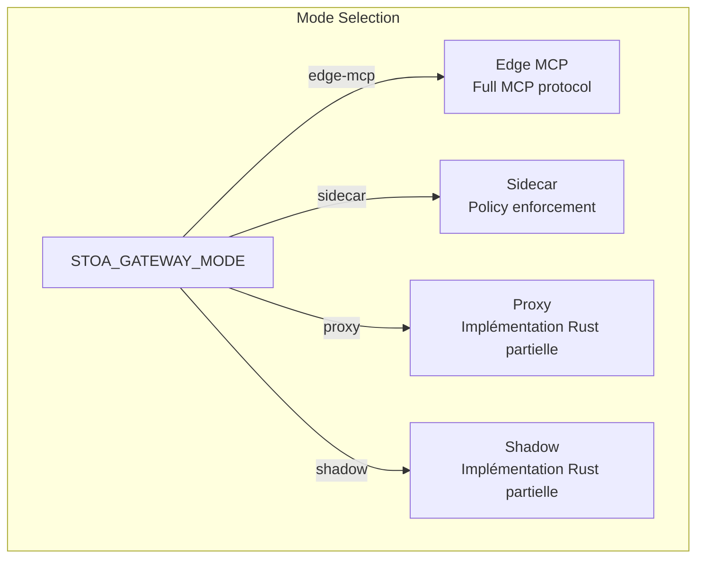

import EnvSetup from '@site/docs/_partials/_env-setup.mdx';

# Modes du Gateway

La passerelle Rust propose quatre valeurs pour `STOA_GATEWAY_MODE`. Le tableau distingue les modes Edge-MCP et Sidecar disponibles des implémentations Rust partielles de Proxy et Shadow.

## Vue d'Ensemble des Modes

| Mode | Port HTTP par défaut | Support MCP | Cas d'Usage | Statut |
|------|------|-------------|----------|--------|
| **edge-mcp** | 8080 | Oui | Gateway MCP autonome avec support complet du protocole (+ écouteur gRPC `ext_authz` Envoy optionnel) | Production (Maintenance, [ADR-073](/docs/architecture/adr/adr-073-adopt-envoy-data-plane)) |
| **sidecar** | 8080 (le chart Helm compagnon fixe 8081) | Non | Allow ou deny sur `POST /authz` HTTP pour un hôte qui l'appelle | Runtime présent |
| **proxy** | 8080 | Non | Composants de transfert HTTP | Implémentation Rust partielle. Cible Envoy xDS ([ADR-073 §8](/docs/architecture/adr/adr-073-adopt-envoy-data-plane)) |
| **shadow** | 8080 | Non | Routes de statut et de génération UAC | Implémentation Rust partielle. Cible de mise en miroir par Envoy ([ADR-073 §8](/docs/architecture/adr/adr-073-adopt-envoy-data-plane)) |



## Capacités par Mode

| Capacité | edge-mcp | sidecar | proxy | shadow |
|-----------|----------|---------|-------|--------|
| Protocole MCP (SSE) | Oui | Non | Non | Non |
| Découverte/invocation d'outils | Oui | Non | Non | Non |
| Authentification JWT | Oui | Non. `/authz` fait confiance au `user` JSON | Non raccordée | Non |
| Limitation de débit | Oui | Optionnelle, en mémoire, par processus | Non raccordée | Non |
| Disjoncteur | Oui | Non | Non raccordé | Non |
| Transformation des requêtes | Non | Non | Composant seul | Non |
| Capture de trafic | Non | Non | Non | Aucune source de capture raccordée |
| Génération UAC | Non | Non | Non | Route manuelle qui exige des données |
| Nécessite un upstream | Non | Non | Le transfert exige une route vers un service amont | GitLab pour la soumission d’un UAC |
| Passif (lecture seule) | Non | Non | Non | Statut et analyse. La soumission UAC écrit dans GitLab |

## Mode Edge-MCP (Production)

Le mode de production par défaut et principal. Implémente le protocole MCP complet avec transport SSE, découverte OAuth 2.1, gestion des outils et gestion des sessions.

### Configuration

```bash
# Variables d'environnement
STOA_GATEWAY_MODE=edge-mcp

# Paramètres spécifiques edge-MCP
STOA_SSE_KEEPALIVE=true
STOA_SSE_KEEPALIVE_INTERVAL_SECS=30
STOA_MAX_SESSIONS=10000
STOA_SESSION_TIMEOUT_SECS=3600
```

### Valeurs Helm

```yaml
stoaGateway:
  mode: edge-mcp
  edgeMcp:
    sseKeepalive: true
    sseKeepaliveIntervalSecs: 30
    maxSessions: 10000
    sessionTimeoutSecs: 3600
```

### Routes Exposées

| Chemin | Méthode | Objectif |
|------|--------|---------|
| `/.well-known/oauth-authorization-server` | GET | Découverte OAuth 2.1 |
| `/.well-known/oauth-protected-resource` | GET | Métadonnées de ressource protégée |
| `/mcp` | GET, POST | Découverte (`GET`) & Streamable HTTP JSON-RPC 2.0 (`POST`) |
| `/mcp/sse` | GET, POST, DELETE | Transport SSE & session JSON-RPC |
| `/mcp/ws` | GET | WebSocket JSON-RPC sur option (`STOA_WEBSOCKET_ENABLED=true`) |
| `/oauth/token` | POST | Proxy de jetons (vers le realm Keycloak `stoa`) |
| `/oauth/par` | POST | Proxy Pushed Authorization Request (vers le realm Keycloak `stoa`) |
| `/oauth/register` | POST | Enregistrement dynamique de clients |
| `/admin/*` | Divers | [API Admin Gateway](/docs/api/gateway-admin-api) (Bearer `STOA_ADMIN_API_TOKEN`) |
| `/health`, `/ready` | GET | Sondes de vivacité et de disponibilité fail-closed |
| `/metrics` | GET | Métriques Prometheus |

*(Note : `GET /oauth/authorize` renvoie `404` sur `stoa-gateway` ; `/.well-known/oauth-authorization-server` renvoie directement l'endpoint d'autorisation Keycloak `/realms/stoa/protocol/openid-connect/auth`. Lorsque `STOA_EXT_AUTHZ_GRPC_ADDR`, `STOA_EXT_AUTHZ_AUDIENCE` et `STOA_EXT_AUTHZ_REQUIRED_SCOPES` non vide en `prod` sont définis, `stoa-gateway` supervise également un écouteur gRPC `envoy.service.auth.v3.Authorization` pour Envoy upstream selon [ADR-073](/docs/architecture/adr/adr-073-adopt-envoy-data-plane).)*

### Quand Utiliser

- Déploiement gateway MCP autonome
- Intégration d'agents AI (Claude, GPT, agents personnalisés)
- Gestion complète des APIs avec limitation de débit, quotas et disjoncteurs
- Charges de production nécessitant le transport SSE

## Mode Sidecar

Démarre le même binaire avec `STOA_GATEWAY_MODE=sidecar`. Le processus expose `POST /authz` et ne monte pas les routes MCP. L'hôte conserve l'authentification, le routage et l'application du verdict. Un template Helm de même pod existe et est désactivé par défaut. Des appels réels depuis Kong, webMethods ou Envoy ne sont pas démontrés dans le dépôt.

Lisez [Usage du compagnon](./companion-usage.md) pour les trois formes d'intégration (passerelle dans le même pod, appel depuis une application, mesh) et les limites actuelles. Les adaptateurs mesh sont uniquement des notes de conception.

### Configuration

```bash
STOA_GATEWAY_MODE=sidecar
STOA_PORT=8081
```

`STOA_UPSTREAM_TYPE`, `STOA_USER_INFO_HEADER` et `STOA_TENANT_ID_HEADER` sont lus dans les réglages sidecar et ne sont pas utilisés par `/authz`. `STOA_DECISION_FORMAT` n'est pas lu. Le format de réponse est uniquement le code de statut : `200`, `401`, `403` ou `429`, avec un corps vide. Les formateurs JSON, Envoy et Kong existent dans le binaire et ne peuvent pas être sélectionnés.

Le listener HTTP se lie à `0.0.0.0` et à `STOA_PORT`. `STOA_HOST` ne change pas cette liaison. Le `STOA_HOST=127.0.0.1` du chart ne rend pas `/authz` accessible uniquement en loopback.

### Routes Exposées

| Chemin | Méthode | Objectif |
|------|--------|---------|
| `/authz` | POST | Allow ou deny depuis le moteur de décision partagé |
| `/health`, `/ready` | GET | Santé et disponibilité |
| `/metrics` | GET | Métriques Prometheus génériques du processus |

Il n'y a pas de métrique `stoa_sidecar_*` dans les sources de la passerelle.

### Quand Utiliser

- Un hôte dans le même pod peut construire le corps JSON et appeler `POST /authz` avant de transmettre.
- Une application peut faire le même appel. Ce n'est pas un déploiement compagnon de même pod.
- La synchronisation GitOps de Kong, Gravitee, webMethods ou Envoy est [`stoa-connect`](./stoa-connect-quickstart.md), qui reste hors du chemin de requête.

## Mode Proxy

Le binaire Rust démarre ce mode avec un registre de routes vide et sans transformateurs de requêtes ou de réponses raccordés. Le dépôt teste séparément les composants de routage et de transformation. Ces tests ne couvrent pas le fonctionnement du proxy lancé depuis le binaire.

L’[ADR-073 §8](/docs/architecture/adr/adr-073-adopt-envoy-data-plane) définit la cible Envoy. Les contrats UAC fournissent les routes via xDS et les services externes STOA assurent le traitement.

## Mode Shadow

Le binaire Rust expose les routes ci-dessous et démarre sans source de capture de trafic raccordée. La génération d’un UAC exige des échantillons de trafic. Le dépôt teste l’analyse et la génération avec des données injectées directement dans le service.

La soumission d’un UAC est une opération distincte qui exige un client GitLab configuré. L’[ADR-073 §8](/docs/architecture/adr/adr-073-adopt-envoy-data-plane) définit la cible Envoy, où la mise en miroir des requêtes et les journaux d’accès alimentent la génération d’UAC.

### Routes Exposées

| Chemin | Méthode | Objectif |
|--------|---------|----------|
| `/shadow/status` | GET | Renvoyer les statistiques de capture et d’analyse |
| `/shadow/generate` | POST | Déclencher la génération d’un UAC. Renvoie `insufficient_data` si le nombre d’échantillons est insuffisant |
| `/shadow/submit-uac` | POST | Soumettre un UAC à GitLab si le client GitLab est configuré |
| `/health` | GET | Vérifier l’état de santé |
| `/metrics` | GET | Métriques Prometheus |

## Guide de Sélection du Mode

| Scénario | Mode Recommandé |
|----------|-----------------|
| Déploiement MCP greenfield | `edge-mcp` |
| Allow ou deny à côté d'un hôte qui appelle `POST /authz` | Compagnon (runtime `sidecar`). Voir [Usage du compagnon](./companion-usage.md) |
| Couche de transformation API | Profil de routage Envoy défini dans l’[ADR-073 §8](/docs/architecture/adr/adr-073-adopt-envoy-data-plane) |
| Découverte d'API legacy | Mise en miroir du trafic par Envoy définie dans l’[ADR-073 §8](/docs/architecture/adr/adr-073-adopt-envoy-data-plane) |
| Conserver une passerelle tierce et synchroniser l'état souhaité | [`stoa-connect`](./stoa-connect-quickstart.md). Un compagnon de même pod est un appel distinct et n'est pas une intégration webMethods enregistrée |

## Configuration à l'Exécution

Définissez le mode via une variable d'environnement ou les valeurs Helm :

```bash
# Variable d'environnement (priorité la plus haute)
export STOA_GATEWAY_MODE=edge-mcp

# Valeurs Helm
stoaGateway:
  mode: edge-mcp
```

Le mode est journalisé au démarrage :

```
INFO Starting STOA Gateway version=2.0.0 mode=edge-mcp
```

Le binaire Rust utilise le port HTTP `8080` par défaut dans les quatre modes. Utilisez `STOA_PORT` pour modifier le port d’écoute. Si la variable historique `PORT` est également définie, elle est prioritaire.

- **Helm** configure le port `8080` dans le conteneur de la passerelle principale et `8081` dans le conteneur compagnon.
- **Docker Compose** associe par défaut le port `8081` de l’hôte au port `8080` du conteneur dans la stack principale. `PORT_GATEWAY` modifie le port de l’hôte.

## Dépannage

| Problème | Cause | Solution |
|---------|-------|-----|
| "Unknown mode" au démarrage | Valeur `STOA_GATEWAY_MODE` invalide | Utilisez : `edge-mcp`, `sidecar`, `proxy`, ou `shadow` |
| Les endpoints MCP retournent 404 | Mauvais mode sélectionné | Seul `edge-mcp` sert les routes MCP |
| Le sidecar répond par un statut et un corps vide | Le format de `/authz` est fixé au code de statut | Envoyez le corps JSON décrit dans [Usage du compagnon](./companion-usage.md). `STOA_DECISION_FORMAT` n'est pas lu |
| Shadow ne capture pas le trafic | Le mode Rust ne raccorde aucune source de capture | Voir [Mode Shadow](#mode-shadow) pour le comportement actuel et la cible Envoy |
| Proxy abandonne le WebSocket | Le mode Rust ne raccorde pas le transfert WebSocket | Voir [Mode Proxy](#mode-proxy) pour le comportement actuel et la cible Envoy |

## Voir Aussi

- [Usage du compagnon](./companion-usage.md) -- Limites same-pod, application et mesh
- [Orchestration Multi-Gateway](/docs/guides/multi-gateway-setup) -- Pattern adaptateur multi-gateway
- [API MCP Gateway](/docs/api/mcp-gateway) -- Référence du protocole Edge-MCP
- [API Admin Gateway](/docs/api/gateway-admin-api) -- Endpoints admin
- [Guide d'Installation](/docs/admin/installation) -- Configuration du chart Helm
- [Vue d'Ensemble de l'Architecture](/docs/concepts/architecture) -- Architecture de la plateforme
