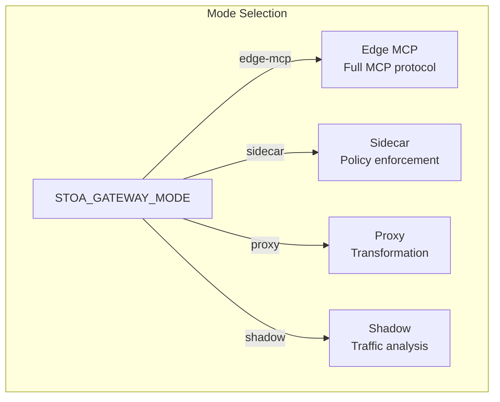
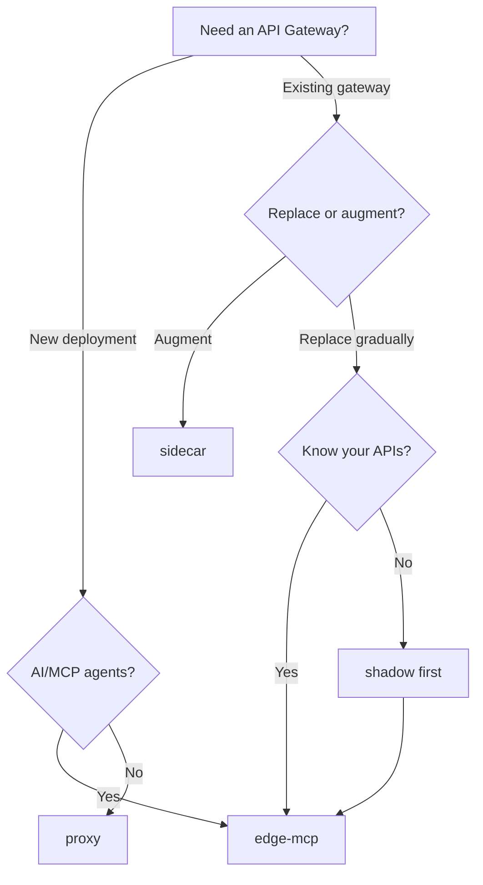

import EnvSetup from '@site/docs/_partials/_env-setup.mdx';

# Modes du Gateway

STOA Gateway supporte 4 modes de déploiement (définis dans [ADR-024](/docs/architecture/adr/adr-024-gateway-unified-modes)), chacun optimisé pour un pattern d'intégration différent. Sélectionnez le mode via la variable d'environnement `STOA_GATEWAY_MODE`.

## Vue d'Ensemble des Modes

| Mode | Port | Support MCP | Cas d'Usage | Statut |
|------|------|-------------|----------|--------|
| **edge-mcp** | 8080 | Oui | Gateway MCP autonome avec support complet du protocole | Production |
| **sidecar** | 8081 dans le chart (défaut du binaire 8080) | Non | Allow ou deny sur `POST /authz` pour un hôte qui l'appelle | Runtime présent |
| **proxy** | 8082 | Non | Transformation inline des requêtes/réponses | T3 2026 |
| **shadow** | 8083 | Non | Capture passive du trafic et génération UAC | T4 2026 |



## Capacités par Mode

| Capacité | edge-mcp | sidecar | proxy | shadow |
|-----------|----------|---------|-------|--------|
| Protocole MCP (SSE) | Oui | Non | Non | Non |
| Découverte/invocation d'outils | Oui | Non | Non | Non |
| Authentification JWT | Oui | Non. `/authz` fait confiance au `user` JSON | Oui | Non |
| Limitation de débit | Oui | Optionnelle, en mémoire, par processus | Oui | Non |
| Disjoncteur | Oui | Non | Oui | Non |
| Transformation des requêtes | Non | Non | Oui | Non |
| Capture de trafic | Non | Non | Non | Oui |
| Génération UAC | Non | Non | Non | Oui |
| Nécessite un upstream | Non | Non | Oui | Oui |
| Passif (lecture seule) | Non | Non | Non | Oui |

## Mode Edge-MCP (Production)

Le mode de production par défaut et principal. Implémente le protocole MCP complet avec transport SSE, découverte OAuth 2.1, gestion des outils et gestion des sessions.

### Configuration

```bash
# Variables d'environnement
STOA_GATEWAY_MODE=edge-mcp

# Paramètres spécifiques edge-MCP
STOA_SSE_KEEPALIVE=true
STOA_SSE_KEEPALIVE_INTERVAL_SECS=30
STOA_MAX_SESSIONS=10000
STOA_SESSION_TIMEOUT_SECS=3600
```

### Valeurs Helm

```yaml
stoaGateway:
  mode: edge-mcp
  edgeMcp:
    sseKeepalive: true
    sseKeepaliveIntervalSecs: 30
    maxSessions: 10000
    sessionTimeoutSecs: 3600
```

### Routes Exposées

| Chemin | Méthode | Objectif |
|------|--------|---------|
| `/.well-known/oauth-authorization-server` | GET | Découverte OAuth 2.1 |
| `/.well-known/oauth-protected-resource` | GET | Métadonnées de ressource protégée |
| `/mcp/sse` | GET | Endpoint de transport SSE |
| `/mcp/messages` | POST | Endpoint de messages JSON-RPC |
| `/oauth/authorize` | GET | Proxy OIDC (vers Keycloak) |
| `/oauth/token` | POST | Proxy de tokens (vers Keycloak) |
| `/oauth/register` | POST | Enregistrement dynamique de clients |
| `/admin/*` | Divers | API Admin (22 endpoints) |
| `/health` | GET | Contrôle de santé |
| `/metrics` | GET | Métriques Prometheus |

### Quand Utiliser

- Déploiement gateway MCP autonome
- Intégration d'agents AI (Claude, GPT, agents personnalisés)
- Gestion complète des APIs avec limitation de débit, quotas et disjoncteurs
- Charges de production nécessitant le transport SSE

## Mode Sidecar

Démarre le même binaire avec `STOA_GATEWAY_MODE=sidecar`. Le processus expose `POST /authz` et ne monte pas les routes MCP. L'hôte conserve l'authentification, le routage et l'application du verdict. Un template Helm de même pod existe et est désactivé par défaut. Des appels réels depuis Kong, webMethods ou Envoy ne sont pas démontrés dans le dépôt.

Lisez [Usage du compagnon](./companion-usage.md) pour les trois formes d'intégration (passerelle dans le même pod, appel depuis une application, mesh) et les limites actuelles. Les adaptateurs mesh sont uniquement des notes de conception.

### Configuration

```bash
STOA_GATEWAY_MODE=sidecar
STOA_PORT=8081
```

`STOA_UPSTREAM_TYPE`, `STOA_USER_INFO_HEADER` et `STOA_TENANT_ID_HEADER` sont lus dans les réglages sidecar et ne sont pas utilisés par `/authz`. `STOA_DECISION_FORMAT` n'est pas lu. Le format de réponse est uniquement le code de statut : `200`, `401`, `403` ou `429`, avec un corps vide. Les formateurs JSON, Envoy et Kong existent dans le binaire et ne peuvent pas être sélectionnés.

Le listener HTTP se lie à `0.0.0.0` et à `STOA_PORT`. `STOA_HOST` ne change pas cette liaison. Le `STOA_HOST=127.0.0.1` du chart ne rend pas `/authz` accessible uniquement en loopback.

### Routes Exposées

| Chemin | Méthode | Objectif |
|------|--------|---------|
| `/authz` | POST | Allow ou deny depuis le moteur de décision partagé |
| `/health`, `/ready` | GET | Santé et disponibilité |
| `/metrics` | GET | Métriques Prometheus génériques du processus |

Il n'y a pas de métrique `stoa_sidecar_*` dans les sources de la passerelle.

### Quand Utiliser

- Un hôte dans le même pod peut construire le corps JSON et appeler `POST /authz` avant de transmettre.
- Une application peut faire le même appel. Ce n'est pas un déploiement compagnon de même pod.
- La synchronisation GitOps de Kong, Gravitee, webMethods ou Envoy est [`stoa-connect`](./stoa-connect-quickstart.md), qui reste hors du chemin de requête.

## Mode Proxy

Se positionne en ligne dans le chemin des requêtes, transformant les requêtes et les réponses entre les clients et les backends. Supporte l'injection d'en-têtes, la transformation de corps et le passthrough WebSocket.

### Configuration

```bash
STOA_GATEWAY_MODE=proxy

# Paramètres spécifiques proxy
STOA_TRANSFORM_REQUEST=false
STOA_TRANSFORM_RESPONSE=false
STOA_INJECT_HEADERS=true
STOA_WEBSOCKET_PASSTHROUGH=false
STOA_CONNECTION_POOL_SIZE=100
```

### Capacités

| Fonctionnalité | Défaut | Description |
|---------|---------|-------------|
| Transformation des requêtes | Désactivé | Modifier les en-têtes/corps avant transmission |
| Transformation des réponses | Désactivé | Modifier les en-têtes/corps avant retour |
| Injection d'en-têtes | Activé | Ajouter des en-têtes de tenant, trace et corrélation |
| Passthrough WebSocket | Désactivé | Transmettre les connexions WebSocket |
| Pool de connexions | 100 | Taille du pool de connexions upstream |

### Quand Utiliser

- Transformation requête/réponse entre clients et backends
- Ajout d'en-têtes d'observabilité au trafic API existant
- Proxying WebSocket avec application de politiques
- Environnements nécessitant une manipulation inline du trafic

## Mode Shadow

Capture passif le trafic pour analyse et génération automatique d'UAC (Universal API Contract). Ne modifie ni ne bloque aucune requête.

### Configuration

```bash
STOA_GATEWAY_MODE=shadow

# Paramètres spécifiques shadow
STOA_CAPTURE_METHOD=Inline       # Options : EnvoyTap, PortMirror, Inline, KafkaReplay
STOA_UAC_OUTPUT_DIR=/var/stoa/uac
STOA_AUTO_CREATE_MR=false
STOA_MIN_REQUESTS_FOR_UAC=100
STOA_ANALYSIS_WINDOW_HOURS=168   # 7 jours
```

### Méthodes de Capture

| Méthode | Description | Infrastructure |
|--------|-------------|----------------|
| `Inline` | STOA capture le trafic directement | Pas d'infra supplémentaire |
| `EnvoyTap` | Le filtre tap d'Envoy transmet des copies | Sidecar Envoy |
| `PortMirror` | Mise en miroir du trafic au niveau réseau | Config switch/routeur |
| `KafkaReplay` | Rejeu depuis un topic Kafka | Redpanda/Kafka |

### Génération d'UAC

Après avoir collecté `min_requests_for_uac` requêtes sur `analysis_window_hours`, le mode shadow génère un Universal API Contract :

```
1. Capturer le trafic (requêtes + réponses)
2. Analyser les patterns (endpoints, schémas, codes d'erreur)
3. Générer la spec OpenAPI + annotations UAC STOA
4. Sortie vers UAC_OUTPUT_DIR (ou auto-création MR si configuré)
```

### Routes Exposées

| Chemin | Méthode | Objectif |
|------|--------|---------|
| `/shadow/status` | GET | Statistiques de capture |
| `/shadow/generate` | POST | Déclencher la génération UAC |
| `/health` | GET | Contrôle de santé |
| `/metrics` | GET | Métriques Prometheus |

### Quand Utiliser

- Découverte d'APIs non documentées dans les environnements legacy
- Génération automatique de contrats API depuis le trafic en direct
- Analyse pré-migration avant passage à STOA
- Audit de conformité des patterns de trafic API

## Guide de Sélection du Mode



| Scénario | Mode Recommandé |
|----------|-----------------|
| Déploiement MCP greenfield | `edge-mcp` |
| Allow ou deny à côté d'un hôte qui appelle `POST /authz` | Compagnon (runtime `sidecar`). Voir [Usage du compagnon](./companion-usage.md) |
| Couche de transformation API | `proxy` |
| Découverte d'API legacy | `shadow` → puis `edge-mcp` |
| Conserver une passerelle tierce et synchroniser l'état souhaité | [`stoa-connect`](./stoa-connect-quickstart.md). Un compagnon de même pod est un appel distinct et n'est pas une intégration webMethods enregistrée |

## Configuration à l'Exécution

Définissez le mode via une variable d'environnement ou les valeurs Helm :

```bash
# Variable d'environnement (priorité la plus haute)
export STOA_GATEWAY_MODE=edge-mcp

# Valeurs Helm
stoaGateway:
  mode: edge-mcp
```

Le mode est journalisé au démarrage :

```
INFO Starting STOA Gateway version=2.0.0 mode=edge-mcp
```

Le gateway écoute sur le port par défaut du mode (8080-8083) sauf si surchargé.

## Dépannage

| Problème | Cause | Solution |
|---------|-------|-----|
| "Unknown mode" au démarrage | Valeur `STOA_GATEWAY_MODE` invalide | Utilisez : `edge-mcp`, `sidecar`, `proxy`, ou `shadow` |
| Les endpoints MCP retournent 404 | Mauvais mode sélectionné | Seul `edge-mcp` sert les routes MCP |
| Le sidecar répond par un statut et un corps vide | Le format de `/authz` est fixé au code de statut | Envoyez le corps JSON décrit dans [Usage du compagnon](./companion-usage.md). `STOA_DECISION_FORMAT` n'est pas lu |
| Shadow ne capture pas le trafic | La méthode de capture nécessite une infra | Utilisez `Inline` si pas d'Envoy/Kafka disponible |
| Proxy abandonne le WebSocket | Passthrough désactivé | Définissez `STOA_WEBSOCKET_PASSTHROUGH=true` |

## Voir Aussi

- [Usage du compagnon](./companion-usage.md) -- Limites same-pod, application et mesh
- [Orchestration Multi-Gateway](/docs/guides/multi-gateway-setup) -- Pattern adaptateur multi-gateway
- [API MCP Gateway](/docs/api/mcp-gateway) -- Référence du protocole Edge-MCP
- [API Admin Gateway](/docs/api/gateway-admin-api) -- Endpoints admin
- [Guide d'Installation](/docs/admin/installation) -- Configuration du chart Helm
- [Vue d'Ensemble de l'Architecture](/docs/concepts/architecture) -- Architecture de la plateforme
