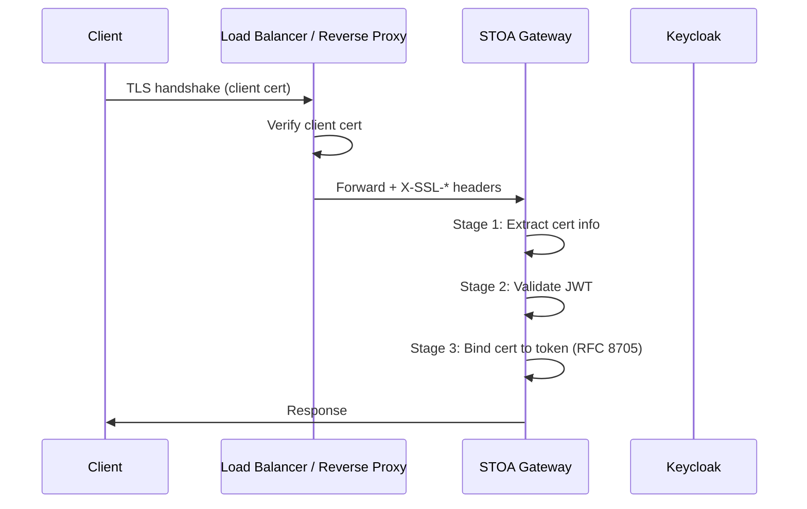

import EnvSetup from '@site/docs/_partials/_env-setup.mdx';

# Configuration mTLS

STOA Gateway supporte le mTLS (mutual TLS) avec validation de tokens liés aux certificats selon la RFC 8705. Les certificats clients sont validés au niveau du gateway, et leurs empreintes sont liées aux tokens JWT pour une preuve de possession de bout en bout.

## Architecture



Le load balancer (nginx, HAProxy, F5) termine le TLS et transmet les détails du certificat via les en-têtes `X-SSL-*`. Le gateway valide ces en-têtes et les lie aux tokens JWT.

## Configuration

### Variables d'Environnement

Les paramètres mTLS se trouvent dans la section imbriquée `mtls` de la configuration du gateway. Les variables d'environnement utilisent un **double underscore** (`__`) entre le préfixe `MTLS` et le nom du champ, par exemple `STOA_MTLS__ENABLED` définit `mtls.enabled`.

| Variable | Défaut | Description |
|----------|---------|-------------|
| `STOA_MTLS__ENABLED` | `false` | Activer le traitement mTLS |
| `STOA_MTLS__REQUIRE_BINDING` | `true` | Exiger la claim JWT `cnf` lorsqu'un certificat est présent |
| `STOA_MTLS__TRUSTED_PROXIES` | (vide) | CIDRs ou IPs des proxies de confiance (séparés par des virgules ou tableau JSON). Comparés à l'entrée la plus à droite de `X-Forwarded-For`, ou à l'adresse de connexion si cet en-tête est absent (voir [Configuration des Proxies de Confiance](#configuration-des-proxies-de-confiance)). **Obligatoire (non vide) lorsque le mTLS est activé.** |
| `STOA_MTLS__ALLOWED_ISSUERS` | (vide) | DNs d'émetteurs, comparés à l'identique avec `X-SSL-Client-I-DN`. Vide = tout émetteur accepté. La forme séparée par des virgules découpe sur chaque virgule : un DN contenant des virgules doit être fourni sous forme de tableau JSON (ou de liste YAML dans le fichier de configuration). |
| `STOA_MTLS__REQUIRED_ROUTES` | (vide) | Patterns glob pour les routes nécessitant des certificats (séparés par des virgules ou tableau JSON) |
| `STOA_MTLS__TENANT_FROM_DN` | `true` | Extraire le tenant du DN sujet du certificat |

:::warning Les noms à simple underscore sont ignorés
Les noms avec un seul underscore, comme `STOA_MTLS_ENABLED`, ne définissent aucun champ mTLS. Le gateway ne lie les champs imbriqués que via la forme `STOA_MTLS__*` (ou la section `mtls:` de son fichier de configuration YAML). Si vous avez utilisé les noms à simple underscore, le mTLS n'a jamais été activé.
:::

### Mapping des En-têtes

Le gateway lit les données du certificat depuis ces en-têtes (configurables) :

| En-tête | Défaut | Contenu |
|--------|---------|---------|
| `X-SSL-Client-Verify` | -- | `SUCCESS` si le certificat est vérifié |
| `X-SSL-Client-Fingerprint` | -- | Empreinte SHA-256 |
| `X-SSL-Client-S-DN` | -- | DN Sujet (RFC 2253) |
| `X-SSL-Client-I-DN` | -- | DN Émetteur |
| `X-SSL-Client-Serial` | -- | Numéro de série (hex) |
| `X-SSL-Client-NotBefore` | -- | Début de validité |
| `X-SSL-Client-NotAfter` | -- | Fin de validité |

## Tokens Liés aux Certificats RFC 8705

Lorsqu'un client présente à la fois un certificat et un JWT, le gateway vérifie que le token a été émis pour ce certificat spécifique :

1. Extraire l'empreinte du certificat (SHA-256) depuis `X-SSL-Client-Fingerprint`
2. Extraire la claim `cnf.x5t#S256` du JWT
3. Comparer en utilisant une comparaison à temps constant (`subtle::ConstantTimeEq`)
4. En cas de divergence : rejeter avec `403 MTLS_BINDING_MISMATCH`

### Token JWT avec Claim cnf

```json
{
  "sub": "user-123",
  "iss": "https://auth.<YOUR_DOMAIN>/realms/stoa",
  "cnf": {
    "x5t#S256": "base64url-encoded-sha256-thumbprint"
  }
}
```

### Normalisation du Format d'Empreinte

Le gateway normalise automatiquement les empreintes depuis trois formats :

| Format d'Entrée | Exemple | Sortie |
|-------------|---------|--------|
| Hex avec deux-points | `a1:b2:c3:...` | `a1b2c3...` (hex minuscules) |
| Hex brut | `A1B2C3...` | `a1b2c3...` (hex minuscules) |
| Base64url | `obsz...` | Décodé en hex |

## Déploiement Progressif

### Phase 1 : Surveillance Uniquement

Activer le traitement mTLS sans application. Une liste de proxies de confiance est obligatoire dès que `STOA_MTLS__ENABLED=true`, sinon le gateway refuse de démarrer :

```bash
STOA_MTLS__ENABLED=true
STOA_MTLS__REQUIRE_BINDING=false
STOA_MTLS__TRUSTED_PROXIES=<TRUSTED_PROXY_CIDR>
```

Les certificats sont extraits et journalisés, mais les requêtes sans certificats sont toujours autorisées.

### Phase 2 : Requis sur les Routes de Test

```bash
STOA_MTLS__ENABLED=true
STOA_MTLS__REQUIRE_BINDING=true
STOA_MTLS__TRUSTED_PROXIES=<TRUSTED_PROXY_CIDR>
STOA_MTLS__REQUIRED_ROUTES=/api/v1/test-mtls/*
```

### Phase 3 : Application en Production

```bash
STOA_MTLS__ENABLED=true
STOA_MTLS__REQUIRE_BINDING=true
STOA_MTLS__TRUSTED_PROXIES=<TRUSTED_PROXY_CIDR>
STOA_MTLS__REQUIRED_ROUTES=/api/v1/payments/*,/api/v1/transfers/*
STOA_MTLS__ALLOWED_ISSUERS='["CN=<YOUR_ISSUING_CA>,O=<YOUR_ORG>,C=<COUNTRY_CODE>"]'
```

Le DN de l'émetteur contient des virgules, il est donc passé sous forme de tableau JSON. La forme séparée par des virgules le découperait en trois entrées distinctes (`CN=...`, `O=...`, `C=...`), dont aucune n'est égale au DN complet, et tous les certificats de cette CA seraient rejetés avec `403 MTLS_ISSUER_DENIED`. Dans le fichier de configuration YAML, utilisez une liste sous `mtls.allowed_issuers`.

## Configuration des Proxies de Confiance

Le gateway n'accepte les en-têtes `X-SSL-*` que depuis des requêtes provenant des IPs listées dans `STOA_MTLS__TRUSTED_PROXIES`. Cette liste est un prérequis au démarrage : lorsque `STOA_MTLS__ENABLED=true` et que la liste est vide, la validation de la configuration échoue et le gateway ne démarre pas. Une liste vide reviendrait à accepter les en-têtes de certificat depuis n'importe quelle source, ce qui constitue un contournement de l'authentification ; il n'existe donc pas de mode « tout accepter ».

```bash
# Faire confiance à des plages CIDR spécifiques (séparées par des virgules)
STOA_MTLS__TRUSTED_PROXIES=<TRUSTED_PROXY_CIDR_1>,<TRUSTED_PROXY_CIDR_2>

# Faire confiance à une IP unique
STOA_MTLS__TRUSTED_PROXIES=<TRUSTED_PROXY_IP>

# La forme tableau JSON est également acceptée
STOA_MTLS__TRUSTED_PROXIES='["<TRUSTED_PROXY_CIDR_1>","<TRUSTED_PROXY_CIDR_2>"]'
```

Listez les adresses des terminateurs TLS qui transmettent les en-têtes `X-SSL-*` au gateway (ingress controller, F5, HAProxy, nginx). Les sources non fiables envoyant des en-têtes `X-SSL-*` reçoivent `403 MTLS_UNTRUSTED_PROXY`.

Le gateway évalue exactement une adresse par requête, et la liste de confiance doit correspondre à cette adresse :

- Lorsque la requête porte un en-tête `X-Forwarded-For`, le gateway utilise son entrée la **plus à droite** et ignore l'adresse de connexion.
- Lorsque l'en-tête est absent, le gateway utilise l'adresse source de la connexion TCP, c'est-à-dire l'adresse de sortie du saut qui s'est connecté à lui.

Cela conditionne la manière dont le dernier saut avant le gateway doit traiter `X-Forwarded-For` :

- Si le terminateur se connecte directement au gateway sans envoyer `X-Forwarded-For`, mettez son adresse de sortie dans la liste de confiance.
- Si le terminateur complète `X-Forwarded-For` de la manière habituelle, l'entrée la plus à droite est l'adresse du saut qui le précède, ou celle du client d'origine lorsque le terminateur est le premier saut. Ne lister que l'adresse de sortie du terminateur échoue alors avec `403 MTLS_UNTRUSTED_PROXY`. Supprimez `X-Forwarded-For` au niveau du terminateur, ou listez l'adresse qu'il place en position la plus à droite.
- Ne transmettez jamais tel quel un `X-Forwarded-For` fourni par le client : l'appelant pourrait alors choisir l'adresse que le gateway évalue. Le dernier saut doit lui-même supprimer ou réécrire cet en-tête.

## Réponses d'Erreur

| Code d'Erreur | Statut HTTP | Cause |
|------------|-------------|-------|
| `MTLS_CERT_REQUIRED` | 401 | Certificat requis sur cette route |
| `MTLS_CERT_INVALID` | 403 | L'en-tête Verify n'est pas `SUCCESS` |
| `MTLS_CERT_EXPIRED` | 403 | Le `NotAfter` du certificat est dans le passé |
| `MTLS_ISSUER_DENIED` | 403 | Émetteur absent de la liste autorisée |
| `MTLS_BINDING_REQUIRED` | 403 | Le JWT manque la claim `cnf` (liaison requise) |
| `MTLS_BINDING_MISMATCH` | 403 | L'empreinte du certificat ne correspond pas au JWT |
| `MTLS_UNTRUSTED_PROXY` | 403 | En-têtes X-SSL-* depuis une IP non fiable |

## En-têtes en Aval

Après une validation réussie, le gateway transmet ces en-têtes aux services backend :

```
X-Authenticated-Client-Fingerprint: {16 premiers caractères de l'empreinte}
X-Authenticated-Client-Subject: {DN sujet}
```

## Voir Aussi

- [Durcissement de la Sécurité](/docs/admin/security-hardening) -- Sécurité en production
- [Guide d'Authentification](/docs/guides/authentication) -- Flux OIDC
- [Configuration de Sécurité](/docs/reference/security-configuration) -- Paramètres JWT et CORS
- [Intégration des Consommateurs](/docs/guides/consumer-onboarding) -- Provisionnement des certificats mTLS
