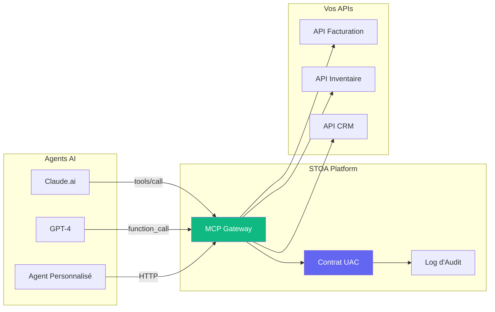
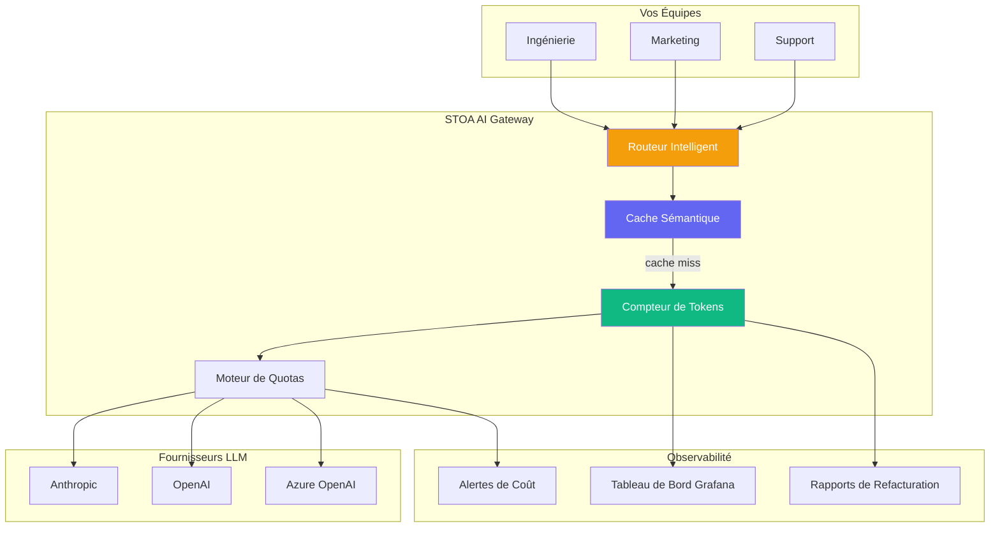
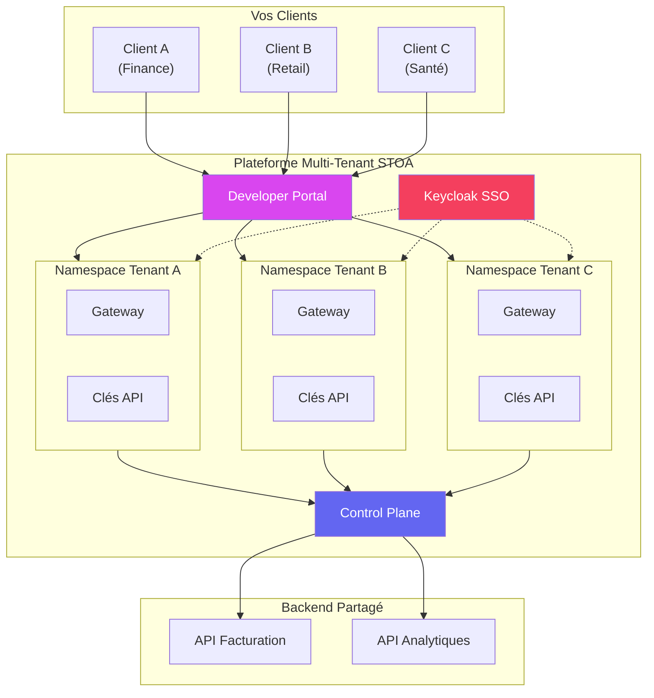

import Tabs from '@theme/Tabs';
import TabItem from '@theme/TabItem';

# Cas d'Usage

Découvrez comment STOA Platform résout des défis réels pour les entreprises adoptant l'AI et gérant des APIs à grande échelle.

---

## 🤖 Cas d'Usage 1 : API Gateway pour Agents AI

**Défi :** Vos agents AI (Claude, GPT, LLMs personnalisés) doivent appeler des APIs internes, mais vous manquez de gouvernance, de pistes d'audit et de contrôle d'accès.

**Solution :** Le MCP Gateway de STOA fournit un point d'entrée unifié pour toutes les interactions AI-vers-API.



### Bénéfices

| Sans STOA | Avec STOA |
|--------------|-----------|
| Accès direct aux APIs, sans gouvernance | Application centralisée des politiques |
| Aucune visibilité sur les appels AI | Piste d'audit complète par agent |
| Gestion manuelle des clés API | Auto-découverte via MCP |
| Rate limiting dispersé | Quotas unifiés par tenant |

### Implémentation Rapide

```bash
# 1. Convertir votre spec OpenAPI en manifestes Tool MCP et les appliquer via stoactl
stoactl bridge ./billing-openapi.yaml --namespace default --output ./tools/
for f in tools/*.yaml; do stoactl apply -f "$f"; done

# 2. L'agent IA découvre les outils enregistrés via MCP (Streamable HTTP / SSE)
# Appel JSON-RPC tools/list et tools/call sur POST /mcp avec jeton Bearer JWT
```

---

## 📊 Cas d'Usage 2 : Gestion des Coûts AI et Metering de Tokens

**Défi :** Plusieurs équipes utilisent des LLMs, mais vous n'avez aucune visibilité sur la consommation de tokens, les coûts s'envolent et il n'existe pas de mécanisme de refacturation.

**Solution :** L'AI Gateway de STOA trace chaque token, fournit des tableaux de bord en temps réel et permet des quotas par équipe.



### Bénéfices

| Métrique | Avant STOA | Après STOA |
|--------|-------------|------------|
| Visibilité des coûts | Aucune | Temps réel par équipe |
| Gaspillage de tokens | Appels LLM redondants | Réduit avec le cache sémantique* |
| Contrôle du budget | Factures surprises mensuelles | Application automatique des quotas |
| Dépendance au fournisseur | Fournisseur unique | Basculement multi-fournisseur |

*Le cache sémantique peut réduire significativement les appels LLM redondants. Les économies réelles varient selon les patterns de requêtes et les cas d'usage.*

### Aperçu du Tableau de Bord

```
┌─────────────────────────────────────────────────────────┐
│  Utilisation de Tokens par Équipe (Janvier 2026)        │
├─────────────────────────────────────────────────────────┤
│  Ingénierie  ████████████████████░░░░  2,4M tokens      │
│  Marketing   ████████░░░░░░░░░░░░░░░░  800K tokens      │
│  Support     ████████████░░░░░░░░░░░░  1,2M tokens      │
├─────────────────────────────────────────────────────────┤
│  Coût Total : 1 240 €  |  Économies Cache : 520 € (30%) │
└─────────────────────────────────────────────────────────┘
```

---

## 🏢 Cas d'Usage 3 : Plateforme API Multi-Tenant

**Défi :** Vous êtes un ESN/ISV exposant des APIs à plusieurs clients. Vous avez besoin d'isolation, de quotas par client, de facturation et de conformité (NIS2/DORA).

**Solution :** STOA fournit une multi-tenant native avec une isolation complète et la souveraineté européenne.



### Architecture d'Isolation des Tenants

| Aspect | Implémentation |
|--------|----------------|
| **Auth** | Realm Keycloak unique (`stoa`), un groupe Keycloak par tenant et claim JWT `tenant_id` vérifié ([ADR-074](/docs/architecture/adr/adr-074-tenant-model)) |
| **Données** | Schéma PostgreSQL partagé filtré logiquement par `tenant_id` |
| **Politiques d'outils** | Politiques par tenant signées par le Control Plane en mode *fail-closed* ([ADR-070](/docs/architecture/adr/adr-070-gateway-fail-closed-posture)) |
| **Secrets** | Chemins Vault / OpenBao isolés par tenant ([ADR-075](/docs/architecture/adr/adr-075-secrets-backend-openbao)) |
| **Quotas** | Rate limits et budgets de tokens indépendants par tenant et par consommateur |

### Fonctionnalités de Conformité

- **NIS2** — Signalement des incidents de sécurité, contrôles d'accès
- **DORA** — Gestion des risques TIC, tests de résilience
- **RGPD** — Résidence des données en UE, pistes d'audit
- **Hébergement Européen** — Option de résidence des données en UE disponible*

*La juridiction légale dépend de multiples facteurs. Consultez votre conseiller juridique pour des conseils de conformité.*

---

## Démarrer

Prêt à évaluer ou déployer ces cas d'usage ? STOA Platform est open source (Apache 2.0) sur [`stoa-platform/stoa`](https://github.com/stoa-platform/stoa) ; l'accès hébergé est disponible sur demande via [sales@gostoa.dev](mailto:sales@gostoa.dev).

<Tabs>
  <TabItem value="local" label="🐳 Évaluation Locale (Compose)" default>

Suivez [`stoa/quickstart/README.md`](https://github.com/stoa-platform/stoa/blob/main/quickstart/README.md) et renseignez les cinq variables obligatoires (`POSTGRES_PASSWORD`, `KC_BOOTSTRAP_ADMIN_PASSWORD`, `KEYCLOAK_CLIENT_SECRET`, `KEYCLOAK_ADMIN_CLIENT_SECRET` et `STOA_ADMIN_API_TOKEN`) avant de démarrer le vérificateur R1 à 5 conteneurs :

```bash
# Vérificateur minimal d'accès R1 à 5 conteneurs (preuve 401/401/200 via POST /admin/contracts)
git clone https://github.com/stoa-platform/stoa.git
cd stoa/quickstart
export POSTGRES_PASSWORD="<a-definir>" \
  KC_BOOTSTRAP_ADMIN_PASSWORD="<a-definir>" \
  KEYCLOAK_CLIENT_SECRET="<a-definir>" \
  KEYCLOAK_ADMIN_CLIENT_SECRET="<a-definir>" \
  STOA_ADMIN_API_TOKEN="<a-definir>"
perl -e 'alarm shift; exec @ARGV' 300 docker compose up --wait
./verify.sh
```

Pour la stack locale à 19 services avec Console, Portail et Observabilité (`deploy/docker-compose`), validez d'abord statiquement votre fichier `.env` avec `docker compose -p stoa-local-check -f docker-compose.yml config --quiet`, puis lancez le raccourci explicite à 5 cibles décrit dans le [Guide de Démarrage Rapide](/docs/guides/quickstart).

  </TabItem>
  <TabItem value="k8s" label="☸️ Gateway Auto-hébergé (Helm)">

Préparez au préalable `my-values.yaml` (`stoaGateway.image.{repository,digest}`, `stoaGateway.policyBootTenants`), les services Control Plane / Keycloak déployés séparément ainsi que votre exécutable post-renderer (`./site-post-render.sh`, ou une étape d'overlay Deployment Kustomize/GitOps appliquée avant de vérifier `Ready`) montant le volume du Secret `private_key_jwt` conformément au [Guide d'Installation](/docs/admin/installation#politiques-au-démarrage-et-readiness) :

```bash
# Installer le chart Helm gateway depuis un checkout du dépôt (pas d'index charts.gostoa.dev)
git clone https://github.com/stoa-platform/stoa.git
cd stoa
git checkout 639e8b9a2217695cfc2f590e246ed9d4ce4d4913
# ./site-post-render.sh monte le volume du Secret de clé private_key_jwt requis avant 1/1 Ready
helm upgrade --install stoa-platform ./charts/stoa-platform \
  -n stoa-system --create-namespace \
  -f my-values.yaml \
  --post-renderer ./site-post-render.sh
```

  </TabItem>
</Tabs>

---

## Besoin d'Aide ?

- 📚 [Guide de Démarrage Rapide](/docs/guides/quickstart)
- 💬 [Communauté Discord](https://discord.gostoa.dev)
- 📧 [Contacter les Ventes](mailto:sales@gostoa.dev) pour les cas d'usage enterprise

---

*Claude est une marque commerciale d'Anthropic, PBC. GPT-4 et Azure OpenAI sont des marques commerciales d'OpenAI/Microsoft. Tous les autres noms de produits sont des marques de leurs propriétaires respectifs.*
